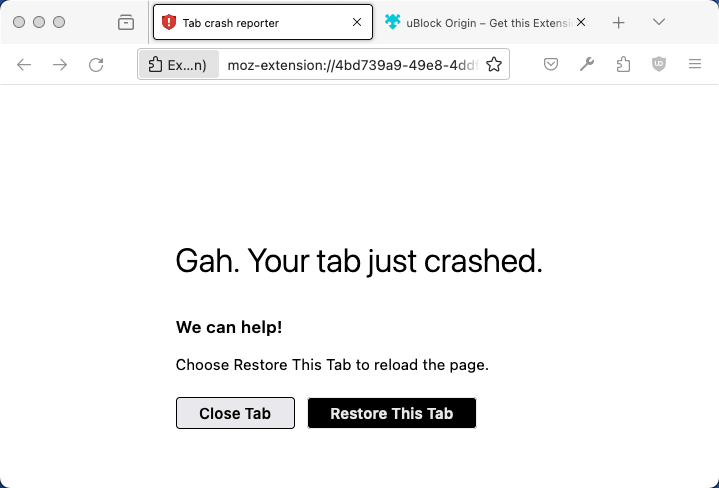

Les scripts d'arrière-plan ou une page d'arrière-plan vous permettent de surveiller et de réagir aux évènements dans le navigateur, tels que la navigation vers une nouvelle page, la suppression d'un signet ou la fermeture d'un onglet.

Les scripts d'arrière-plan ou une page d'arrière-plan sont&nbsp;:

- Persistants — chargés lorsque l'extension démarre et déchargés lorsque l'extension est désactivée ou désinstallée.
- Non persistants (également appelés pages d'évènements) — chargés uniquement lorsque c'est nécessaire pour répondre à un évènement et déchargés lorsqu'ils deviennent inactifs. Cependant, une page d'arrière-plan ne se décharge pas tant que toutes les vues visibles et les ports de message sont fermés. L'ouverture d'une vue ne provoque pas le chargement de la page d'arrière-plan mais empêche sa fermeture.

> [!NOTE]
> Dans Firefox, si le processus de l'extension plante&nbsp;:
>
> - les scripts d'arrière-plan persistants en cours d'exécution au moment du plantage sont rechargés automatiquement.
> - les scripts d'arrière-plan non persistants (également appelés «&nbsp;pages d'évènements&nbsp;») en cours d'exécution au moment du plantage ne sont pas rechargés. Cependant, ils sont redémarrés automatiquement lorsque Firefox appelle l'un de leurs écouteurs d'évènements de l'API WebExtensions.
> - les pages d'extension chargées dans des onglets au moment du plantage ne sont pas restaurées automatiquement. Un message d'avertissement dans chaque onglet informe l'utilisateur·ice que la page a planté et lui permet de fermer ou de restaurer l'onglet.
>   
>   Vous pouvez tester cette condition en ouvrant un nouvel onglet et en naviguant vers `about:crashextensions`, ce qui déclenche silencieusement un plantage du processus de l'extension.

Dans le Manifest V2, les scripts d'arrière-plan ou une page peuvent être persistants ou non persistants. Les scripts d'arrière-plan non persistants sont recommandés, car ils réduisent le coût en ressources de votre extension. Dans le Manifest V3, seuls les scripts d'arrière-plan non persistants ou une page sont pris en charge.

Si vous avez des scripts d'arrière-plan persistants ou une page dans le Manifest V2 et que vous souhaitez préparer votre extension à la migration vers le Manifest V3, [Convertir en non persistant](#convertir_en_non_persistant) fournit des conseils sur la transition des scripts ou de la page vers le modèle non persistant.

## Environnement de script en arrière-plan

### API DOM

Les scripts d'arrière-plan s'exécutent dans le contexte d'une page spéciale appelée page d'arrière-plan. Cela leur fournit un objet {{DOMxRef("Window")}} global, ainsi que toutes les API DOM standard fournies par cet objet.

> [!WARNING]
> Dans Firefox, les pages d'arrière-plan ne prennent pas en charge l'utilisation de {{DOMxRef("Window.alert", "alert()")}}, {{DOMxRef("Window.confirm", "confirm()")}}, ou {{DOMxRef("Window.prompt", "prompt()")}}.

### API WebExtension

Les scripts d'arrière-plan peuvent utiliser toutes les [API WebExtension](/fr/docs/Mozilla/Add-ons/WebExtensions/API), tant que leur extension dispose des [autorisations](/fr/docs/Mozilla/Add-ons/WebExtensions/manifest.json/permissions) nécessaires.

### Accès inter-origines

Les scripts d'arrière-plan peuvent effectuer des requêtes XHR vers des hôtes pour lesquels ils disposent des [autorisations d'hôte](/fr/docs/Mozilla/Add-ons/WebExtensions/manifest.json/permissions).

### Contenu web

Les scripts d'arrière-plan n'ont pas d'accès direct aux pages web. Cependant, ils peuvent charger des [scripts de contenu](/fr/docs/Mozilla/Add-ons/WebExtensions/Content_scripts) dans les pages web et [communiquer avec ces scripts de contenu en utilisant une API de passage de messages](/fr/docs/Mozilla/Add-ons/WebExtensions/Content_scripts#communiquer_avec_les_scripts_darrière-plan).

### Politique de sécurité du contenu

Les scripts d'arrière-plan sont restreints dans certaines opérations potentiellement dangereuses, comme l'utilisation de {{JSxRef("eval()")}}, par le biais d'une politique de sécurité du contenu.

Voir [Politique de sécurité du contenu](/fr/docs/Mozilla/Add-ons/WebExtensions/Content_Security_Policy) pour plus de détails.

## Implémenter les scripts d'arrière-plan

Cette section décrit comment implémenter un script d'arrière-plan non persistant.

### Définir les scripts d'arrière-plan

Dans votre extension, vous incluez un script d'arrière-plan ou plusieurs scripts, si nécessaire, en utilisant la clé [`"background"`](/fr/docs/Mozilla/Add-ons/WebExtensions/manifest.json/background) dans `manifest.json`. Pour les extensions Manifest V2, la propriété `persistent` doit être `false` pour créer un script non persistant. Elle peut être omise pour les extensions Manifest V3 ou doit être définie sur `false`, car les scripts sont toujours non persistants dans Manifest V3. L'inclusion de `"type": "module"` charge les scripts d'arrière-plan en tant que modules ES.

```json
"background": {
  "scripts": ["background-script.js"],
  "persistent": false,
  "type": "module"
}
```

Ces scripts s'exécutent dans la page d'arrière-plan de l'extension, donc ils s'exécutent dans le même contexte que les scripts chargés dans une page web.

Cependant, si vous avez besoin de certains contenus dans la page d'arrière-plan, vous pouvez en définir une. Vous définissez alors votre script depuis la page plutôt qu'en utilisant la propriété `"scripts"`. Avant l'introduction de la propriété `"type"` dans la clé `"background"`, c'est la seule option pour inclure des modules ES. Vous définissez une page d'arrière-plan comme ceci&nbsp;:

- manifest.json

  ```json
  "background": {
    "page": "background-page.html",
    "persistent": false
  }
  ```

- background-page.html

  ```html
  <!doctype html>
  <html lang="fr">
    <head>
      <meta charset="utf-8" />
      <script type="module" src="background-script.js"></script>
    </head>
  </html>
  ```

Vous ne pouvez pas définir à la fois des scripts d'arrière-plan et une page d'arrière-plan.

Pour prendre en charge les scripts d'arrière-plan sur les navigateurs qui utilisent des service workers (comme Chrome) et ceux qui utilisent des pages d'évènements, définissez à la fois `scripts` et `service_worker` dans la clé `background`. L'exemple [script-on-click <sup>(angl.)</sup>](https://github.com/mdn/webextensions-examples/tree/main/script-on-click) illustre ce modèle multiplateforme.

### Initialiser l'extension

Écoutez {{WebExtAPIRef("runtime.onInstalled")}} pour initialiser une extension lors de son installation. Utilisez cet évènement pour définir un état ou pour une initialisation unique.

Pour les extensions avec des pages d'évènements, c'est ici que les API avec état, telles qu'un menu contextuel créé à l'aide de {{WebExtAPIRef("menus.create")}}, doivent être utilisées. En effet, les API avec état n'ont pas besoin d'être exécutées à chaque rechargement de la page d'évènements&nbsp;; elles ne doivent être exécutées que lorsque l'extension est installée.

```js
browser.runtime.onInstalled.addListener(() => {
  browser.contextMenus.create({
    id: "sampleContextMenu",
    title: "Sample Context Menu",
    contexts: ["selection"],
  });
});
```

### Ajouter des écouteurs

Structurez les scripts d'arrière-plan autour des évènements dont l'extension dépend. La définition des évènements pertinents permet aux scripts d'arrière-plan de rester inactifs jusqu'à ce que ces évènements se produisent et empêche l'extension de manquer des déclencheurs essentiels.

Les écouteurs doivent être enregistrés de manière synchrone dès le début de la page.

```js
browser.runtime.onInstalled.addListener(() => {
  browser.contextMenus.create({
    id: "sampleContextMenu",
    title: "Menu contextuel d'exemple",
    contexts: ["selection"],
  });
});

// Ceci s'exécute lorsque un marque-page est créé.
browser.bookmarks.onCreated.addListener(() => {
  // faire quelque-chose
});
```

Ne pas enregistrer les écouteurs de manière asynchrone, car ils ne sont pas correctement déclenchés. Donc, plutôt que&nbsp;:

```js example-bad
window.onload = () => {
  // ATTENTION ! Cet évènement n'est pas persistant et ne redémarre
  // pas la page d'évènements.
  browser.bookmarks.onCreated.addListener(() => {
    // faire quelque-chose
  });
};
```

Faites ceci&nbsp;:

```js
browser.tabs.onUpdated.addListener(() => {
  // Cet évènement s'exécute dans le contexte de niveau supérieur de la
  // page d'évènements, et il persiste, permettant de redémarrer la page
  // d'évènements si nécessaire.
});
```

Les extensions peuvent supprimer des écouteurs depuis leurs scripts d'arrière-plan en appelant `removeListener`, comme avec {{WebExtAPIRef("runtime.onMessage")}} `removeListener`. Si tous les écouteurs pour un évènement sont supprimés, le navigateur ne charge plus le script d'arrière-plan de l'extension pour cet évènement.

```js
browser.runtime.onMessage.addListener(
  function messageListener(message, sender, sendResponse) {
    browser.runtime.onMessage.removeListener(messageListener);
  },
);
```

### Filtrer les évènements

Lorsque votre extension n'a besoin d'agir que sur un sous-ensemble d'évènements, par exemple lorsqu'une page web est ouverte depuis un domaine spécifique, utilisez des filtres d'évènements lorsque c'est possible.

Par exemple, vous pouvez ajouter un filtre à l'évènement {{WebExtAPIRef("webNavigation.onCompleted")}} pour démarrer votre script d'arrière-plan lorsque certaines UR se chargent, comme ceci&nbsp;:

```js
browser.webNavigation.onCompleted.addListener(
  () => {
    console.log("Ceci est mon site web préféré !");
  },
  { url: [{ urlMatches: "https://www.mozilla.org/" }] },
);
```

Lorsque vous ciblez uniquement Firefox pour ordinateur de bureau, vous pouvez également ajouter des filtres à {{WebExtAPIRef("tabs.onUpdated")}} pour obtenir un résultat similaire.

### Réagir aux écouteurs

Les écouteurs existent pour déclencher une fonctionnalité une fois qu'un évènement s'est produit. Pour réagir à un évènement, structurez la réaction souhaitée à l'intérieur de l'évènement écouteur.

Lors de la réponse à des évènements dans le contexte d'un onglet ou d'un cadre spécifique, utilisez le `tabId` et le `frameId` à partir des détails de l'évènement au lieu de vous fier à «&nbsp;l'onglet actuel&nbsp;». Définir la cible garantit que votre extension n'invoque pas une API d'extension sur la mauvaise cible lorsque «&nbsp;l'onglet actuel&nbsp;» change pendant le réveil de la page d'évènements.

Par exemple, {{WebExtAPIRef("runtime.onMessage")}} peut répondre aux appels de {{WebExtAPIRef("runtime.sendMessage")}} comme suit&nbsp;:

```js
browser.runtime.onMessage.addListener((message, sender, sendResponse) => {
  if (message.data === "setAlarm") {
    browser.alarms.create({ delayInMinutes: 5 });
  } else if (message.data === "runLogic") {
    browser.scripting.executeScript({
      target: {
        tabId: sender.tab.id,
        frameIds: [sender.frameId],
      },
      files: ["logic.js"],
    });
  } else if (message.data === "changeColor") {
    browser.scripting.executeScript({
      target: {
        tabId: sender.tab.id,
        frameIds: [sender.frameId],
      },
      func: () => {
        document.body.style.backgroundColor = "orange";
      },
    });
  }
});
```

### Décharger les scripts d'arrière-plan

Les données doivent être sauvegardées périodiquement afin de ne pas perdre d'informations importantes si une extension plante sans recevoir {{WebExtAPIRef("runtime.onSuspend")}}. Utilisez l'API de stockage pour vous aider dans cette tâche.

```js
// Ou storage.session si la variable n'a pas besoin de persister après la fermeture du navigateur.
browser.storage.local.set({ variable: variableInformation });
```

Les ports de message ne peuvent pas empêcher une page d'évènement de se fermer. Si une extension utilise le passage de messages, les ports sont fermés lorsque la page d'évènement est inactive. Écouter le `onDisconnect` de {{WebExtAPIRef("runtime.Port")}} permet de savoir quand les ports ouverts se ferment, cependant l'écouteur a les mêmes contraintes de temps que {{WebExtAPIRef("runtime.onSuspend")}}.

```js
browser.runtime.onConnect.addListener((port) => {
  port.onMessage.addListener((message) => {
    if (message === "hello") {
      let response = { greeting: "bienvenue !" };
      port.postMessage(response);
    } else if (message === "goodbye") {
      console.log("Déconnexion du port de ce côté");
      port.disconnect();
    }
  });
  port.onDisconnect.addListener(() => {
    console.log("Le port a été déconnecté de l'autre côté");
  });
});
```

Les scripts d'arrière-plan se déchargent après quelques secondes d'inactivité. Cependant, si pendant la suspension d'un script d'arrière-plan un autre évènement réveille le script d'arrière-plan, {{WebExtAPIRef("runtime.onSuspendCanceled")}} est appelé et le script d'arrière-plan continue de s'exécuter. Si un nettoyage est nécessaire, écoutez {{WebExtAPIRef("runtime.onSuspend")}}.

```js
browser.runtime.onSuspend.addListener(() => {
  console.log("Déchargement.");
  browser.browserAction.setBadgeText({ text: "" });
});
```

Cependant, il est préférable de persister les données plutôt que de se fier à {{WebExtAPIRef("runtime.onSuspend")}}. Cela ne permet pas autant de nettoyage que nécessaire et n'aide pas en cas de plantage.

## Convertir en non persistant

Si vous avez un script d'arrière-plan persistant, cette section fournit des instructions pour le convertir en modèle non persistant.

### Mettre à jour votre fichier `manifest.json`

Dans le fichier `manifest.json` de votre extension, changez la propriété persistent de la clé [`"background"`](/fr/docs/Mozilla/Add-ons/WebExtensions/manifest.json/background) à `false` pour votre script ou page.

```json
"background": {
  …,
  "persistent": false
}
```

### Déplacer les écouteurs d'évènements

Les écouteurs doivent être au niveau supérieur pour activer le script d'arrière-plan si un évènement est déclenché. Les écouteurs enregistrés peuvent devoir être restructurés selon le modèle synchrone et déplacés au niveau supérieur.

```js
browser.runtime.onStartup.addListener(() => {
  // exécute la fonction de démarrage
});
```

### Enregistrer les changements d'état

Les scripts s'ouvrent et se ferment maintenant selon les besoins. Par conséquent, ne vous fiez pas aux variables globales.

```js example-bad
var count = 101;
browser.runtime.onMessage.addListener((message, sender, sendResponse) => {
  if (message === "count") {
    ++count;
    sendResponse(count);
  }
});
```

À la place, utilisez l'API de stockage pour définir et retourner les états et les valeurs&nbsp;:

- Utilisez {{WebExtAPIRef("storage.session")}} pour un stockage en mémoire qui est effacé lorsque l'extension ou le navigateur se ferme. Par défaut, `storage.session` n'est disponible que pour les contextes d'extension et non pour les scripts de contenu.
- Utilisez {{WebExtAPIRef("storage.local")}} pour une zone de stockage plus grande qui persiste entre les redémarrages du navigateur et de l'extension.

```js
browser.runtime.onMessage.addListener(async (message, sender) => {
  if (message === "count") {
    let items = await browser.storage.session.get({ monCompteStocke: 101 });
    let count = items.monCompteStocke;
    ++count;
    await browser.storage.session.set({ monCompteStocke: count });
    return count;
  }
});
```

Le précédent exemple [envoie une réponse asynchrone en utilisant une promesse](/fr/docs/Mozilla/Add-ons/WebExtensions/API/runtime/onMessage#envoyer_une_réponse_asynchrone_en_utilisant_une_promesse), ce qui n'est pas pris en charge dans Chrome tant que le [bogue 1185241 de Chrome <sup>(angl.)</sup>](https://crbug.com/1185241) n'est pas résolu.
Une alternative multi-navigateurs consiste à [retourner true et utiliser `sendResponse`](/fr/docs/Mozilla/Add-ons/WebExtensions/API/runtime/onMessage#envoyer_une_réponse_asynchrone_en_utilisant_sendresponse).

```js
browser.runtime.onMessage.addListener((message, sender, sendResponse) => {
  if (message === "count") {
    browser.storage.session
      .get({ monCompteStocke: 101 })
      .then(async (items) => {
        let count = items.monCompteStocke;
        ++count;
        await browser.storage.session.set({ monCompteStocke: count });
        sendResponse(count);
      });
    return true;
  }
});
```

### Changer les chronomètres en alarmes

Les chronomètres basés sur le DOM, tels que {{DOMxRef("Window.setTimeout", "setTimeout()")}}, ne restent pas actifs après qu'une page d'évènement est devenue inactive. Utilisez plutôt l'API {{WebExtAPIRef("alarms")}} si vous avez besoin qu'un chronomètre réveille une page d'évènement.

```js
browser.alarms.create({ delayInMinutes: 3.0 });
```

Ensuite, ajoutez un écouteur.

```js
browser.alarms.onAlarm.addListener(() => {
  alert("Bonjour, le monde !");
});
```

### Mettre à jour les appels aux fonctions du script d'arrière-plan

Les extensions hébergent généralement leur fonctionnalité principale dans le script d'arrière-plan. Certaines extensions accèdent aux fonctions et aux variables définies dans la page d'arrière-plan avec le `window` retourné par {{WebExtAPIRef("runtime.getBackgroundPage")}}.
La méthode retourne `null` lorsque&nbsp;:

- les pages d'extension sont isolées, telles que les pages d'extension en mode de navigation privée ou les onglets de conteneur.
- la page d'arrière-plan n'est pas en cours d'exécution. C'est rare avec les pages d'arrière-plan persistantes mais très probable lors de l'utilisation d'une page d'évènement, car une page d'évènement peut être suspendue.

> [!NOTE]
> La manière recommandée d'invoquer des fonctionnalités dans le script d'arrière-plan est de communiquer avec celui-ci par le biais de {{WebExtAPIRef("runtime.sendMessage","runtime.sendMessage()")}} ou {{WebExtAPIRef("runtime.connect","runtime.connect()")}}.
> Les méthodes `getBackgroundPage()` abordées dans cette section ne peuvent pas être utilisées dans une extension multi-navigateurs, car les extensions Manifest Version 3 dans Chrome ne peuvent pas utiliser de pages d'arrière-plan ou de pages d'évènement.

Si votre extension nécessite une référence à la `window` de la page d'arrière-plan, utilisez {{WebExtAPIRef("runtime.getBackgroundPage")}} pour vous assurer que la page d'évènement est en cours d'exécution.
Si l'appel est optionnel (c'est-à-dire seulement nécessaire si la page d'évènement est active), utilisez alors {{WebExtAPIRef("runtime.getBackgroundPage")}}.

```js example-bad
document.getElementById("target").addEventListener("click", async () => {
  let backgroundPage = browser.runtime.getBackgroundPage();
  // Attention : backgroundPage est probablement null.
  backgroundPage.backgroundFunction();
});
```

```js
document.getElementById("target").addEventListener("click", async () => {
  // runtime.getBackgroundPage() réveille la page d'évènement si elle n'est pas en cours d'exécution.
  let backgroundPage = await browser.runtime.getBackgroundPage();
  backgroundPage.backgroundFunction();
});
```
