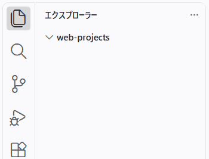

{{PreviousMenuNext("Learn_web_development/Getting_started/Environment_setup/Code_editors", "Learn_web_development/Getting_started/Environment_setup/Command_line", "Learn_web_development/Getting_started/Environment_setup")}}

ウェブサイトは、テキストコンテンツ、コード、スタイルシート、メディアコンテンツなど、多くのファイルで構成されています。ウェブサイトを構築する際は、まずローカルコンピューター上でこれらのファイルを適切な構造にまとめ、ファイル同士が正常に連携することが可能であることを確認し、すべてのコンテンツの見栄えを適切に整えた上で、最終的にサーバーにアップロードして世界中に公開する必要があります。この記事では、コンピューターのファイルエクスプローラーのインターフェイス (UI) をどのように使用するか、そしてウェブサイトに適したファイル構造をどのように設定するかについて説明します。

<table>
  <tbody>
    <tr>
      <th scope="row">前提条件:</th>
      <td>
        コンピューターのオペレーティングシステム (OS) と、ウェブサイトを構築するための基本的なソフトウェアに慣れていること。
      </td>
    </tr>
    <tr>
      <th scope="row">学習成果:</th>
      <td>
        <ul>
          <li>ファイルやフォルダーの操作。</li>
          <li>名付けのベストプラクティス。</li>
          <li>標準的なウェブサイトのフォルダー構造。</li>
          <li>ファイルパスの扱い。</li>
          <li>ファイルの拡張子の扱い。</li>
        </ul>
      </td>
    </tr>
  </tbody>
</table>

## ファイルとフォルダーの扱い

コンピューター内のファイルやフォルダーを作成・編集する方法は、さまざまなものがあります。コンピューターのコマンドラインや端末で一連のテキストコマンドを使って操作することも可能ですが、その詳細については次の記事で解説します。しかし、多くの人にとっては、ファイルシステムについて視覚的に学ぶ方が理解しやすいでしょう。そこで、ここではその方法について解説します。現行のオペレーティングシステム (OS) には、必要に応じてファイルやフォルダーを操作できる、堅牢なファイルシステムユーザーインターフェイス (UI) を使用することができます。

例えば、macOS には Finder というプログラムがあります。


一方、Windows にはファイルエクスプローラーがあります。


> [!NOTE]
> このガイドは、Windows 11 および macOS 15 を使用して作成されました。お使いの OS のバージョンが異なる場合や、まったく別の OS を使用している場合は、使い勝手が異なる可能性があります。OS の基本的な使い方については、ウェブ上に多くのガイドがあります。お使いの OS に関する情報は、ウェブで検索することをお勧めします。

### 基本構造

現行のオペレーティングシステムのほとんどには `ユーザー` フォルダーがあり、そこにはシステム上に存在するそれぞれのユーザーアカウントごとのフォルダーが含まれています。これは、ユーザーの「ホーム」フォルダーとも呼ばれます。通常、探しやすいように家のアイコンで表されています。また、ホームフォルダーには、「ドキュメント」や「ミュージック」など、そのユーザーに特有の重要な標準フォルダー（およびファイル）が含まれています。コンピューター上には他にも多くのファイルやフォルダーがありますが、現時点ではそれらについては気にしなくて大丈夫です。

デフォルトで、現在ログインしているユーザーは、自身のホームフォルダーにしかアクセスできません。

作業に関連するプロジェクトファイルは、ホームフォルダー内のどこか、たとえば「ドキュメント」フォルダーの中に作成することをお勧めします。ウェブページのファイルは多くの場合「ドキュメント」と呼ばれるため、これは意味があります。

> [!WARNING]
> システム上の他の場所（例えば、オペレーティングシステムや重要なアプリケーションを制御する領域など）でファイルの作成や編集を始めると、何かが正常に動作しなくなることがあります。操作内容を十分に理解するまでは、ホームフォルダー内でのみファイルの作成や編集を行うようにしてください。

### フォルダーの作成

すべてのウェブプロジェクトを格納するために新しいフォルダーを作成しましょう。

1. ファイルシステムの UI で、「ホーム」フォルダーをクリックし、次に「ドキュメント」フォルダー内をダブルクリックしてください。
2. この場所に `web-projects` という名前の新しいフォルダーを作成してください。
   1. Windows では、ファイルエクスプローラーのウィンドウで「新規作成」ボタンを選択し、「フォルダー」を選択するか（または <kbd>Ctrl</kbd> + <kbd>Shift</kbd> + <kbd>N</kbd> を押す）、現れた新しいフォルダーのアイコンに `web-projects` と名前を入力し、<kbd>Enter</kbd>/<kbd>Return</kbd> キーを押します。
   2. macOS では、Finder メニューから _ファイル_ > _新規フォルダ_ を選択します（または <kbd>Cmd</kbd> + <kbd>Shift</kbd> + <kbd>N</kbd> を押す）、_untitled folder_ という名前の新しいフォルダが現れます。フォルダー名をクリックして編集が始め、`web-projects` を入力して、<kbd>Enter</kbd>/<kbd>Return</kbd> キーを押します。

入力ミスをした場合は、フォルダー名を編集して修正することができます（ファイルについても同様です）。

- Windows では、フォルダーを右クリックし、メニューから「名前の変更」を選択して、名前を変更してください。Windows のバージョンによっては、最初に示されるメニューが簡略化されている場合があります。その場合は、右クリックして「その他のオプションを確認」を選択し、そこから「名前の変更」を選択する必要があるかもしれません。
- macOS では、フォルダー内の名前をクリックまたは選択して編集します。

### VS Code でプロジェクトフォルダーを開き、ファイルを作成する

OS のファイルシステム UI 内でテキストファイルを作成することも可能ですが、一般的にはコードエディター内で作成するほうが簡単で、エラーの可能性も低いです。実際、VS Code には独自のファイルエクスプローラーが搭載されており、ウェブプロジェクトに必要なすべてのフォルダーやファイルを作成することができます。

では、なぜわざわざ OS のファイルシステム UI を使用してフォルダーを作成する手間をかけさせたのでしょうか。それは、VS Code に初期の最上位フォルダーを指す必要があるからです。

同時に、OS のファイルシステムがどのように構成されているかを少し理解しておくことも有益です。これは、後でより複雑なツールを使用するようになると、さらに有益になるでしょう。

`web-projects` フォルダーを VS Code で開いてみましょう。

1. VS Code を開きます。
2. メニューから _ファイル_ > _フォルダーを開く..._ を選択します。
   > [!NOTE]
   > キーボード操作のユーザーは、Windows では <kbd>Ctrl</kbd> キーを押したまま、<kbd>K</kbd>、続いて <kbd>O</kbd> を押すことで、_フォルダーを開く_ コマンドを実行可能です。macOS ユーザーの場合、最も簡単な方法は、<kbd>Cmd</kbd> + <kbd>Shift</kbd> + <kbd>P</kbd> で _コマンドパレット_ を開き、"Open Folder" を入力してコマンド一覧を絞り込み、カーソルキーを使って _ファイル: フォルダーを開く_ まで移動し、<kbd>Enter</kbd> キーを押すことです。
3. OS のファイルシステム UI のミニ版が現れます。これを使って `web-projects` フォルダーを探し、それを選択してから、_フォルダーを選択_ ボタンを押してください。
4. _このフォルダー内のファイルの作成者を信頼しますか？_ というタイトルのダイアログボックスが表示されます。その内容をよく読んで、何が問われているのかを理解してください。現時点では、このフォルダーにファイルを作成するのはあなただけですので、_はい、作成者を信頼します_ をクリックしてください。

次の図のように、VS Code の _エクスプローラー_ ペインに `web-projects` フォルダーが開いているのが確認できるはずです。



> [!WARNING]
> 繰り返しになりますが、システムに問題が発生しないように、_ホーム_ フォルダー内の自分のファイルのみを編集するようにしてください。

#### VS Code のキーボードナビゲーションに関する余談

VS Code は決して完璧というわけではありませんが、豊富なキーボードショートカットが用意されています。この記事では、可能な限り役立つものを記載するように努めましたが、より包括的な一覧については、VS Code の[キーボードショートカットリファレンス](https://code.visualstudio.com/docs/configure/keybindings)をご覧ください。

一般的に、キーボードを使って VS Code を操作したい場合は、<kbd>Tab</kbd> キーを押すと、UI のさまざまな領域間を移動できます（<kbd>Shift</kbd> + <kbd>Tab</kbd> を押すと、前回のタブのフォーカス位置に移動します）。タブのフォーカス位置に複数のボタンがある場合は、カーソルキーを使ってそれらの間を移動できます。

現在ファイルを編集中の場合、Tab キーを押してもUI内を移動することはできず、ファイル内にタブ文字が追加されます。編集中のファイルから _エクスプローラー_ ペインに移動するには、macOS では <kbd>Cmd</kbd> + <kbd>Shift</kbd> + <kbd>E</kbd> で、Windows では <kbd>Ctrl</kbd> + <kbd>Shift</kbd> + <kbd>E</kbd> で可能です。

ファイルエディターペインに戻り、異なるタブで開いているファイル間を移動するには、<kbd>Ctrl</kbd> キーを押したまま、<kbd>Tab</kbd> キーや <kbd>Shift</kbd> + <kbd>Tab</kbd> キーを使用して、開いているタブのリストを上下に移動します（macOS と Windows の両方で利用可能です）。編集したいファイルをハイライトしたら、キーを離してそのタブに移動されます。

#### ファイルの作成

ここから、_エクスプローラー_ ペインの上部にある各ボタンを使用して、新しいファイルやフォルダーを作成できます。

1. _新しいファイル..._ アイコンをクリックして新しいファイルを作成します（または、<kbd>Tab</kbd> キーでそのアイコンに移動し、<kbd>Enter</kbd>/<kbd>Return</kbd> キーを押します）。
2. 現れたテキスト入力ボックスにファイル名として "index.html" と入力し、<kbd>Enter</kbd>/<kbd>Return</kbd> キーを押します。

> [!NOTE]
> _Welcome_ タブの上部にあるボタンは、動作が少し異なるため、ファイルやフォルダーを作成する際には使用しないでください。実際、_Welcome_ タブには必要がないので、閉じて構いません。タブの右側にある "x" をクリックするか、macOS では <kbd>Cmd</kbd> + <kbd>W</kbd>（Windows では <kbd>Ctrl</kbd> + <kbd>W</kbd>）を押して閉じるのが最適です。

ここで、OS のファイルシステム UI に戻り、`web-projects` フォルダーをダブルクリックして開くと、そこに `index.html` ファイルも表示されているはずです。VS Code は独自の奇妙なファイルシステムを使用しているわけではなく、基盤となる OS のファイルシステムを利用しています。

### index.html を専用のサブフォルダーに移動

フォルダー内に、他のフォルダー（_サブフォルダー_ と呼ばれる）を、好きなだけ階層を重ねて作成することができます。また、ファイル（やフォルダー）を他のフォルダーの上にドラッグ＆ドロップすることで、そのフォルダー内に移動させることも可能です。

これについて詳しく見ていきましょう。その過程で、`index.html` ファイルを専用のサブフォルダー内に移動させます。このファイルをメインの `web-projects` フォルダー内にはそのまま置いておくのはあまり望ましくないからです。

1. VS Code の _エクスプローラー_ ペインにある _新しいフォルダー..._ ボタンを使用して、`web-projects` 内に新しいフォルダーを作成します。
2. `test-site` と名付けます。
3. これで、`index.html` ファイルを `test-site` フォルダーの上にドラッグ＆ドロップして、そのフォルダー内にファイルを移動できるようになったはずです。
   > [!NOTE]
   > キーボードのユーザーの場合は、以下の手順に従って操作できます。
   >
   > 1. 上矢印キーと下矢印キーを使用して、フォーカスの枠を `index.html` ファイルの上に移動させてください。
   > 2. macOS では <kbd>Cmd</kbd> + <kbd>X</kbd>（Windows では <kbd>Ctrl</kbd> + <kbd>X</kbd>）を押して、移動されるファイルを選択します。
   > 3. 矢印キーを使用して、フォーカスの枠をフォルダー内に移動させてください。
   > 4. macOS では <kbd>Cmd</kbd> + <kbd>V</kbd> を（Windows では <kbd>Ctrl</kbd> + <kbd>V</kbd> を）押して、そのフォルダー内にファイルを移動してください。

OS のファイルシステム UI や VS Code の使い方については、まだ記載したいことがたくさんありますが、紙面の都合上、今回はここまでとします。これで、まずは始めるのに十分な情報は得られたはずです。ファイルやフォルダーに関するその他の操作方法については、ぜひウェブで検索してみてください。

それでは、ウェブサイトの構成について簡単な解説に移りましょう。

## ウェブサイトはどのような構成にすべきか

ウェブサイトをローカル（自分のコンピューター上）で作業する際は、それぞれのウェブサイトに関連するファイルをすべて単一のフォルダーにまとめておくべきです。また、すべてのウェブサイトフォルダーを 1 つの中央フォルダーにまとめておけば、どのフォルダーも簡単に探すことができるようになります。

この記事の冒頭で、すべてのウェブサイトプロジェクトを格納するための `web-projects` という名前のメインフォルダーを作成するよう指示しました。また、`test-site` という名前のサブフォルダーを作成し、その中に空の `index.html` ファイルを入れておくよう指示しました。

`test-site` 内に、一般的なウェブサイトの構造を示すために、さらにいくつかの機能を追加してみましょう。次のモジュールでは、その中に完全なウェブサイトの例を構築してもらいます。どのようなウェブサイトプロジェクトでも、最も一般的な構成要素として、index.html ファイルと、画像、スタイルシート、スクリプトファイルを格納するフォルダーが含まれます。

1. **`index.html`**: このファイルには、通常、ホームページのコンテンツ、つまり、ユーザーがサイトに初めてアクセスした際に表示されるテキストや画像を置きます。
2. **`images` フォルダー**: このフォルダー内には、サイト上で使用するすべての画像を置きます。
3. **`styles` フォルダー**: このフォルダー内には、コンテンツのスタイル設定（テキストや背景色の設定など）に使用される CSS コードを置きます。
4. **`scripts` フォルダー**: このフォルダー内には、サイトに対話型機能を追加するために使用されるすべての JavaScript コード（例えば、ボタンがクリックされたときの動作を定義するコードなど）を置きます。

`test-site` フォルダー内には、すでに `index.html` ファイルがあるはずです。`images`、`styles`、`scripts` フォルダーはそこに作成してください。

## ファイル名

ファイル名は通常、**名前**と**拡張子**の 2 つの部分で構成されています。先ほど作成したファイル `index.html` を例に挙げてみましょう。

- この場合の名前は `index` です。ファイル名には一般的に任意の文字を含めることができますが、コンピューターシステムによって使用できる文字にはさまざまな制限があります。少なくとも始める際には、数字とアルファベットのみを使用することをお勧めします。また、システムによっては特定の名前や名前の部分に対して特別な意味を付与する場合があります。すでに述べたように、`index` ファイルはウェブサイトのメインのホームページファイルとして認識される傾向があります。
- ファイル拡張子は、そのファイルの種類を示すものであり、コンピュータシステムが、そのファイルにどのようなコンテンツが格納されているか、どのプログラムを使用しましょうかなどを判断するために使用されます。この場合、拡張子は `.html` であり、これはファイルにプレーンテキスト、より具体的には HTML コードが含まれていることを意味します。この拡張子があるため、コンピューターは、ファイルを開こうとした際に、デフォルトのテキストエディターを使用して開くべきであることを認識します。これまでの手順をすべて正しく実行していれば、そのデフォルトのテキストエディターは VS Code になっているはずです。

すべての場合に当てはまるわけではありませんが、ほとんどのファイルには正しく処理されるために拡張子が必要です。ファイルの拡張子を除去したり変更したりするとエラーが発生する可能性が高いため、その操作について十分に理解していない限り、変更すべきではありません。

> [!NOTE]
> ファイル名に複数のドットを含めることはできます（例えば `my.cats.html`）。このような場合、最後のドットがファイル拡張子の先頭であるとみなされます。

Windows コンピューターでは、一部のファイルの拡張子が表示されない場合があります。これは、Windows ではデフォルトで**登録されている拡張子は表示しない**というオプションが有効になっているためです。この設定を無効にするには、ファイルエクスプローラーを開き、**フォルダーオプション...** を選択して、**登録されている拡張子は表示しない**のチェックボックスのチェックを外し、**OK** をクリックします。お使いの Windows のバージョンに関するより特定の情報網羅については、ウェブ上で検索することが可能です。

### ファイル名の付け方についてのベストプラクティス

このコースを進めていくと、フォルダーやファイルの名前は常に小文字のみで、空白を含まないように指定するよう依頼していることに気づくでしょう。このアドバイスを無視すると、さまざまな課題が生じますが、特に一般的なものを以下に挙げます。

1. ほとんどのウェブサーバーを初めとする多くのコンピュータシステムでは大文字と小文字が区別されます。例えば、ウェブサイトの `test-site/images/MyImage.jpg` に画像を配置し、別のファイル内で `test-site/images/myimage.jpg` と指定してその画像を参照しようとすると、動作しない可能性があります。
2. コマンドラインでコマンドを呼び出す際、空白を含むファイル名は引用符で囲む必要があります。そうしないと、2 つの別個のアイテムとして解釈されてしまいます。
3. 一部のプログラミング言語（例えば Python）では、特定の状況下（たとえば、それらのファイルがインポートされるモジュールである場合など）において、ファイル名に空白が含まれていると正常に動作しないことがあります。
4. ファイル名は通常、ウェブアドレス/URL に割り当てられます。例えば、サーバーのルートフォルダーに <code>my&nbsp;file.html</code> というファイルがある場合、一般的には `https://example.com/my%20file.html` のようなURLでアクセスできます。ウェブサーバーは通常、ファイル名に含まれる空白を `%20` に置き換えます（URL は {{Glossary("Percent-encoding", "パーセントエンコーディング")}}されるためです）。これにより、ファイル名と URL が完全に一致すると仮定している一部のシステムでは、気づきにくいバグが発生する可能性があります。

多くの開発者は、空白の代わりにハイフン (`-`) などの区切り文字を使用しています。例えば、<code>my&nbsp;file.html</code> ではなく、`my-file.html` というようにです。これは良い慣習です。

少なくとも操作に慣れるまでは、フォルダー名やファイル名を小文字で、空白を挟まず、単語をハイフンで区切って付ける習慣をつけるのが最善です。そうすれば、後々トラブルに巻き込まれることが少なくなります。

> [!NOTE]
> ファイル名や URL に関するその他のベストプラクティスは、[Google 検索における URL 構造のベストプラクティス](https://developers.google.com/search/docs/crawling-indexing/url-structure)にあります。

## ファイルパス

あるファイルから別のファイルを参照するには、ファイルパスを指定する必要があります。これは基本的に、あるファイルが別のファイルの場所を知るための経路です。例えば、画像を保有するウェブページを作成する場合、表示したい画像の場所を示すファイルパスをウェブページのコードに記述する必要があります。

それでは、この基本的な例を作成してみましょう。 現時点では、このすべてが何を意味するのか理解できないかもしれませんが、問題ありません。

1. ウェブ上で気に入った画像を検索し（例えば、[Google 画像検索](https://www.google.com/imghp) などのサービスを使用して）、ダウンロードしてください。あるいは、この例では、当サイトの [Firefox アイコン画像](https://raw.githubusercontent.com/mdn/beginner-html-site/refs/heads/main/images/firefox-icon.png)をそのまま使用することもできます。
2. 画像を_images_フォルダー内に配置してください。
3. 画像ファイル名は、スペースをつけていない、短くて単純な名前にしてください。例えば、`firefox-icon.png` や `cat.jpg` は良くありますが、`efregre^%^£$£@%$^&YTJgfbgfdgt54656756_ertgrth-rtgtfghhyj.png` のような名前は良くありません。同時に、ファイル拡張子は必ず残しておくようにしてください。

次に、`index.html` ファイルにコンテンツを追加して、画像ファイルを特定して表示することができるようにします。

1. VS Codeで`index.html`を開き、下記に示す内容を、表示されている通りに正確にファイルに貼り付けてください。これはHTMLという、ウェブページのコンテンツを定義し、構成するために使用する言語です。これについては、まもなくさらに詳しく学んでいきます！

   ```html
   <!doctype html>
   <html lang="ja">
     <head>
       <meta charset="utf-8" />
       <meta name="viewport" content="width=device-width" />
       <title>テストページ</title>
     </head>
     <body>
       
     </body>
   </html>
   ```

2. `` という行は、ページに画像を挿入する HTML コードです。画像がどこにあるのかを HTML に伝える必要があります。画像は _images_ ディレクトリー内にあり、`index.html` と同じディレクトリーにあります。ファイル構造の中で `index.html` からその画像に移動するのに必要なファイルパスは `images/your-image-filename` です。例えば、私たちの画像は `firefox-icon.png` と呼ばれており、ファイルパスは `images/firefox-icon.png` になります。
3. `src=""` コードの二重引用符の間の HTML コードにファイルパスを挿入してください。
4. HTML ファイルを保存してから、ウェブブラウザーで開いてください。これは、HTML ファイルを <kbd>Ctrl</kbd> キーを押しながら右クリックし、表示されるサブメニューから「プログラムから開く」 を選択して、ウェブブラウザーを選ぶことで実行できます。また、同時にファイルシステムの UI とウェブブラウザーウィンドウを両方開き、HTML ファイルをウェブブラウザーウィンドウの上にドラッグ＆ドロップしても開くことができます。

画像を表示させるシンプルなウェブページが表示されるはずです。


ファイルパスの一般的なルールは次の通りです。

- 呼び出し元の HTML ファイルと同じディレクトリーにある対象ファイルにリンクするには、 `my-image.jpg` のようにファイル名を使用します。
- サブディレクトリー内のファイルを参照するには、 `subdirectory/my-image.jpg` のようにパスの前にディレクトリー名とスラッシュを入力します。
- 呼び出し元の HTML ファイルの**上階層**のディレクトリー内にある対象ファイルにリンクするには、2 つのドットを記述します。例えば、 `index.html` が `test-site` のサブフォルダー内にあり、 `my-image.jpg` が `test-site` 内にある場合、 `my-image.jpg` を `index.html` から参照するには `../my-image.jpg` を使用します。
- 例えば `../subdirectory/another-subdirectory/my-image.jpg` など、好きなだけ組み合わせることができます。

> [!NOTE]
> Windows のファイルシステムでは、スラッシュ (/) ではなくバックスラッシュまたは￥記号を使用します（例 : `C:\Windows`）。これは HTML では使用できません。Windows でウェブサイトを開発している場合でも、コード内ではスラッシュを使用する必要があります。

{{PreviousMenuNext("Learn_web_development/Getting_started/Environment_setup/Code_editors", "Learn_web_development/Getting_started/Environment_setup/Command_line", "Learn_web_development/Getting_started/Environment_setup")}}
