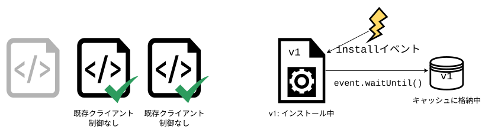
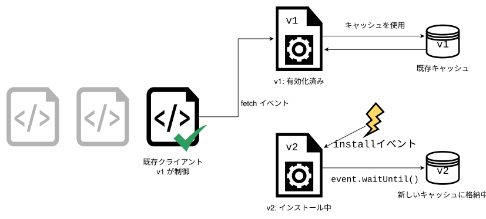
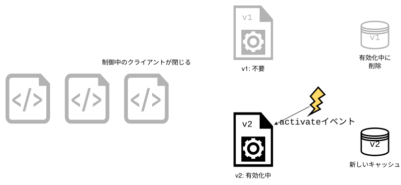
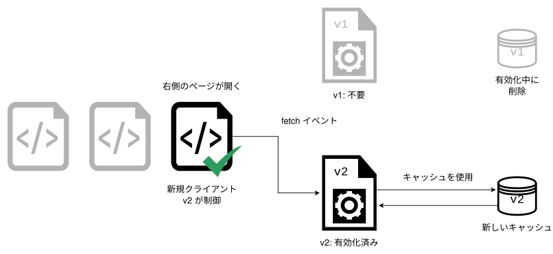
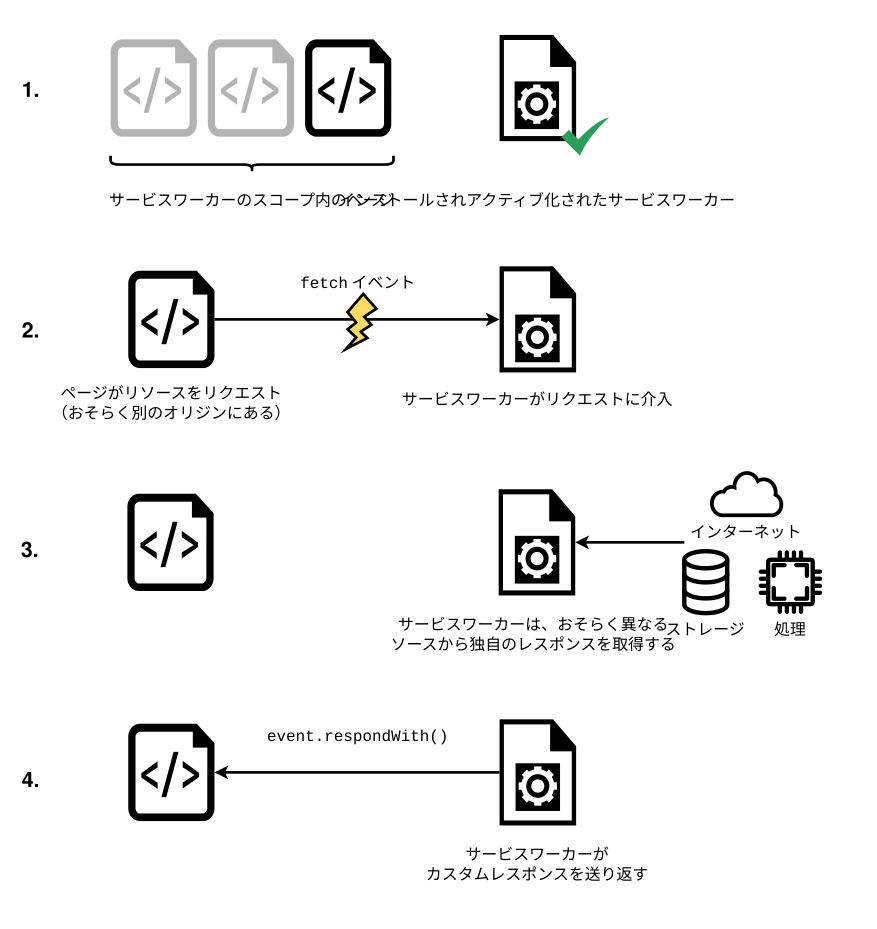

{{DefaultAPISidebar("Service Workers API")}}

この記事では、オフラインで動作するアプリを題材に、サービスワーカーの基本構造、登録、新しいサービスワーカーのインストールと有効化、更新、キャッシュ制御、カスタムレスポンスについて説明します。

## サービスワーカーの背景

ウェブユーザーが長年苦しめられてきた主要な問題の一つは、接続を失うことです。世界中の最高のウェブアプリは、ダウンロードできないときの使い勝手が最悪でした。これまでにも、この問題を解決するための技術を生み出す試みはさまざまに行われ、いくつかの問題は解決されてきました。しかし、一番の問題は、資産のキャッシュとカスタムネットワークリクエストのための優れた全体的な制御メカニズムが存在しなかったことです。

このような課題を解決するのがサービスワーカーです。サービスワーカーを使うと、キャッシュした資産を最初に使用するようアプリを設定できます。そのため、ネットワークからデータを取得する前でも、オフライン時にデフォルトの使い勝手を提供できます（一般に「オフラインファースト」と呼ばれます）。これはネイティブアプリではすでに実現されており、ネイティブアプリがウェブアプリよりよく選ばれる主な理由のひとつです。

サービスワーカーはプロキシーサーバーのように機能し、自身のキャッシュ内のアイテムでリクエストやレスポンスを置き換えて変更できます。

## サービスワーカーを実行するための設定

サービスワーカーは、現代のすべてのブラウザーでデフォルトで有効になっています。サービスワーカーを使用するコードは、セキュリティ上の理由から HTTPS 経由で提供する必要があります。そのため、HTTPS に対応したサーバーが必要です。実験用のコードは GitHub、Netlify、Vercel などのサービスでホストできます。ローカル開発を容易にするため、ブラウザーは `localhost` も保護されたオリジンとして扱います。

## 基本構造

サービスワーカーでは、初回インストールと既存のサービスワーカーの置き換えに、一般に次の手順があります。図は、インストール時にバージョン管理されたキャッシュを作成し、有効化時に古いキャッシュを削除する例です。

### 初回インストール

この例では、最初のサービスワーカーを登録する前から 2 つのページが開いています。そのうちの 1 つのページで [`serviceWorkerContainer.register()`](/ja/docs/Web/API/ServiceWorkerContainer/register) を呼び出すと、処理が始まります。

1. サービスワーカーのコードが取得され、登録されます。登録に成功すると、サービスワーカーは [`ServiceWorkerGlobalScope`](/ja/docs/Web/API/ServiceWorkerGlobalScope) で実行されます。これはメインスクリプトの実行スレッドから独立し、DOM にアクセスできない、特殊な種類のワーカーコンテキストです。サービスワーカーはイベントを処理できる状態になります。

   

2. インストールが行われます。`install` イベントはサービスワーカーに送られる最初のイベントです（これを使って IndexedDB へのデータ格納やサイト資産のキャッシュを開始できます）。この段階で、アプリケーションはすべてをオフラインで使えるように準備します。

   

3. インストールが正常に完了すると、サービスワーカーはインストール済みと見なされます。

   

4. これは初回のサービスワーカーなので、開いているページが閉じるのを待たずに `activate` イベントを受け取ります。`activate` ハンドラーでサービスワーカーのセットアップを完了できます。

   

5. 有効化後、サービスワーカーはスコープ内で新しく開かれたページを制御します。既存の文書を制御するには再読み込みが必要です。文書はサービスワーカーの制御下にあるかどうかが決まった状態で読み込まれ、その状態は文書が存続する間変わらないためです。このデフォルトの動作を上書きして開いているページを制御するには、サービスワーカーから [`clients.claim()`](/ja/docs/Web/API/Clients/claim) を呼び出します。

   

### 既存のサービスワーカーの置き換え

この独立した例は、バージョン 1 に制御されるクライアントが 1 つ開いている状態から始まります。既存のサービスワーカーを置き換えるときのデフォルトの待機動作を示します。

1. 新しいバージョンのサービスワーカーが取得されるたびに、このサイクルが繰り返されます。以前のバージョンはアクティブなままで、クライアントを制御し続けます。

   

2. 新しいバージョンのインストールが行われます。その `install` ハンドラーで新しいキャッシュを格納する間、以前のバージョンは既存のキャッシュを引き続き使用できます。

   

3. インストールが正常に完了すると、以前のバージョンがクライアントを制御している間、新しいバージョンは待機します。新しいバージョンはまだアクティブではありません。

   

4. 以前のバージョンが制御するページがすべて閉じられ、以前のバージョンが保留中のイベントの処理を完了すると、以前のバージョンを終了できます。新しくインストールされたサービスワーカーは `activate` イベントを受け取ります。`activate` の主な用途は、以前のバージョンで使用していたリソース（この例では古いキャッシュなど）を削除することです。

   新しいサービスワーカーから [`skipWaiting()`](/ja/docs/Web/API/ServiceWorkerGlobalScope/skipWaiting) を呼び出すと、開いているページが閉じるのを待たずに有効化されるよう要求できます。すると、以前のバージョンが制御していたページを引き継ぎます。

   

5. 有効化後、登録のスコープ内で新しく開かれたページは新しいバージョンに制御されます。

   

### サービスワーカーのイベント

利用可能なサービスワーカーのイベントの概要は次の通りです。

- [`install`](/ja/docs/Web/API/ServiceWorkerGlobalScope/install_event)
- [`activate`](/ja/docs/Web/API/ServiceWorkerGlobalScope/activate_event)
- [`message`](/ja/docs/Web/API/ServiceWorkerGlobalScope/message_event)
- 機能イベント
  - [`fetch`](/ja/docs/Web/API/ServiceWorkerGlobalScope/fetch_event)
  - [`sync`](/ja/docs/Web/API/ServiceWorkerGlobalScope/sync_event)
  - [`push`](/ja/docs/Web/API/ServiceWorkerGlobalScope/push_event)

### デモ

サービスワーカーの登録とインストールのごく基本的なことを示すために、[シンプルなサービスワーカー](https://github.com/mdn/dom-examples/tree/main/service-worker/simple-service-worker) というシンプルなデモを作成しました。これは、シンプルな Star Wars レゴの画像ギャラリーです。これは、プロミスを利用した関数で、 JSON オブジェクトから画像データを読み込み、 [`fetch()`](/ja/docs/Web/API/Fetch_API/Using_Fetch) を用いて画像を読み込んでから、ページの下に画像を並べて表示するものです。今のところ静的でシンプルなものにしています。また、サービスワーカーを登録、インストール、アクティブ化しています。


[GitHub 上のソースコード](https://github.com/mdn/dom-examples/tree/main/service-worker/simple-service-worker)を確認し、[例をライブで表示](https://bncb2v.csb.app/)してみましょう。

### ワーカーの登録

このアプリの JavaScript ファイルである `app.js` の最初のコードブロックは、以下の通りです。これは、サービスワーカーを使用するためのエントリーポイントです。

```js
const registerServiceWorker = async () => {
  if ("serviceWorker" in navigator) {
    try {
      const registration = await navigator.serviceWorker.register("/sw.js", {
        scope: "/",
      });
      if (registration.installing) {
        console.log("Service worker installing");
      } else if (registration.waiting) {
        console.log("Service worker installed");
      } else if (registration.active) {
        console.log("Service worker active");
      }
    } catch (error) {
      console.error(`Registration failed with ${error}`);
    }
  }
};

// …

registerServiceWorker();
```

1. `if` ブロックは、登録を試みる前にサービスワーカーに対応しているか確認する機能検出試験を行います。
2. 次に、[`ServiceWorkerContainer.register()`](/ja/docs/Web/API/ServiceWorkerContainer/register) 関数を使って、このサイトのサービスワーカーを登録します。サービスワーカーのコードはアプリ内にあります（なお、これはオリジンからのファイルの相対 URL であって、それを参照している JS ファイルではありません）。
3. `scope` 引数はオプションで、サービスワーカーが制御するコンテンツの範囲を指定できます。この例では `'/'` を指定しているため、アプリのオリジン配下のすべてのコンテンツが対象です。省略した場合もこの値がデフォルトになりますが、ここでは指定方法を示しています。

サービスワーカーはワーカーコンテキストで実行されるため、DOM にアクセスできません。

1 つのサービスワーカーで、多数のページを制御することができます。スコープ内のページが読み込まれるたびに、サービスワーカーはそのページにインストールされて動作します。そのため、サービスワーカースクリプト内でのグローバル変数の扱いには注意が必要だということを心にとどめておいてください。各ページが固有のワーカーを持つわけではありません。

> [!NOTE]
> サービスワーカーの良いところは、以上で見てきたような機能の検出をすることで、サービスワーカーに対応していないブラウザーでもオンラインで期待通りの流儀でアプリを使用することができることです。

#### サービスワーカーの登録に失敗する理由

サービスワーカーの登録は、次のいずれかの理由で失敗します。

- アプリケーションを[保護されたコンテキスト](/ja/docs/Web/Security/Defenses/Secure_Contexts) (HTTPS) で実行していない。
- サービスワーカーファイルのパスが正しくない。
  パスはアプリのルートディレクトリーではなく、オリジンからの相対パスで指定する必要があります。
  例では、ワーカーは `https://bncb2v.csb.app/sw.js` にあり、アプリのルートは `https://bncb2v.csb.app/` なので、サービスワーカーは `/sw.js` と指定します。
- サービスワーカーのパスが、アプリとは異なるオリジンのサービスワーカーを指している。
- サービスワーカーの登録で指定した `scope` オプションが、ワーカーのパスで許可される範囲より広い。
  デフォルトでは、サービスワーカーのスコープはワーカーが置かれたディレクトリーです。
  つまり、スクリプト `sw.js` が `/js/sw.js` にある場合、デフォルトでは `/js/` 以下の URL しか制御できません。
  {{HTTPHeader("Service-Worker-Allowed")}} ヘッダーを使うと、サービスワーカーのスコープを広げたり狭めたりできます。
- Cookie のブロック、プライベートブラウジングモード、終了時の Cookie の自動削除など、ブラウザー固有の設定が有効になっている。
  詳しくは [`serviceWorker.register()` のブラウザーの互換性](/ja/docs/Web/API/ServiceWorkerContainer/register#ブラウザーの互換性)を参照してください。

### インストールとアクティブ化: キャッシュの作成

サービスワーカーを登録した後、ブラウザーはページ/サイト上でサービスワーカーをインストールおよびアクティブ化しようとします。

`install` イベントは、サービスワーカーのインストールまたは更新時に発生する最初のイベントです。このイベントは登録が正常に完了した直後に一度だけ発生し、一般に、アプリをオフラインで実行するために必要な資産をブラウザーのオフラインキャッシュに格納するために使われます。これには、サービスワーカーで利用できるストレージ API である [`Cache`](/ja/docs/Web/API/Cache) を使います。`Cache` オブジェクトを使うと、レスポンスで配信された資産をリクエストをキーとして保存できます。この API はブラウザーの標準キャッシュと同様に動作しますが、そのドメインに固有です。キャッシュの内容はクリアするまで保持されます。

サービスワーカーが `install` イベントを扱う方法の例です。

```js
const addResourcesToCache = async (resources) => {
  const cache = await caches.open("v1");
  await cache.addAll(resources);
};

self.addEventListener("install", (event) => {
  event.waitUntil(
    addResourcesToCache([
      "/",
      "/index.html",
      "/style.css",
      "/app.js",
      "/image-list.js",
      "/star-wars-logo.jpg",
      "/gallery/bountyHunters.jpg",
      "/gallery/myLittleVader.jpg",
      "/gallery/snowTroopers.jpg",
    ]),
  );
});
```

1. ここでは サービスワーカー（thisによって）にイベントリスナーを追加して、イベントに [`ExtendableEvent.waitUntil()`](/ja/docs/Web/API/ExtendableEvent/waitUntil) メソッドをチェーンしています ― これは `waitUntil()` の内部のコードが成功裡に実行されるまで、サービスワーカーがインストールされないことを保証します。
2. `addResourcesToCache()` の内部で、 [`caches.open()`](/ja/docs/Web/API/CacheStorage/open) を使用して、 `v1` と呼ばれる新しいキャッシュを作成します。これはサイトリソースキャッシュのバージョン 1 となります。次に、作成されたキャッシュに対して `addAll()` を呼び出す関数を呼び出します。この関数の引数には、キャッシュしたいすべてのリソースのオリジンからの相対 URL の配列が渡されます。URL はワーカーの {{domxref("WorkerGlobalScope.location", "location", "", 1)}} からの相対パスです。
3. プロミスが拒否された場合、インストールが失敗し、ワーカーは何もしません。これは、コードを修正し、次に登録が発生したときに再試行することができるので、問題ありません。
4. インストールに成功すると、サービスワーカーがアクティブになります。これは、サービスワーカーの初回インストール/アクティベーション時にはあまり明確な用途はありませんが、サービスワーカーが更新された時にはより大きな意味を持ちます（後の [サービスワーカーの更新](#サービスワーカーの更新)の節を参照してください）。

> [!NOTE]
> [ウェブストレージ API (`localStorage`)](/ja/docs/Web/API/Web_Storage_API) はサービスワーカーキャッシュと同じように動作しますが、同期処理であるため、サービスワーカー内では許可されていません。

> [!NOTE]
> 必要であれば、 [IndexedDB](/ja/docs/Web/API/IndexedDB_API) をサービスワーカー内でデータ保存のために使用することができます。

### リクエストに対するカスタムレスポンス

サイトの資産がキャッシュされたので、サービスワーカーにキャッシュされたコンテンツを使って何かするように指示する必要があります。これは `fetch` イベントを使って実現できます。

1. `fetch` イベントは、サービスワーカーが制御するリソースが取得されるたびに発生します。これには、指定されたスコープ内の文書と、それらの文書が参照するすべてのリソースが含まれます（例えば、`index.html` が画像を埋め込むためにオリジンをまたぐリクエストを行う場合も、サービスワーカーを通過します）。

2. `fetch` イベントリスナーをサービスワーカーに割り当てると、そのイベント上で `respondWith()` を呼び出すことで、 HTTP レスポンスを乗っ取ってコンテンツを更新することができます。

   ```js
   self.addEventListener("fetch", (event) => {
     event.respondWith(/* カスタムコンテンツはこちら */);
   });
   ```

3. それぞれのケースで、ネットワークリクエストの URL と一致するリソースでレスポンスすることから始めることができる。

   ```js
   self.addEventListener("fetch", (event) => {
     event.respondWith(caches.match(event.request));
   });
   ```

   `caches.match(event.request)` を使うと、ネットワークからリクエストされた各リソースを、キャッシュ内に同等のリソースがあればそれと照合できます。照合は通常の HTTP リクエストと同様に、URL とさまざまなヘッダーに基づいて行われます。



## 失敗したリクエストの復旧

では、 `caches.match(event.request)` はサービスワーカーのキャッシュに一致するものがある場合は良いのですが、一致しない場合はどうでしょうか？もし、何らかの失敗処理を提供しなければ、プロミスは `undefined` で解決され、何も返されないでしょう。

キャッシュからのレスポンスを確認した後、通常のネットワークリクエストに切り替えることができます。

```js
const cacheFirst = async (request) => {
  const responseFromCache = await caches.match(request);
  if (responseFromCache) {
    return responseFromCache;
  }
  return fetch(request);
};

self.addEventListener("fetch", (event) => {
  event.respondWith(cacheFirst(event.request));
});
```

キャッシュにないリソースは、ネットワークからリクエストされます。

もっと複雑な戦略を用いると、ネットワークからリソースを要求するだけでなく、キャッシュに保存して、後でそのリソースに対するリクエストをオフラインで取得できるようにすることができます。つまり、Star Warsのギャラリーに画像が追加されたら、アプリが自動的に画像を取得してキャッシュすることができるのです。以下は、このような戦略を実装するためのスニペットです。

```js
const putInCache = async (request, response) => {
  const cache = await caches.open("v1");
  await cache.put(request, response);
};

const cacheFirst = async (request, event) => {
  const responseFromCache = await caches.match(request);
  if (responseFromCache) {
    return responseFromCache;
  }
  const responseFromNetwork = await fetch(request);
  event.waitUntil(putInCache(request, responseFromNetwork.clone()));
  return responseFromNetwork;
};

self.addEventListener("fetch", (event) => {
  event.respondWith(cacheFirst(event.request, event));
});
```

リクエスト URL がキャッシュにない場合、 `await fetch(request)` でネットワークリクエストからリソースをリクエストします。その後、レスポンスのクローンをキャッシュに格納します。 `putInCache()` 関数は `caches.open('v1')` と `cache.put()` を使用して、リソースをキャッシュに追加します。本来のレスポンスはブラウザーに返され、それを呼び出したページに渡されます。

リクエストストリームとレスポンスストリームは一度しか読み込めないので、レスポンスの複製を作成する必要があります。ブラウザーにレスポンスを返してキャッシュに入れるには、それを複製する必要があります。つまり、オリジナルはブラウザーに返され、クローンはキャッシュに送られます。これらはそれぞれ一度だけ読み込まれます。

一見奇妙なのは、`putInCache()` が返すプロミスを待たないことです。レスポンスを返す前に、レスポンスのクローンがキャッシュに追加されるのを待ちたくないためです。ただし、キャッシュへの追加が完了する前にサービスワーカーが終了しないよう、このプロミスに対して `event.waitUntil()` を呼び出す必要があります。

今ある唯一の問題は、リクエストに一致するものがキャッシュになく、ネットワークも利用できない場合、やはりリクエストが失敗することです。何が起きてもユーザーが少なくとも何かを得られるよう、デフォルトの代替処理を用意しましょう。

```js
const putInCache = async (request, response) => {
  const cache = await caches.open("v1");
  await cache.put(request, response);
};

const cacheFirst = async ({ request, fallbackUrl, event }) => {
  // キャッシュからリソースを取得
  const responseFromCache = await caches.match(request);
  if (responseFromCache) {
    return responseFromCache;
  }

  // 次にネットワークからリソースを取得
  try {
    const responseFromNetwork = await fetch(request);
    // レスポンスは一度しか使用できない
    // 複製を保存して、片方をキャッシュに格納
    // もう片方を返す
    event.waitUntil(putInCache(request, responseFromNetwork.clone()));
    return responseFromNetwork;
  } catch (error) {
    const fallbackResponse = await caches.match(fallbackUrl);
    if (fallbackResponse) {
      return fallbackResponse;
    }
    // 代替レスポンスも利用できず、
    // 対処方法がなくても、常に
    // Response オブジェクトを返す
    return new Response("Network error happened", {
      status: 408,
      headers: { "Content-Type": "text/plain" },
    });
  }
};

self.addEventListener("fetch", (event) => {
  event.respondWith(
    cacheFirst({
      request: event.request,
      fallbackUrl: "/gallery/myLittleVader.jpg",
      event,
    }),
  );
});
```

この代替画像を選択したのは、失敗する可能性のあるアップデートは新しい画像だけで、他のすべては先に見た `install` イベントのリスナーでのインストールに依存しているためです。

## サービスワーカーのナビゲーション先読み

有効にすると、[ナビゲーション先読み](/ja/docs/Web/API/NavigationPreloadManager)機能は、フェッチリクエストがなされるとすぐに、サービスワーカーのアクティブ化と並行してリソースのダウンロードを開始します。
これにより、サービスワーカーがアクティブ化するまで待つ必要がなく、ページへのナビゲーションですぐにダウンロードが開始されるようになります。
この遅延は比較的稀にしか発生しませんが、発生した場合は避けられないものであり、重大なものになる可能性があります。

まず、サービスワーカーアクティブ化時に [`registration.navigationPreload.enable()`](/ja/docs/Web/API/NavigationPreloadManager/enable) を使ってこの機能を有効にする必要があります。

```js
self.addEventListener("activate", (event) => {
  event.waitUntil(self.registration?.navigationPreload.enable());
});
```

そして、[`event.preloadResponse`](/ja/docs/Web/API/FetchEvent/preloadResponse) を使って `fetch` イベントハンドラーの中で先読みされたリソースのダウンロードが終了するのを待ちます。

前の節の例に引き続き、キャッシュチェックの後に先読みされたリソースを待機し、成功しなかった場合はネットワークから取得するコードを挿入します。

新しい処理は次の通りです。

1. キャッシュをチェック
2. `event.preloadResponse` を待ちます。これは `preloadResponsePromise` として `cacheFirst()` 関数に渡されます。結果が返ってきたら、それをキャッシュします。
3. どちらも定義されていない場合は、ネットワークに行きます。

```js
const addResourcesToCache = async (resources) => {
  const cache = await caches.open("v1");
  await cache.addAll(resources);
};

const putInCache = async (request, response) => {
  const cache = await caches.open("v1");
  await cache.put(request, response);
};

const cacheFirst = async ({
  request,
  preloadResponsePromise,
  fallbackUrl,
  event,
}) => {
  // キャッシュからリソースを取得
  const responseFromCache = await caches.match(request);
  if (responseFromCache) {
    // レスポンスを使わない場合もナビゲーション先読みのリクエストを維持
    event.waitUntil(preloadResponsePromise.catch(() => undefined));
    return responseFromCache;
  }

  // 先読みしたレスポンスがあれば、次に使用してキャッシュ
  const preloadResponse = await preloadResponsePromise;
  if (preloadResponse) {
    console.info("using preload response", preloadResponse);
    event.waitUntil(putInCache(request, preloadResponse.clone()));
    return preloadResponse;
  }

  // 次にネットワークからリソースを取得
  try {
    const responseFromNetwork = await fetch(request);
    // レスポンスは一度しか使用できない
    // 複製を保存して、片方をキャッシュに格納
    // もう片方を返す
    event.waitUntil(putInCache(request, responseFromNetwork.clone()));
    return responseFromNetwork;
  } catch (error) {
    const fallbackResponse = await caches.match(fallbackUrl);
    if (fallbackResponse) {
      return fallbackResponse;
    }
    // 代替レスポンスも利用できず、
    // 対処方法がなくても、常に
    // Response オブジェクトを返す
    return new Response("Network error happened", {
      status: 408,
      headers: { "Content-Type": "text/plain" },
    });
  }
};

// ナビゲーション先読みを有効化
const enableNavigationPreload = async () => {
  if (self.registration.navigationPreload) {
    await self.registration.navigationPreload.enable();
  }
};

self.addEventListener("activate", (event) => {
  event.waitUntil(enableNavigationPreload());
});

self.addEventListener("install", (event) => {
  event.waitUntil(
    addResourcesToCache([
      "/",
      "/index.html",
      "/style.css",
      "/app.js",
      "/image-list.js",
      "/star-wars-logo.jpg",
      "/gallery/bountyHunters.jpg",
      "/gallery/myLittleVader.jpg",
      "/gallery/snowTroopers.jpg",
    ]),
  );
});

self.addEventListener("fetch", (event) => {
  event.respondWith(
    cacheFirst({
      request: event.request,
      preloadResponsePromise: event.preloadResponse,
      fallbackUrl: "/gallery/myLittleVader.jpg",
      event,
    }),
  );
});
```

この例では、リソースを「通常」ダウンロードしても先読みしても、同じデータをダウンロードしてキャッシュすることに注意してください。代わりに、先読み時に別のリソースをダウンロードし、キャッシュするように選択することもできます。詳細については、[`NavigationPreloadManager` > カスタムレスポンス](/ja/docs/Web/API/NavigationPreloadManager#カスタムレスポンス)を参照してください。

## サービスワーカーの更新

サービスワーカーが以前にインストールされているが、ページの更新や読み込みの時に新しいバージョンのワーカーが利用できる場合、新しいバージョンはバックグラウンドでインストールされますが、まだアクティブ化しません。まだ古いサービスワーカーを使用している読み込まれたページがなくなったら、新しいサービスワーカーがアクティブ化します。

> [!NOTE]
> [`Clients.claim()`](/ja/docs/Web/API/Clients/claim) を使用して、これを回避することが可能です。

新しいサービスワーカーで、 `install` イベントリスナーをこのようなもの（新しいバージョン番号を通知するもの）に更新したくなるでしょう。

```js
const addResourcesToCache = async (resources) => {
  const cache = await caches.open("v2");
  await cache.addAll(resources);
};

self.addEventListener("install", (event) => {
  event.waitUntil(
    addResourcesToCache([
      "/",
      "/index.html",
      "/style.css",
      "/app.js",
      "/image-list.js",

      // …

      // 新しいバージョンのための新しい他のリソースを入れてください...
    ]),
  );
});
```

サービスワーカーをインストールしている間、以前のバージョンはまだフェッチに対してレスポンスします。新しいバージョンは、バックグラウンドでインストールされています。以前の `v1` キャッシュを妨げないように、新しいキャッシュを `v2` と呼んでいます。

どのページも前回のバージョンを使用していないとき、新しいワーカーが有効化し、フェッチにレスポンスするようになります。

### 古いキャッシュの削除

前の節で見たように、サービスワーカーを新しいバージョンに更新するとき、その `install` イベントハンドラーで新しいキャッシュを作成します。前回バージョンのワーカーによって制御される開くためのページがある一方で、前回バージョンのキャッシュが必要なので、両方のキャッシュを保持する必要があります。前のキャッシュからデータを削除するには `activate` イベントを使用します。

`waitUntil()` に渡されたプロミスは、完了するまで他のイベントをブロックするので、新しいキャッシュ上で初めての `fetch` イベントを取得するときには、クリーンアップ操作が完了していると確信できます。

```js
const deleteCache = async (key) => {
  await caches.delete(key);
};

const deleteOldCaches = async () => {
  const cacheKeepList = ["v2"];
  const keyList = await caches.keys();
  const cachesToDelete = keyList.filter((key) => !cacheKeepList.includes(key));
  await Promise.all(cachesToDelete.map(deleteCache));
};

self.addEventListener("activate", (event) => {
  event.waitUntil(deleteOldCaches());
});
```

## 開発者ツール

- [Chrome](https://www.chromium.org/blink/serviceworker/service-worker-faq/)
- [Firefox](https://firefox-source-docs.mozilla.org/devtools-user/application/service_workers/index.html)
  - [Firefox のツールバーのカスタマイズオプション](https://support.mozilla.org/en-US/kb/customize-firefox-controls-buttons-and-toolbars)で利用できる「このサイトを忘れる」ボタンは、サービスワーカーとそのキャッシュを消去するために使用できます。
- [Edge](https://learn.microsoft.com/en-us/microsoft-edge/devtools/progressive-web-apps/#service-workers)

## 関連情報

- [プロミス](/ja/docs/Web/JavaScript/Reference/Global_Objects/Promise)
- [ウェブワーカーの使用](/ja/docs/Web/API/Web_Workers_API/Using_web_workers)
- HTTP {{HTTPHeader("Service-Worker-Allowed")}} ヘッダー
