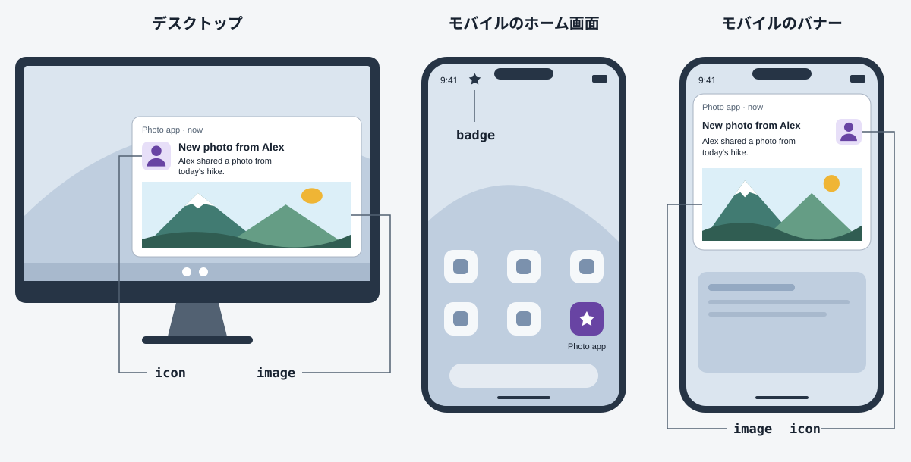

{{APIRef("Web Notifications")}}{{SecureContext_Header}} {{AvailableInWorkers}}

{{domxref("ServiceWorkerRegistration")}} インターフェイスの **`showNotification()`** メソッドは、アクティブなサービスワーカー上で通知を作成します。

## 構文

```js-nolint
showNotification(title)
showNotification(title, options)
```

### 引数

- `title`
  - : 通知ウィンドウの上部に表示する通知のタイトルを定義します。
- `options` {{optional_inline}}
  - : 通知に適用するカスタム設定を含むオブジェクトです。指定できるオプションは次のとおりです。
    - `actions` {{optional_inline}} {{experimental_inline}}
      - : 通知に表示するアクションの配列です。デフォルトは空の配列です。配列内の各要素は、次のメンバーを持つオブジェクトです。
        - `action`
          - : アクション配列内の個々のアクションを一意に識別する文字列です。

            `navigate` URL のないアクションボタンがクリックされたときは、`notificationclick` イベントリスナー内で `event.action` を確認すると、どのボタンが選択されたか判断できます。

        - `title`
          - : ユーザーに表示するアクションテキストを含む文字列です。
        - `icon` {{optional_inline}}
          - : アクションとともに表示するアイコンの URL を含む文字列です。
        - `navigate` {{optional_inline}} {{experimental_inline}}
          - : ユーザーがこのアクションを有効化したときに移動する URL を含む文字列です。
            設定すると、ユーザーエージェントは {{domxref("ServiceWorkerGlobalScope.notificationclick_event", "notificationclick")}} イベントを発生させる代わりに、この URL に移動します。
            詳細は {{domxref("Notification.navigate")}} を参照してください。

    - `badge` {{optional_inline}} {{experimental_inline}}
      - : ウェブアプリケーション自体を表す小さなアイコンの URL を含む文字列です。
        通知全体を表示する十分なスペースがない場合（例えばステータスバーなど）に、プラットフォームがバッジを使用します。
        `icon` および `image` オプションよりも視覚的な優先度を低くしてください。
        Android では、バッジは最大 4 倍のディスプレイ解像度（約 96×96 ピクセル）に対応する必要があり、画像は自動的に単色のシルエットにマスクされます。
    - `body` {{optional_inline}}
      - : 通知のタイトルの下に表示する本文テキストを表す文字列です。デフォルトは空文字列です。
    - `data` {{optional_inline}} {{experimental_inline}}
      - : 通知に関連付ける任意のデータです。任意の[構造化複製可能な](/ja/docs/Web/API/Web_Workers_API/Structured_clone_algorithm#supported_types)データ型を指定できます。デフォルトは `null` です。
    - `dir` {{optional_inline}}
      - : 通知を表示する方向です。デフォルトの `auto` はブラウザーの言語設定に従いますが、`ltr` または `rtl` を設定して動作を上書きできます（ただし、ほとんどのブラウザーはこれらの設定を無視するようです）。
    - `icon` {{optional_inline}}
      - : 通知を補足する小さな画像（アプリのロゴやメッセージの送信者の写真など）の URL を含む文字列です。通知のタイトルと本文の横に表示されます。
    - `image` {{optional_inline}} {{experimental_inline}}
      - : 通知の本文の一部として表示する大きな画像（ニュース写真や商品のサムネイルなど）の URL を含む文字列です。3 つの画像オプション（`image`、`icon`、`badge`）の中で最も視覚的な優先度が高くなります。
    - `lang` {{optional_inline}}
      - : {{glossary("BCP 47 language tag", "BCP 47 言語タグ")}}を表す文字列で指定する通知の言語です。デフォルトは空文字列です。
    - `navigate` {{optional_inline}} {{experimental_inline}}
      - : ユーザーが通知を有効化したときに移動する URL を含む文字列です。
        設定すると、ユーザーエージェントは {{domxref("ServiceWorkerGlobalScope.notificationclick_event", "notificationclick")}} イベントを発生させる代わりに、この URL に移動します。
        値はサービスワーカーのベース URL を基準に構文解析されます。
        詳細は {{domxref("Notification.navigate")}} を参照してください。
    - `renotify` {{optional_inline}} {{experimental_inline}}
      - : 新しい通知が古い通知を置き換えた後に、ユーザーに通知するかどうかを指定する論理値です。デフォルトの `false` は、ユーザーに通知しないことを示します。`true` の場合は、`tag` も設定する必要があります。
    - `requireInteraction` {{optional_inline}} {{experimental_inline}}
      - : 通知が自動的に閉じられるのではなく、ユーザーがクリックするか閉じるまでアクティブなままにすることを示します。デフォルト値は `false` です。
    - `silent` {{optional_inline}}
      - : 通知を無音（音やバイブレーションを発生させない状態）にするかどうかを、端末の設定にかかわらず指定する論理値です。デフォルトの `null` は端末のデフォルト設定に従うことを示します。`true` の場合、`vibrate` を指定してはいけません。
    - `tag` {{optional_inline}}
      - : 通知を識別するタグを表す文字列です。デフォルトは空文字列です。
    - `timestamp` {{optional_inline}}
      - : 通知に関連付けられた時刻を表すタイムスタンプです。{{glossary("Unix time")}}のミリ秒単位で指定します。
        端末がオフラインでメッセージをすぐに配信できなかった場合の通知では過去の時刻、これから始まる会議の通知では未来の時刻になることがあります。
    - `vibrate` {{optional_inline}} {{experimental_inline}}
      - : 通知とともに端末のバイブレーション機能で実行する[バイブレーションパターン](/ja/docs/Web/API/Vibration_API#vibration_patterns)です。
        指定する場合、`silent` を `true` にしてはいけません。

### 返値

`undefined` に解決する {{jsxref('Promise')}} です。

### 例外

- {{jsxref("TypeError")}}
  - : 次の場合に発生します。
    - 現在のサービスワーカーの状態が `activating` または `activated` ではない場合。
    - ユーザーが、この API を使用するためのブラウザーの許可要求を明示的に拒否した場合。
    - `silent` オプションが `true` で、`vibrate` オプションが指定されている場合。
    - `renotify` オプションが `true` で、`tag` オプションが空の場合。
- `DataCloneError` {{domxref("DOMException")}}
  - : `data` オプションのシリアライズに失敗した場合に発生します。

## 例

### 基本的な使い方

この例では、サービスワーカー内で実行される関数が、許可を要求して許可された後に通知を表示します。関数を実際に呼び出すコードは示していません。

```js
navigator.serviceWorker.register("sw.js");

async function showNotification() {
  const result = await Notification.requestPermission();

  if (result === "granted") {
    const registration = await navigator.serviceWorker.ready;

    registration.showNotification("バイブレーションの例", {
      body: "ブンブン! ブンブン!",
      icon: "../images/touch/chrome-touch-icon-192x192.png",
      vibrate: [200, 100, 200, 100, 200, 100, 200],
      tag: "vibration-sample",
    });
  }
}
```

次のコードは、この通知に対するユーザー操作を処理するために、{{domxref("ServiceWorkerGlobalScope.notificationclick_event", "notificationclick")}} イベントを監視する方法を示しています。

```js
self.addEventListener("notificationclick", (event) => {
  const notification = event.notification;

  // 通知が不要になった場合は閉じる。
  notification.close();

  // 対象の通知を処理する
  if (notification.tag === "vibration-sample") {
    // Promise が解決するまでサービスワーカーを実行し続けるために event.waitUntil を使用する
    event
      .waitUntil
      // 特定のイベントを処理するコード。
      ();
  }
});
```

現在のサービスワーカーから発生した {{domxref("Notification")}} の詳細は、{{domxref("ServiceWorkerRegistration.getNotifications()")}} を使用して取得することもできます。

### 画像の異なる通知

この例では、`badge`、`icon`、`image` の各オプションに、アプリのシンボル、送信者の肖像写真、風景写真という異なる画像を設定します。URL は独自の画像へのパスに置き換えてください。この例では、サービスワーカーが登録済みで、通知の許可が得られているものとします。

```js
const registration = await navigator.serviceWorker.ready;

await registration.showNotification("アレックスから新しい写真", {
  body: "アレックスが今日のハイキングの写真を共有しました。",
  badge: "/images/app-badge.png",
  icon: "/images/alex-avatar.png",
  image: "/images/hiking-photo.png",
});
```

次の図は、デスクトップ、モバイルのホーム画面、モバイルのバナーでこれらの画像がどのように表示されるかを示しています。ステータスバーには `badge`、タイトルと本文の横には `icon`、展開された通知には `image` が表示されます。実際のレイアウトと表示される画像は、ブラウザーとオペレーティングシステムによって異なります。



### アクションとアクションハンドラーを使った通知

この例では、例えばメールの受信時にプッシュメッセージによって通知される可能性がある、持続的な通知を表示する方法を示します。

通知を生成するコードには、通知に表示される 2 つの `actions` が含まれます。1 つはメッセージへの返信用、もう 1 つは通知を閉じるためのものです。
各アクションには `title` があり、通常は通知上のボタンテキストとして表示されます。また、ユーザーが通知を操作したときに選択されたアクションを識別するための `action` もあります。

```js
registration.showNotification("新しいメッセージ", {
  body: "メールが届いています。",
  icon: "/images/icon.png",
  actions: [
    { action: "reply", title: "返信" },
    { action: "dismiss", title: "閉じる" },
  ],
});
```

次のコードは、通知の `notificationclick` イベントを監視し、`event.action` プロパティの値を使用して選択されたアクションを判断する方法を示しています。
ユーザーがアクションボタンではなく通知本文をクリックした場合、`event.action` は空文字列になることに注意してください。

```js
self.addEventListener("notificationclick", (event) => {
  event.notification.close();

  if (event.action === "reply") {
    // 返信を処理する
  } else if (event.action === "dismiss") {
    // 通知を閉じる処理を行う
  }
});
```

## 仕様書

{{Specifications}}

## ブラウザーの互換性

{{Compat}}
