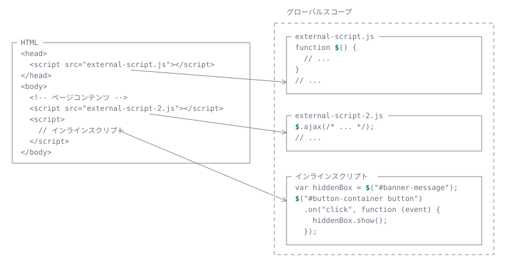
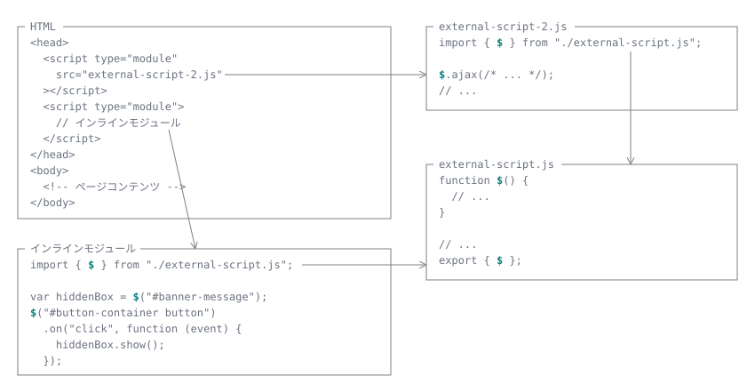

{{Previous("Web/JavaScript/Guide/Internationalization")}}

このガイドでは、JavaScript のモジュール構文を使い始めるために必要なことをすべて紹介します。

## モジュールの考え方

モジュール内で使用できる構文を見る前に、まずモジュールとは何か、従来のスクリプトとどう異なるのか、なぜ必要なのかを概説します。

### モジュールの背景

JavaScript のプログラムはとても小さいものから始まりました。初期の用途は、必要に応じてウェブページにちょっとした対話的な機能を追加する独立したスクリプト処理がほとんどであったため、大きなスクリプトは通常必要ありませんでした。そして何年かが過ぎ、今や大量の JavaScript を持つ完全なアプリケーションをブラウザーで実行することはもちろん、JavaScript を他のコンテキスト（例えば [Node.js](/ja/docs/Glossary/Node.js)）で使うこともあります。

複雑なプロジェクトでは、必要に応じてインポートできるコード単位であるモジュールに、JavaScript プログラムを分割する仕組みが必要です。Node.js は長年この機能を提供しており、モジュールを使用できる JavaScript ライブラリーやツールも数多くあります（例えば、[RequireJS](https://requirejs.org/)<sup>(英語)</sup> のような [AMD](https://github.com/amdjs/amdjs-api/blob/master/AMD.md)<sup>(英語)</sup> ローダー、[webpack](https://webpack.js.org/)<sup>(英語)</sup> のようなバンドラー、[Babel](https://babeljs.io/)<sup>(英語)</sup> のようなコンパイラー）。

現行のブラウザーはすべて、トランスパイルを必要とせずにモジュール機能にネイティブで対応しています。ブラウザーがライブラリーを使わずにモジュールの読み込みを自動的に処理できるため、余分なクライアント側の処理や通信を省けます。ただし、webpack のようなバンドラーが不要になるわけではありません。バンドラーはコードを適切なサイズのチャンクに分割でき、ミニファイ、デッドコードの除去、{{glossary("tree shaking", "ツリーシェイク")}}などの最適化も行えます。

### モジュールとは

JavaScript コードは、スクリプト（「クラシックスクリプト」や「従来のスクリプト」とも呼ばれます）またはモジュールとして評価できます。主な違いは 2 つあります。

1. 構文解析時、モジュールはスクリプトと少し異なる構文で解析されます。モジュールは自動的に[厳格モード](/ja/docs/Web/JavaScript/Reference/Strict_mode)になり、モジュール内でのみ {{jsxref("Statements/import", "import")}} 文と {{jsxref("Statements/export", "export")}} 文を使用できます。
2. 実行時、モジュールはグローバルスコープではなく独自のスコープで実行されます。そのため、モジュールで宣言した変数、関数、クラスなどは、明示的にエクスポートして他のモジュールからインポート可能にするか、（ブラウザーの `window` など）グローバルオブジェクトに追加してグローバルに利用できるようにしない限り、モジュールの外から見えません。モジュール内で捕捉されなかったエラーは開発者ツールに表示されますが、JavaScript コンソールからモジュールスコープの変数にアクセスすることはできません。

ウェブ上のモジュールにはほかにも違いがあります。詳しくは[ウェブでのモジュールの使用](/ja/docs/Web/JavaScript/Guide/Modules/Modules_on_the_web)を参照してください。

従来、スクリプトは次のようにウェブページに追加されていました。

```html
<head>
  <script src="external-script.js"></script>
</head>
<body>
  <!-- ページコンテンツ -->
  <script src="external-script-2.js"></script>
  <script>
    // インラインスクリプト
  </script>
</body>
```

```js
// -- external-script.js --
function $() {
  // …
}
// …
```

```js
// -- external-script-2.js --
$.ajax(/* … */);
// …
```



特に重要なのは、ページに追加されたすべてのクラシックスクリプトが同じスコープ、つまりグローバルスコープで実行されることです。他の関数やブロック内にない変数は、ページ内の後続のどこからでもアクセスできます。これは便利な一方で危険でもあります。この図では、すべてのスクリプトがグローバルスコープにあるため、2 番目と 3 番目のスクリプトから、最初のスクリプトで宣言された `$` 変数にアクセスできます。

この方法は非常に便利ですが、規模が大きくなると扱いにくくなります。

- スコープの汚染や識別子の衝突が大きな問題になります。[jQuery](https://jquery.com/)<sup>(英語)</sup> や [Underscore](https://underscorejs.org/)<sup>(英語)</sup> のような一般的なライブラリーは、リスクを減らすために `$` や `_` のような特別な識別子を使いますが、多くのサードパーティライブラリーが `map`、`merge`、`debounce` などのよくある名前を取り合います。
- すべての依存関係を作者が明示的に宣言して管理する必要があります。ライブラリー A がライブラリー B をインポートする場合、アプリケーションの作者が B を読み込む `<script>` 要素を追加し、A より先に読み込まれるようにしなければなりません。
- 必要なときにライブラリーを読み込むのが困難です。ページを読み込むと、すべてが読み込まれて初期化されます。

同じコードをモジュールで記述するとどうなるか考えてみましょう。最初のスクリプト `external-script.js` は、変数 `$` を他のスクリプトと共有しようとしています。先ほどはこの変数をグローバルスコープに置きましたが、モジュールではエクスポートして他のスクリプトにインポートできます。

```html
<head>
  <script type="module" src="external-script-2.js"></script>
  <script type="module">
    import { $ } from "./external-script.js";
    // インラインスクリプト
  </script>
</head>
<body>
  <!-- ページコンテンツ -->
</body>
```

```js
// -- external-script.js --
function $() {
  // …
}
// …
export { $ };
```

```js
// -- external-script-2.js --
import { $ } from "./external-script.js";

$.ajax(/* … */);
// …
```



スクリプトの場合、後続のコードがそれ以前のすべてのコードにアクセスできる_線形_な依存関係になります。一方、モジュールでは[依存関係グラフ](/ja/docs/Web/JavaScript/Guide/Modules/Module_graph)が形成され、各モジュールは依存するモジュールと、そこから必要とする変数を明示的に宣言します。

前述のとおり、モジュールはスクリプトと異なる方法で構文解析されます。そのため、JavaScript エンジンはモジュールとスクリプトのどちらの構文解析規則を適用するかを知る必要があります。ホストは一般に[アウトオブバンドシグナリング機構](https://github.com/tc39/how-we-work/blob/main/terminology.md#out-of-band)<sup>(英語)</sup>を使ってこれを指定します。これは、コードの振る舞いをコード外の情報で設定する方法です（`"use strict"` でスクリプト内に解釈モードを宣言する[厳格モード](/ja/docs/Web/JavaScript/Reference/Strict_mode)とは異なります）。その情報を指定する方法はいくつかあります。

- モジュールを `<script>` タグから参照する場合は、`type="module"` 属性を使用できます。詳しくは[ウェブでのモジュールの使用](/ja/docs/Web/JavaScript/Guide/Modules/Modules_on_the_web)も参照してください。
- Node.js を使用する場合は、`.mjs` ファイル拡張子を使用するか、最も近い `package.json` ファイルに `"type": "module"` を追加できます。詳しくは[プラットフォームをまたぐモジュール](/ja/docs/Web/JavaScript/Guide/Modules/Modules_across_platforms)も参照してください。
- モジュールをワーカーとして使用する場合は、{{domxref("Worker/Worker", "Worker()")}} コンストラクターの呼び出し時に `type: "module"` を渡せます。

> [!NOTE]
> Node.js など一部のランタイムは、明示的な指定がない場合、モジュール以外では使用できない `import` / `export` のような構文がコードにあるかどうかに基づいて、モジュール種別を暗黙的に検出します。ブラウザーにはこの機能はありません。

モジュールからもグローバル変数にアクセスできます。例えば、モジュールからクラシックスクリプトで宣言した変数を使用できます。

```html
<script>
  var text = "Hello";
</script>
<script type="module" src="render.js"></script>
```

```js
// -- render.js --
document.body.textContent = text;
```

### 余談 — .mjs と .js

この記事ではモジュールファイルに `.js` の拡張子を使用していますが、他の資料では `.mjs` 拡張子を使用していることがあります。[V8 のドキュメント](https://v8.dev/features/modules#mjs)<sup>(英語)</sup>ではこれを推奨しています。その理由は次のとおりです。

- HTML タグや `package.json` などの周辺情報を調べなくても、ファイル自体からモジュールかスクリプトかを判断できます。
- ブラウザー以外では、`.mjs` をモジュールモードとして直接扱うことがほぼ一般的になっています。[Node.js](https://nodejs.org/api/esm.html#esm_enabling)<sup>(英語)</sup> のようなランタイムや [Babel](https://babeljs.io/docs/options#sourcetype)<sup>(英語)</sup> のようなビルドツールも対応しています。

ブラウザーでは、拡張子の違いは見た目だけのものです。ウェブ上ではファイル拡張子は重要ではありません。JavaScript かどうかは [`Content-Type`](/ja/docs/Web/HTTP/Reference/Headers/Content-Type) ヘッダーで識別され、モジュールかどうかは `<script>` タグの `type="module"` 属性で識別されます。ブラウザーでモジュールを正しく動作させるには、サーバーが `text/javascript` などの JavaScript MIME タイプを含む `Content-Type` ヘッダーでファイルを提供する必要があります。そうしないと、"The server responded with a non-JavaScript MIME type" のような厳格な MIME タイプチェックエラーが発生し、ブラウザーは JavaScript を実行しません。

この記事では `.js` を使用することにしました。主な利点は、`.js` 拡張子の方が `.mjs` より広く認識されていることです。`.mjs` の対応は進んでいますが、対応していないソフトウェアに遭遇する可能性があります。

- ほとんどのサーバーは `.js` ファイルに正しい MIME タイプを自動的に設定しますが、`.mjs` ファイルには設定しないサーバーもあります。[GitHub Pages](https://pages.github.com/)<sup>(英語)</sup> や Node.js 用の [`http-server`](https://github.com/http-party/http-server#readme)<sup>(英語)</sup> など、`.mjs` ファイルを正しく提供するサーバーもあります。すでにそのような環境を使っている場合や、`.mjs` ファイルに正しい `Content-Type` を設定するようサーバーを構成できる場合は問題ありません。しかし、ファイルを提供するサーバーを管理していない場合や、ここでのようにファイルを公開する場合は、混乱を招くことがあります。
- ファイル拡張子は HTTP サーバー以外にも、エディター、オペレーティングシステム、静的解析ツール、フォーマッターなど多くのツールで使用されます。`.mjs` はツール全般での対応が十分でない場合があります。例えば、オペレーティングシステムによっては認識できなかったり、ファイルを開くときに `.js` を暗黙的に追加するなど、別の形式に置き換えたりする場合があります。

上記の問題に遭遇せず、通常の JavaScript ファイルに `.js` を使うのと区別するためにモジュールに `.mjs` を使いたい場合は、開発時に `.mjs` を使用し、ビルド時に `.js` に変換する方法もあります。

## 使用例

モジュールの使い方を紹介するために、GitHub 上に[簡単な例のセット](https://github.com/mdn/js-examples/tree/main/module-examples)を作成しました。これらは、ウェブページに [`<canvas>`](/ja/docs/Web/HTML/Reference/Elements/canvas) 要素を作成し、キャンバス上にさまざまな図形を描画して、その情報を報告するモジュールの例です。

これらの例は単純ですが、モジュールの説明が明確になるよう意図的に単純にしています。

最初の例 ([basic-modules](https://github.com/mdn/js-examples/tree/main/module-examples/basic-modules) を参照) のファイル構造は次のとおりです。

```plain
index.html
main.js
modules/
    canvas.js
    square.js
```

> [!NOTE]
> このガイドの例はすべて、基本的に同じ構造になっています。

`index.html` ファイルは DOM を宣言し、`main.js` モジュールを[適用](/ja/docs/Web/JavaScript/Guide/Modules/Modules_on_the_web)するだけです。以降で示すコードはすべて `.js` ファイルのものです。

`modules` ディレクトリーにある 2 つのモジュールは次のとおりです。

- `canvas.js` — キャンバスの設定に関する関数を含みます。
  - `create()` — 指定された `width` と `height` を持つキャンバスを、指定された ID を持つラッパー [`<div>`](/ja/docs/Web/HTML/Reference/Elements/div) 内に作成し、そのラッパー自体を指定された親要素に追加します。返値は、キャンバスの二次元コンテキストとラッパーの ID を含むオブジェクトです。
  - `createReportList()` — 指定されたラッパー要素内に順序なしリストを作成し、レポートデータの出力に使えるようにします。返値はリストの ID です。
- `square.js` — 次のものを含みます。
  - `name` — 文字列 `"square"` を値とする定数です。
  - `draw()` — 指定されたサイズ、位置、色で、指定されたキャンバス上に正方形を描画します。返値は正方形のサイズ、位置、色を含むオブジェクトです。
  - `reportArea()` — 指定された辺の長さの正方形の面積を、指定されたレポート用リストに書き出します。
  - `reportPerimeter()` — 指定された辺の長さの正方形の周囲の長さを、指定されたレポート用リストに書き出します。

これらの例をダウンロードしたら、[ローカルサーバーを起動](/ja/docs/Learn_web_development/Howto/Tools_and_setup/set_up_a_local_testing_server)して `index.html` ファイルにアクセスしてください。

## 名前付きエクスポート

スクリプトでは、最上位で宣言した変数は後続のスクリプトから暗黙的に利用できます。一方、他のモジュールから利用できるようにするには、変数を明示的に {{jsxref("Statements/export", "export")}} する必要があります。このキーワードは[宣言](/ja/docs/Web/JavaScript/Reference/Statements)（`var`、`let`、`const`、`function`、`class` など）の前に置けます。エクスポートするものは最上位にある必要があります。例えば、関数の中で `export` を使うことはできません。

```js
export const name = "square";

export function draw(ctx, length, x, y, color) {
  ctx.fillStyle = color;
  ctx.fillRect(x, y, length, length);

  return { length, x, y, color };
}
```

モジュール内の別の場所で宣言済みのものをエクスポートするには、`export` の後にエクスポートする名前を中かっこで囲んだカンマ区切りのリストとして指定します。

```js
export { name, draw, reportArea, reportPerimeter };
```

## 名前付きインポート

モジュールから変数をエクスポートしたら、別のモジュールで使うためにインポートする必要があります。そのためには、{{jsxref("Statements/import", "import")}} 文の後に、インポートする名前を中かっこで囲んだカンマ区切りのリストとして記述します。その後に `from` キーワードとモジュール指定子を続けます。

```js
import { name, draw, reportArea, reportPerimeter } from "./modules/square.js";
```

このようなコードは[`main.js`](https://github.com/mdn/js-examples/blob/main/module-examples/basic-modules/main.js)で確認できます。

> [!NOTE]
> モジュール指定子は、インポートする変数をエクスポートするモジュールを示す文字列です。ブラウザーでは通常、現在のモジュールの URL を基準とする URL です。これは {{HTMLElement("a")}} 要素の [`href`](/ja/docs/Web/HTML/Reference/Elements/a#href) 属性と同じように指定できます。例えば、上の例のモジュールが `https://example.com/basic-modules/main.js` で配信され、`square.js` が `https://example.com/basic-modules/modules/square.js` で配信されている場合、次の指定子はどれも同じです。
>
> ```plain
> "https://example.com/basic-modules/modules/square.js"
> "/basic-modules/modules/square.js"
> "./modules/square.js"
> ```
>
> ランタイム（ブラウザー、Node.js、バンドラーなど）によって、モジュール指定子の形式には異なる規則があります。詳しくは[ウェブでのモジュールの使用](/ja/docs/Web/JavaScript/Guide/Modules/Modules_on_the_web)と[プラットフォームをまたぐモジュール](/ja/docs/Web/JavaScript/Guide/Modules/Modules_across_platforms)を参照してください。

機能をインポートすると、同じファイル内で宣言されているかのように使用できます。次のコードは、`main.js` のインポート文に続く部分です。

```js
const myCanvas = create("myCanvas", document.body, 480, 320);
const reportList = createReportList(myCanvas.id);

const square = draw(myCanvas.ctx, 50, 50, 100, "blue");
reportArea(square.length, reportList);
reportPerimeter(square.length, reportList);
```

> [!NOTE]
> インポートした値は、エクスポートされた機能の読み取り専用ビューです。`const` 変数と同様に、インポートした変数を再代入することはできませんが、オブジェクトのプロパティは変更できます。値を再代入できるのは、その値をエクスポートしているモジュールだけです。例は [`import` のリファレンス](/ja/docs/Web/JavaScript/Reference/Statements/import#インポートした値はエクスポートしたモジュールだけが変更できる)を参照してください。

## デフォルトエクスポートとインポート

ここまでの例では、変数を名前でエクスポートおよびインポートしました。エクスポート側とインポート側で名前を一致させる必要があります。名前付きエクスポートとインポートだけでもモジュールのコードを記述できます。しかし、CommonJS モジュールや JavaScript 以外のファイルなどの[非 ESM モジュール](/ja/docs/Web/JavaScript/Guide/Modules/Modules_across_platforms)からインポートする場合、これらのシステムでは名前付きエクスポートを使いません。これらのシステムでは、各モジュールはちょうど 1 つの JavaScript 値に対応します。このようなモジュールを表すために、JavaScript はデフォルトエクスポートを提供します。デフォルトエクスポートにはほかにも用途があります。例えば、単一のクラスや関数など、1 つの主要な値を中心に構成されたモジュールでは、インポート側がエクスポート側でその値に付けられた名前を知らなくても、独自のローカル名を選べます。

名前付きエクスポートと異なり、デフォルトエクスポートには名前がありません。各モジュールがエクスポートできるデフォルト値は最大 1 つです。`const` や `function` などの_宣言_ではなく、_式_の前に `export default` を付けてエクスポートします。例えば、次の各例は個別に有効です。

```js
// オブジェクトリテラルは式となる
export default {
  some: "object",
};

// 加算式となる
export default 1 + 1;

// 識別子も式となる
export default randomSquare;
```

basic-modules の `square.js` では、最後の形式を使って、ランダムな色、大きさ、位置の正方形を描く `randomSquare()` 関数をエクスポートしています。中かっこがないことに注意してください。

特例として、関数とクラスは式ではなく宣言としてエクスポートでき、これらの宣言には名前を付けなくてもかまいません。そのため、宣言時に関数を直接デフォルトエクスポートすることもできます。

```js
export default function randomSquare(ctx) {
  // …
}
```

```js
// -- main.js --
import randomSquare from "./modules/square.js";
```

ここでも中かっこがありません。モジュールにはデフォルトエクスポートが 1 つしかないため、それが `randomSquare` だとわかっています。インポート名は任意で、エクスポート側の関数名と一致させる必要はありません。

名前付きエクスポートとデフォルトエクスポートは、同じモジュールで併用できます。

## 名前の衝突を避ける

これまでのところ、キャンバスに図形を描く私たちのモジュールは正常に動作しているようです。しかし、円や三角形など別の図形を描くモジュールを追加しようとしたらどうなるでしょう？ そのような図形にも `draw()` や `reportArea()` のような関数があるかもしれません。もし同じ名前を持つ異なる関数を同じトップレベルのモジュールファイルにインポートしようとすると、最終的に名前の衝突によるエラーが起きるでしょう。

実際の例を見てみましょう。[renaming](https://github.com/mdn/js-examples/tree/main/module-examples/renaming) ディレクトリーでは、前の使用例と同じモジュールを使っていますが、円や三角形を描画するためのモジュールである `circle.js` と `triangle.js` も追加しています。

それぞれのモジュール内部では、同じ名前を持つ機能がエクスポートされており、それゆえそれぞれの末尾の `export` 文は次のように同一であることがわかります。

```js
export { name, draw, reportArea, reportPerimeter };
```

これらを `main.js` にインポートするために、次のようにするとします。

```js
import { name, draw, reportArea, reportPerimeter } from "./modules/square.js";
import { name, draw, reportArea, reportPerimeter } from "./modules/circle.js";
import { name, draw, reportArea, reportPerimeter } from "./modules/triangle.js";
```

すると、ブラウザーは "SyntaxError: redeclaration of import name" (構文エラー: インポート名の再宣言) (Firefox の場合) のようなエラーを発生させるでしょう。

幸いなことに、これに対処する方法はいくつかあります。それらについて、次の節で見ていきましょう。

### インポートやエクスポートの名前を変更する

`import` 文や `export` 文の中かっこの中では、キーワード `as` と新しい名前を使うことで、トップレベルのモジュールでその機能を使うときの名前を変更することができます。

そのため、それぞれが固有の名前を持つようにするために、次のようにインポートの名前を変える必要があります。

```js
import {
  name as squareName,
  draw as drawSquare,
  reportArea as reportSquareArea,
  reportPerimeter as reportSquarePerimeter,
} from "./modules/square.js";

import {
  name as circleName,
  draw as drawCircle,
  reportArea as reportCircleArea,
  reportPerimeter as reportCirclePerimeter,
} from "./modules/circle.js";

import {
  name as triangleName,
  draw as drawTriangle,
  reportArea as reportTriangleArea,
  reportPerimeter as reportTrianglePerimeter,
} from "./modules/triangle.js";
```

他の方法として、例えば次のようにすることで、モジュールファイル側でこの問題を解決することもできます。

```js
// -- square.js --
export {
  name as squareName,
  draw as drawSquare,
  reportArea as reportSquareArea,
  reportPerimeter as reportSquarePerimeter,
};
```

```js
// -- main.js --
import {
  squareName,
  drawSquare,
  reportSquareArea,
  reportSquarePerimeter,
} from "./modules/square.js";
```

これも同じように機能します。どちらのスタイルを使うかは自由ですが、モジュール側のコードはそのままにしてインポート側を変更する方がよいでしょう。制御できないサードパーティ製モジュールからインポートする場合は特にそうです。

デフォルトエクスポートにも同じ構文を使えます。エクスポート名 `default`（有効な識別子名ではなく、[予約語](/ja/docs/Web/JavaScript/Reference/Lexical_grammar#reserved_words)です）を指定します。`export default randomSquare;` とは異なり、この形式では式の値を取り込むのではなく、既存の_ライブバインディング_をエクスポートします。エクスポート側で `randomSquare` に別の値を再代入すると、インポート側にも新しい値が見えます。`export default function randomSquare() {}` のように名前付きのデフォルト関数宣言やクラス宣言を使った場合も、ライブバインディングがエクスポートされます。

```js
import { default as randomSquare } from "./modules/square.js";

export { randomSquare as default };
```

### モジュール名前空間オブジェクトの作成

上記のインポート方法は正常に動作しますが、少し使いづらく冗長です。よりよい方法は、モジュール内のそれぞれの機能を、モジュールオブジェクトの中にインポートすることです。その構文は次のとおりです。

```js
import * as Module from "./modules/module.js";
```

これは、`module.js` の中にある全てのエクスポートを取得して、それらを `Module` というオブジェクトのメンバーとして利用できるようにすることで、独自の名前空間を持たせるような効果があります。次のようにして使います。

```js
Module.function1();
Module.function2();
```

実際の使用例を見てみましょう。[module-objects](https://github.com/mdn/js-examples/tree/main/module-examples/module-objects) ディレクトリーでは、また同じ例を使っていますが、この新しい構文を利用するために書き直されています。モジュール内のエクスポートは、いずれも次の単純な構文を使っています。

```js
export { name, draw, reportArea, reportPerimeter };
```

一方でインポートは次のようなものです。

```js
import * as Canvas from "./modules/canvas.js";

import * as Square from "./modules/square.js";
import * as Circle from "./modules/circle.js";
import * as Triangle from "./modules/triangle.js";
```

どの場合も、その指定されたオブジェクト名の配下からモジュールのインポートにアクセスできます。例えば次のようにして使います。

```js
const square = Square.draw(myCanvas.ctx, 50, 50, 100, "blue");
Square.reportArea(square.length, reportList);
Square.reportPerimeter(square.length, reportList);
```

このように (必要な箇所にオブジェクトの名前を含むようにさえすれば) コードは以前と同じように書くことができ、そしてインポートはより簡潔になります。

### モジュールとクラス

最初の方で触れましたが、クラスをエクスポートしたりインポートすることもできます。これがコード上で名前の衝突を避けるもう一つの方法で、もし自分のモジュールを既にオブジェクト指向のスタイルで書いているのであれば、特に便利です。

[classes](https://github.com/mdn/js-examples/tree/main/module-examples/classes) ディレクトリーの中には、私たちの図形を描くモジュールを ES クラスを使って書き直した例があります。例えば [`square.js`](https://github.com/mdn/js-examples/blob/main/module-examples/classes/modules/square.js) ファイルでは、次のように全ての機能を一つのクラスの中に持たせています。

```js
class Square {
  constructor(ctx, listId, length, x, y, color) {
    // …
  }

  draw() {
    // …
  }

  // …
}
```

そして、次のようにエクスポートします。

```js
export { Square };
```

```js
// -- main.js --
import { Square } from "./modules/square.js";
```

そして、正方形を描くために次のようにクラスを使います。

```js
const square = new Square(myCanvas.ctx, myCanvas.listId, 50, 50, 100, "blue");
square.draw();
square.reportArea();
square.reportPerimeter();
```

## モジュールの集約

ここまでに複数のモジュールを作成しました。それぞれが似た機能を提供する場合、いくつかを使いたい人は個別にインポート宣言を書く必要があります。

```js
import { Square } from "./modules/square.js";
import { Circle } from "./modules/circle.js";
import { Triangle } from "./modules/triangle.js";
```

ただ、これらすべてのエクスポートを同じモジュールにまとめられると、さらに便利です。そうすれば、利用側は必要なエクスポートがいくつあっても、1 つの `import` ですべて取得できます。

```js
import { Square, Circle, Triangle } from "./modules/shapes.js";
```

[module-aggregation](https://github.com/mdn/js-examples/tree/main/module-examples/module-aggregation) の例（クラスを使った前の例を基にしています）には、`circle.js`、`square.js`、`triangle.js` の機能を集約する `shapes.js` モジュールがあります。他のモジュールからのエクスポートを集約する以外の処理をしないため、このようなモジュールは「バレルモジュール」と呼ばれます。また、サブモジュールを `modules` ディレクトリー内の `shapes` サブディレクトリーに移動しています。この例のモジュール構造は次のとおりです。

```plain
modules/
  canvas.js
  shapes.js
  shapes/
    circle.js
    square.js
    triangle.js
```

```js
// -- shapes.js --
import { Circle } from "./shapes/circle.js";
import { Square } from "./shapes/square.js";
import { Triangle } from "./shapes/triangle.js";

export { Circle, Square, Triangle };
```

これにより、個々のサブモジュールからエクスポートしたものを `shapes.js` から利用できるようになります。ただし、エクスポートするだけのために `import` する必要はありません。`export ... from` 構文を使えば、1 行で直接インポートして再エクスポートできます。

```js
export { Square } from "./shapes/square.js";
export { Triangle } from "./shapes/triangle.js";
export { Circle } from "./shapes/circle.js";
```

> [!NOTE]
> `shapes.js` で参照されているエクスポートは、ファイルを経由して転送されるだけで、そのファイル自体には存在しません。そのため、同じファイル内にそれらを使うコードを書くことはできません。

別の方法として、`shapes.js` を特殊な `export * from` 構文で置き換えることもできます。

```js
export * from "./shapes/square.js";
export * from "./shapes/triangle.js";
export * from "./shapes/circle.js";
```

この構文は、対象モジュールのすべてのエクスポート（デフォルト以外）を、現在のモジュールの名前付きエクスポートとして再エクスポートします。そのため、例えば `square.js` に別のエクスポートを追加しても、`shapes.js` を変更する必要はありません。ただし、`shapes.js` から `square.js` のすべてを再エクスポートしたい場合にだけ使ってください。そうしないと、意図せずほかのエクスポートまで公開するおそれがあります。

ここまで紹介したほとんどの `import` 構文には、対応する `export ... from` 構文があります。例外は `import x from "mod"` のデフォルトインポートです。`export x from "mod"` という構文はなく、特別な `export { default } from "mod"` 構文を使います。

```js
export { x } from "mod";
export { x as v } from "mod";
export * as ns from "mod";
export { default } from "mod";
```

## 副作用のためのモジュールのインポート

例えばポリフィルをインストールするなど、エクスポートをインポートせずにモジュールの初期化コードだけを実行したいことがあります。その場合は、モジュール指定子だけを指定してインポートします。

```js
import "./modules/polyfills.js";
```

詳しくは[`import` のリファレンス](/ja/docs/Web/JavaScript/Reference/Statements/import#副作用のためだけにモジュールをインポートする)を参照してください。

## インポート宣言は巻き上げされる

インポート宣言は[巻き上げ](/ja/docs/Glossary/Hoisting)されます。つまり、インポートした値はインポート宣言より前にあるモジュール内のコードからも利用できます。また、インポートしたモジュールの副作用は、インポート元のモジュールで残りのコードの実行が始まる前に発生します。

例えば、`main.js` のコードの途中で `Canvas` をインポートしても動作します。

```js
// …
const myCanvas = new Canvas("myCanvas", document.body, 480, 320);
myCanvas.create();
import { Canvas } from "./modules/canvas.js";
myCanvas.createReportList();
// …
```

ただし、依存関係を分析しやすくするため、すべてのインポートをコードの先頭に置くのがよい習慣です。

## JSON モジュールのインポート

ここまで、`export` 文でデータをエクスポートする JavaScript モジュールからインポートする方法を見てきました。ランタイム環境が解釈方法を認識していれば、他の言語で記述されたモジュールからも値をインポートできます。仕様では、JSON モジュールと[テキストモジュール](/ja/docs/Web/JavaScript/Reference/Statements/import/with#text_modules_type_text)という 2 種類のリソースも定義されています。ここでは、より一般的な JSON モジュールを見ていきます。

JSON モジュールは独立した JSON ファイルです。インポートすると、構文解析された JSON 値を含むデフォルトエクスポートを 1 つ提供します。次のようにインポートします。

```js
import data from "./data.json" with { type: "json" };
```

末尾の `with { type: "json" }` に注目してください。これは、読み込んだファイルが JSON であることをランタイム環境に検証させる[インポート属性](/ja/docs/Web/JavaScript/Reference/Statements/import/with)です。インポート属性はコア言語では意味が定義されていないため、詳しくは[ウェブでのモジュールの使用](/ja/docs/Web/JavaScript/Guide/Modules/Modules_on_the_web#javascript_以外のリソースの読み込み)で説明します。`with { type: "json" }` を指定せずに JSON モジュールをインポートできる場合もあります。唯一の要件は、`with { type: "json" }` を指定した場合、読み込んだモジュールが JSON として構文解析されることです。どの環境でも動作するよう、インポートするモジュールの型は常に宣言するのがよい習慣です。

テキストモジュールも同様に動作し、文字列を返します。

```js
import text from "./text.txt" with { type: "text" };
```

## 動的なモジュールの読み込み

全てを最初に読み込んでしまうのではなく、必要が生じたときにのみ動的にモジュールを読み込むことができます。これには明らかなパフォーマンス上の利点があります。どのように動作するのか、読んで見てみましょう。

[`import()`](/ja/docs/Web/JavaScript/Reference/Operators/import) 演算子には、引数としてモジュールへのパスを渡せます。これは {{jsxref("Promise")}} を返し、モジュール名前空間オブジェクト（[モジュール名前空間オブジェクトの作成](#モジュール名前空間オブジェクトの作成)を参照）で履行されます。このオブジェクトから、そのモジュールのエクスポートにアクセスできます。

```js
import("./modules/myModule.js").then((module) => {
  // モジュールを使った処理
});
```

> [!NOTE]
> 動的インポートは、ブラウザーのメインスレッド、共有ワーカー、専用ワーカーで許可されています。
> ただし、サービスワーカーやワークレットで `import()` を呼び出すと、返されたプロミスは拒否されます。

<!-- https://whatpr.org/html/6395/webappapis.html#hostimportmoduledynamically(referencingscriptormodule,-specifier,-promisecapability) -->

例を見てみましょう。[dynamic-module-imports](https://github.com/mdn/js-examples/tree/main/module-examples/dynamic-module-imports) ディレクトリーには、以前のクラスの例に基づいた別の使用例があります。しかし、今回は使用例が読み込まれたときにはキャンバスに何も描画しません。その代わり "Circle" (円)、"Square" (正方形)、"Triangle" (三角形) という 3 つのボタンを表示し、それらが押されたとき、対応した図形を描くために必要なモジュールを動的に読み込んで使用します。

この使用例では [`index.html`](https://github.com/mdn/js-examples/blob/main/module-examples/dynamic-module-imports/index.html) と [`main.js`](https://github.com/mdn/js-examples/blob/main/module-examples/dynamic-module-imports/main.js) のみを変更しており、モジュールのエクスポートは以前と同じままです。

`main.js` では、それぞれのボタンへの参照を取得するために、次のように [`document.querySelector()`](/ja/docs/Web/API/Document/querySelector) を使っています。

```js
const squareBtn = document.querySelector(".square");
```

そしてそれぞれのボタンに、押されたときに関連するモジュールを動的に読み込んで図形を描くためのイベントリスナーを設定します。

```js
squareBtn.addEventListener("click", () => {
  import("./modules/square.js").then((Module) => {
    const square = new Module.Square(
      myCanvas.ctx,
      myCanvas.listId,
      50,
      50,
      100,
      "blue",
    );
    square.draw();
    square.reportArea();
    square.reportPerimeter();
  });
});
```

なお、履行されたプロミスはモジュールオブジェクトを返すので、クラスはそのオブジェクトのサブ機能となり、これでコンストラクターには `Module.Square( /* … */ )` のように `Module.` を先頭に付けてアクセスする必要があります。

動的インポートのもう一つの利点は、スクリプト環境であっても常に利用できるということです。したがって、HTMLに既存の `<script>` タグがあり、そのタグに `type="module"` がない場合でも、モジュールとして配布されているコードを動的にインポートして再利用することができます。

```html
<script>
  import("./modules/square.js").then((module) => {
    // モジュールを使った処理
  });
  // グローバルスコープで動作する、
  // まだモジュール化する段階にない他のコード
  var btn = document.querySelector(".square");
</script>
```

## 最上位の await

最上位の `await` はモジュールで利用できる機能で、非同期関数の外でも最上位で `await` キーワードを使用できます。これによりモジュールは大きな[非同期関数](/ja/docs/Learn_web_development/Extensions/Async_JS/Introducing)のように動作し、依存するモジュールが実行される前に非同期処理を完了できます。一方、その処理に依存しない兄弟モジュールの評価はブロックしません。

例を見ていきましょう。この節で記述するすべてのファイルとコードは [`top-level-await`](https://github.com/mdn/js-examples/tree/main/module-examples/top-level-await) ディレクトリーにあり、前回までの例から拡張されています。

まず最初に、別個の [`colors.json`](https://github.com/mdn/js-examples/blob/main/module-examples/top-level-await/data/colors.json) ファイルでカラーパレットを宣言します。

```json
{
  "yellow": "#F4D03F",
  "green": "#52BE80",
  "blue": "#5499C7",
  "red": "#CD6155",
  "orange": "#F39C12"
}
```

次に、[`getColors.js`](https://github.com/mdn/js-examples/blob/main/module-examples/top-level-await/modules/getColors.js) というモジュールを作成します。このモジュールは `fetch` リクエストを使って [`colors.json`](https://github.com/mdn/js-examples/blob/main/module-examples/top-level-await/data/colors.json) ファイルを読み込み、そのデータをオブジェクトとして返します。

```js
// fetch リクエスト
const colors = fetch(
  "https://mdn.github.io/js-examples/module-examples/top-level-await/data/colors.json",
).then((response) => response.json());

export default await colors;
```

ここで最後のエクスポート行に注目してください。

エクスポートする定数 `colors` の前に `await` を使っています。このモジュールをインポートする他のモジュールは、`colors` がダウンロードされ、構文解析されるまで待ってから使用します。

```js
// -- main.js --
import colors from "./modules/getColors.js";
import { Canvas } from "./modules/canvas.js";

const circleBtn = document.querySelector(".circle");

// …
```

シェイプ関数を呼び出す際に、前回使用された文字列の代わりに `colors` を使用することにします。

```js
const square = new Module.Square(
  myCanvas.ctx,
  myCanvas.listId,
  50,
  50,
  100,
  colors.blue,
);

const circle = new Module.Circle(
  myCanvas.ctx,
  myCanvas.listId,
  75,
  200,
  100,
  colors.green,
);

const triangle = new Module.Triangle(
  myCanvas.ctx,
  myCanvas.listId,
  100,
  75,
  190,
  colors.yellow,
);
```

これにより、[`main.js`](https://github.com/mdn/js-examples/blob/main/module-examples/top-level-await/main.js) のコードは [`getColors.js`](https://github.com/mdn/js-examples/blob/main/module-examples/top-level-await/modules/getColors.js) のコードが完了するまで実行されません。ただし、依存していないモジュールの評価は停止しません。例えば、`colors` の取得中も [`canvas.js`](https://github.com/mdn/js-examples/blob/main/module-examples/top-level-await/modules/canvas.js) は評価されます。

最上位の `await` を使うと、無視できない影響が生じます。これは、[モジュールグラフ](/ja/docs/Web/JavaScript/Guide/Modules/Module_graph)の一部が非同期でしか評価できなくなるためです。詳しくは[モジュールグラフの理解](/ja/docs/Web/JavaScript/Guide/Modules/Module_graph#最上位の_await_と非同期評価)を参照してください。

## モジュールのメタデータ

スクリプトはグローバルコンテキストで実行されるため、{{domxref("Window.document")}} や {{domxref("Window.location")}} などのグローバル変数を使って環境に関する情報を取得できます。各モジュールにも独自の実行コンテキストがあり、モジュール固有の [`import.meta`](/ja/docs/Web/JavaScript/Reference/Operators/import.meta) オブジェクトからアクセスできます。このオブジェクトのプロパティはホスト環境で定義され、コア言語の仕様では定義されません。ブラウザーについては[ウェブでのモジュールの使用](/ja/docs/Web/JavaScript/Guide/Modules/Modules_on_the_web#import.meta_オブジェクト)、Node.js やバンドラーなどについては[プラットフォームをまたぐモジュール](/ja/docs/Web/JavaScript/Guide/Modules/Modules_across_platforms)を参照してください。

例えば、ブラウザー、Node.js、バンドラーなど、ウェブに似た環境の多くでは、`import.meta.url` にモジュールの URL が格納されます。これを使って、モジュールを基準とするリソースの場所を解決できます。

```js
// -- modules/getColors.js --
const colorsURL = new URL("../data/colors.json", import.meta.url);
```

これにより、別のディレクトリーにあるページやモジュールから `getColors.js` がインポートされた場合でも、リソースの URL を `getColors.js` 基準にできます。

## 言語とホストの責任

この記事では、ECMAScript 仕様で定義されているモジュールを紹介してきました。JavaScript モジュールはホスト環境と密接に関係し、さまざまな入出力条件、アーキテクチャー、開発上の要件に適応する必要があります。そのため、コア言語で定義されるのは次の内容です。

- モジュール機能の構文。例えば、[`import`](/ja/docs/Web/JavaScript/Reference/Statements/import) 文と [`export`](/ja/docs/Web/JavaScript/Reference/Statements/export) 文、[`import.meta`](/ja/docs/Web/JavaScript/Reference/Operators/import.meta)、[`import()`](/ja/docs/Web/JavaScript/Reference/Operators/import) 式です。
- 循環の検出を含む、[モジュールグラフ](/ja/docs/Web/JavaScript/Guide/Modules/Module_graph)の構築、リンク、評価。
- [モジュール名前空間オブジェクト](#モジュール名前空間オブジェクトの作成)の形状。

一方、コア言語では次の内容は定義されません。

- 「ファイル」という概念。各モジュールは慣例として個別のファイルに置かれますが、メモリー内のオブジェクト、動的に取得した文字列など、JavaScript の値として表現できるものでもかまいません。
- モジュール指定子の文字列の構造。URL、ファイルパスなど、ホストが認識する識別子を使用できます。
- `import.meta` のプロパティ。`import.meta.url` を含むすべてのプロパティはホストで定義されます。
- モジュールの読み込み処理。ホスト環境がモジュールを取得し、JSON モジュールなど言語側の要件に従って[インポート属性](/ja/docs/Web/JavaScript/Reference/Statements/import/with)を適用します。

実際には、ブラウザー、Node.js、Deno などのランタイム環境が同じ機能を実装することが多く、コードのプラットフォーム間の互換性が高まっています。このガイドではブラウザーで実行する例を扱いますが、すべての環境に適用できる基本概念に焦点を当てています。[ウェブでのモジュールの使用](/ja/docs/Web/JavaScript/Guide/Modules/Modules_on_the_web)では、特にモジュール指定子など、ブラウザーでのモジュール読み込みについて説明します。[プラットフォームをまたぐモジュール](/ja/docs/Web/JavaScript/Guide/Modules/Modules_across_platforms)では、他の環境との統合について詳しく説明します。

## 関連情報

- [ウェブでのモジュールの使用](/ja/docs/Web/JavaScript/Guide/Modules/Modules_on_the_web)
- [モジュールグラフの理解](/ja/docs/Web/JavaScript/Guide/Modules/Module_graph)
- [プラットフォームをまたぐモジュール](/ja/docs/Web/JavaScript/Guide/Modules/Modules_across_platforms)
- [JavaScript modules](https://v8.dev/features/modules)<sup>(英語)</sup> - v8.dev (2018)
- [ES modules: A cartoon deep-dive](https://hacks.mozilla.org/2018/03/es-modules-a-cartoon-deep-dive/)<sup>(英語)</sup> - hacks.mozilla.org (2018)
- [ES6 in Depth: Modules](https://hacks.mozilla.org/2015/08/es6-in-depth-modules/)<sup>(英語)</sup> - hacks.mozilla.org (2015)
- [Exploring JS, Ch.16: Modules](https://exploringjs.com/es6/ch_modules.html)<sup>(英語)</sup> - Dr. Axel Rauschmayer

{{Previous("Web/JavaScript/Guide/Internationalization")}}
