JavaScript のモジュールは、`import` 宣言と `export` 宣言を通じて複雑な依存関係のグラフを形成します。このガイドでは、モジュールの読み込みに関するさまざまな概念と、それがコードの構成や記述方法に与える影響について説明します。

## モジュールグラフとは

以前、[JavaScript モジュール](/ja/docs/Web/JavaScript/Guide/Modules)のガイドで、モジュールグラフの基本的な例を示しました。


グラフは、辺で接続されたノードで構成されます。このモジュールグラフでは、ノードはインポートされる JavaScript ファイルです（ここではすべて JavaScript モジュールですが、JSON、CSS、WebAssembly なども有効です）。`module A` に `import ... from "module B"`（または `export ... from "module B"`）と記述するたびに、`module A` から `module B` へ向かう有向辺が作られます。HTML ファイル自体はモジュールグラフに含まれませんが、すべての _エントリーポイント_ を定義します。

各モジュールグラフには少なくとも 1 つのエントリーポイントが必要です。ランタイムはそこから依存関係の検出を始めます。上の例には複数のエントリーポイントがあります。それぞれの `<script>` 要素が 1 つずつ開始します。[Node.js](/ja/docs/Web/JavaScript/Guide/Modules/Modules_across_platforms)（または他のサーバーサイドランタイム）では、`node` に渡したファイルがエントリーポイントです。ワーカーでは、{{domxref("Worker/Worker", "Worker()")}} コンストラクターに渡したファイルがエントリーポイントです。異なるエントリーポイントから始まるグラフは、必ずしも互いに独立しているとは限りません。同じモジュールをインポートする場合（またはエントリーポイント自体がすでにインポートされている場合）、より大きな 1 つのグラフに統合できます。

## モジュールソースから実行まで

次の例を使って、モジュールがどのように読み込まれ、評価されるかを説明します。ここでは `node main.js` を使って Node.js で実行するものとします（Node.js 固有の内容はありませんが、Node.js ではモジュールを簡単に実行できます）。

```js
// -- main.js --
import { greet } from "./formatters.js";
import config from "./config.js";

greet("Josh", config.locale);
```

```js
// -- formatters.js --
import config from "./config.js";
import { log } from "./logger.js";

export function greet(name, localeName = config.defaultLocale) {
  const locale = new Intl.Locale(localeName);
  if (locale.language === "en") {
    log(`Hello, ${name}!`);
  } else if (locale.language === "fr") {
    log(`Bonjour, ${name} !`);
  } else {
    throw new Error(`Sorry, I don't speak ${locale}.`);
  }
}
```

```js
// -- config.js --
export default {
  locale: "en-US",
  defaultLocale: "en-US",
};
```

```js
// -- logger.js --
export function log(message) {
  console.log(`[${new Date().toISOString()}] ${message}`);
}
```

### グラフの読み込み

モジュールの読み込みには、ホスト（Node.js）とエンジン (V8) の緊密な連携が必要です。読み込みは再帰的に行われ、再帰の各段階でホストがモジュールリクエスト（モジュール指定子と、あればインポート属性を含む）を受け取って、次の処理を行います。

- ホストは、対応するモジュールのソースコードを読み込みます（ファイルシステム上の場所に対応付けて、そのファイルの内容を読むなど）。
  - この処理はさらに、[指定子の解決](/ja/docs/Web/JavaScript/Guide/Modules/Modules_on_the_web#ウェブ上のモジュール指定子)と、実際にリクエストを送る処理に分けられます。ブラウザーでは HTTP リクエスト、Node.js ではファイルシステムへのアクセスになる場合があります。
  - エントリーポイントは少し異なり、通常は指定子の解決を行いません。例えば、`main.js` というコマンドライン引数はファイルパスとして直接読み込まれ、`<script>` 要素の `src` 属性は URL として直接読み込まれます。どちらもモジュール指定子ではありません。取得処理も少し異なる場合があります。
- ホストはモジュールのソースコードをエンジンに渡します。エンジンはソースコードを構文解析し、すべての `import` 宣言と `export from` 宣言を収集します。これらの宣言によって新しいモジュールリクエストが作られます（ソースが JavaScript でない場合、ホストは代わりに別のパーサーでソースコードを処理することがあります）。
- これらのモジュールリクエストをホストが受け取り、処理全体を再び開始します。複数のリクエストを並行して処理する場合もあります。
- ホストが、あるモジュールリクエストをすでに読み込み済み、または読み込み中だと判定した場合（ブラウザーと Node.js では、解決済み URL とモジュール種別の両方でモジュールをキャッシュします）、再度取得したり、エンジンに再度構文解析させたりしません。代わりに既存のモジュールを渡し、必要であれば進行中の読み込みが終わるのを待ちます。

この例では、次のようになります。

- ホストは `main.js` ファイルを読み込み、エンジンに構文解析を依頼します。
- エンジンは `./formatters.js` と `./config.js` の 2 つのモジュールリクエストを見つけ、ホストに渡します。
- ホストは対応するファイルを読み込んで、両方のモジュールを読み込みます。ここでは `formatters.js` の読み込みが先に完了したとします。ホストはそのソーステキストを先にエンジンへ渡します。
- `formatters.js` の構文解析で、`./config.js` への別のリクエストと、新たな依存関係である `./logger.js` が見つかります。エンジンは両方をホストに渡します。
- ホストは `./config.js` がすでに `main.js` からリクエストされていると判定し（まだ読み込み中ですが）処理を省略して、`logger.js` の読み込みを開始します。
- `logger.js` と `config.js` の両方の読み込みが完了します。どちらにも追加のリクエストはありません。

この段階で、モジュールグラフはすでに確立されています。すべてのモジュールが読み込まれ、構文解析されていますが、この読み込み処理では JavaScript モジュールの本体はまだ実行されていません。

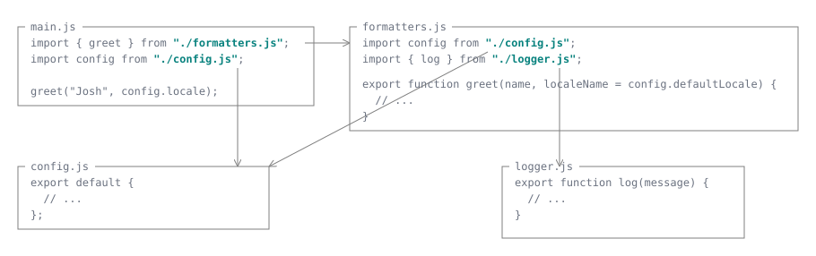

### モジュールのリンク

グラフの読み込みが正常に完了すると、ホストはエンジンにエントリーモジュールのリンクを依頼します。リンクの主な目的は、エクスポートするバインディングを含むさまざまな {{glossary("binding", "バインディング")}}、つまり[モジュール環境](/ja/docs/Glossary/Scope)を設定することです。インポートされた名前は、実際に定義およびエクスポートされている場所に解決されます。その過程で複数層の `export from` 宣言をたどる場合もあります。コードの評価が始まる前に、インポート先でエクスポートされていない名前をインポートしていることを検出できるよう、グラフ内のすべてのモジュールを評価前にリンクする必要があります。また、インポートされた名前が使われるたびにモジュールグラフを何度もたどらずに済むため、その後の評価も容易になります。

リンク段階では、エンジンは深さ優先探索 (DFS) を使ってモジュールグラフをたどります。これは再帰的に行われ、再帰の各段階でエンジンは（エントリーポイントから始めて）モジュールを訪問し、次の処理を行います。

- モジュールがすでにリンク済み、またはリンク中の場合（[循環インポート](#循環インポート)で起こります）、エンジンは再処理しません。それ以外の場合、モジュールをリンク中として記録します。
- エンジンは同じ処理を使って、各モジュールの依存関係を再帰的にリンクします。読み込みとは異なり、リンクは完全に同期的かつ決定的です。依存関係は、ソース内でモジュールリクエストが現れる順に訪問されます。
- すべての依存関係を訪問した後、エンジンはモジュール自身の環境を設定します。モジュールの最上位の宣言ごとにバインディングを作成します。各インポート名について（モジュール名前空間オブジェクトに解決されるインポートを除き）、その名前を実際に宣言しているモジュール内のバインディングに解決し、間接バインディングを作成します。これは、インポート元のモジュール内で、別のモジュールのバインディングを永続的に参照する名前です。`export * as ns from` のエクスポートからの名前付きインポートを含め、モジュール名前空間オブジェクトに解決されるインポートでは、代わりにそのオブジェクトで初期化されたローカルバインディングを作成します。インポート名を解決できない場合、リンクは失敗します。
- このモジュールをリンク済みとして記録します（循環がある場合、すべてのモジュールをまとめてリンク済みとして記録します。この点については後で説明します）。

通常の宣言（{{glossary("hoisting", "巻き上げ")}}を参照）と同様に、エクスポートされるバインディングも作成と初期化が別々の段階で行われます。関数宣言はリンク中に初期化され、`var` 宣言は `undefined` に初期化されます。一方、`export default`、`let`、`const`、`class` の宣言は、評価がその宣言に到達するまで初期化されません。

この例では、次のようになります。

- エンジンは `main.js` から始め、依存先の `formatters.js` をたどり、次に `config.js` に到達します。`main.js` と `formatters.js` を「リンク中」として記録します。

  > [!NOTE]
  > これが「深さ優先」の探索です。エンジンは未処理のリクエストがないモジュールに到達するまで可能な限り深く進み、そこから戻って処理します。

- `config.js` では、エンジンはデフォルトエクスポートのバインディングを作成しますが、オブジェクトリテラルはまだ評価しません。評価は次の段階で行われます。バインディングは未初期化のままです。
- 次に、`formatters.js` の次の依存先である `logger.js` をリンクします。エンジンは `log` バインディングを作成し、関数オブジェクトで初期化します。
- エンジンは `formatters.js` に戻ります。インポートした `config` バインディングは `config.js` のデフォルトエクスポートを参照し、インポートした `log` バインディングは `logger.js` の `log` バインディングを参照します。`greet` 自身のバインディングは関数オブジェクトで初期化されます。
- 最後にエンジンは `main.js` に戻ります。もう一方の依存先である `config.js` はすでにリンク済みなので、再度リンクしません。エンジンは `main.js` の `greet` と `config` のインポートを、それぞれ対応するエクスポート済みバインディングに接続します。

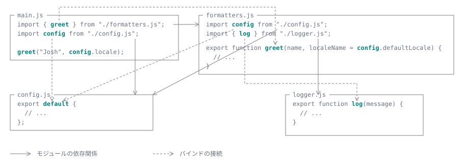

ほとんどの場合、この例のようにインポート名はインポート先のモジュールで直接宣言されているため、バインディングの接続はモジュール依存関係グラフと同じ経路をたどります。ただし、`export from` を使う場合や、インポートした識別子をエクスポートする場合、リンカーは実際に宣言されている場所を見つけるまで、それらの層をたどります。

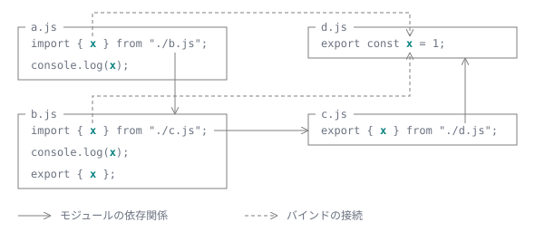

ここでは、インポートの連鎖は `a.js → b.js → c.js → d.js` ですが、この連鎖にあるすべての `x` バインディングは最終的に `d.js` の同じ `const` 宣言に解決されます。一方、`c.js` にはモジュールスコープのバインディングがありません。バインディングの接続は `d.js` に直接つながりますが、モジュール依存関係グラフにはインポートの連鎖全体が含まれます。

`export * from` 宣言は、別のモジュールのすべての名前（`default` を除く）を現在のモジュールの名前付きエクスポートとして再エクスポートします。インポート名を解決するとき、エンジンはまずその名前の明示的なエクスポートがあるか確認します。なければ、`export * from` 宣言をたどり、それらのモジュール内で名前を再帰的に解決します。

複数の `export * from` 宣言によって、現在のモジュールが同じ名前を複数回エクスポートすることがあります（繰り返しますが、`export * from` は明示的な名前付きエクスポートと衝突せず、後者が常に優先されます）。これらの宣言が最終的に同じバインディングに解決される場合、曖昧さはありません。異なるバインディングに解決される場合、たとえそれらのバインディングに同じ値が含まれていても、その名前は曖昧になります。例えば、次のとおりです。

```js
// -- first.js --
export const x = 1;
```

```js
// -- second.js --
export const x = 1;
```

```js
// -- combined.js --
export * from "./first.js";
export * from "./second.js";
// このモジュールの "x" は first.js と second.js のどちらに解決されるか?
```

スターエクスポートだけではエラーになりません。しかし、`import { x } from "./combined.js"` や `export { x } from "./combined.js"` は、リンク中に {{jsxref("SyntaxError")}} を発生させます。`import * as combined from "./combined.js"` のような名前空間インポートは成功しますが、名前空間オブジェクトに `x` プロパティはありません。

`combined.js` に `export { x } from "./first.js"` を追加すると、曖昧さが解消されます。宣言の順序にかかわらず、明示的なエクスポートはスターエクスポートより優先されます。

### モジュールの評価

すべてのモジュール環境が準備できたので、いよいよ評価を行います。ホストはエンジンにエントリーモジュールの評価を依頼します。エンジンは再び深さ優先探索を使ってモジュールグラフをたどります。ここでは、どのモジュールも[最上位の `await`](#最上位の_await_と非同期評価)を使わないものとします。この処理は再帰的に行われ、再帰の各段階でエンジンは（エントリーポイントから始めて）モジュールを訪問し、次の処理を行います。

- モジュールの評価がすでに成功している場合、再度実行しません。以前の評価が失敗している場合、エンジンは代わりに記録済みのエラーを伝播します。モジュールがすでに評価中の場合、循環による無限再帰を避けるため、依存関係を再度訪問しません。それ以外の場合、モジュールを評価中として記録します。
- エンジンは、ソース内でモジュールリクエストが現れる順に、同じ処理で各依存関係を再帰的に評価します。
- すべての依存関係を訪問した後、エンジンはモジュール本体を実行します。変数の初期化子を実行してリンク中に準備したバインディングを初期化し、その他の文をソース内の順序で実行します。インポート名はリンク中に接続されたバインディングにアクセスします。循環がある場合、依存先の本体がまだ実行されておらず、インポートされたバインディングが未初期化のことがあります。これについては[後で](#循環インポート)説明します。
- モジュール本体の実行が正常に完了すると、そのモジュールを評価済みとして記録します。循環がある場合、同じ[強連結成分](#循環インポートでのエラー)に属するモジュールは、本体の実行が完了した時点でまとめて評価済みとして記録されます。

この例では、次のようになります。

- エンジンは `main.js` から始め、依存先の `formatters.js` をたどり、次に `config.js` に到達します。`main.js` と `formatters.js` を「評価中」として記録します。
- `config.js` では、エンジンがオブジェクトリテラルを評価し、その結果のオブジェクトでデフォルトエクスポートのバインディングを初期化します。
- 次に、`formatters.js` の次の依存先である `logger.js` を評価します。`log` 関数はリンク中にすでに作成されており、関数本体は呼び出されるまで実行されないため、ここで評価するものはほかにありません。
- エンジンは `formatters.js` に戻ります。`greet` 関数もリンク中に作成されているため、ここでも評価するものはありません。
- 最後にエンジンは `main.js` に戻ります。もう一方の依存先である `config.js` はすでに評価済みなので、再度実行しません。エンジンは `greet("Josh", config.locale)` を呼び出し、これが `log` を呼び出して、タイムスタンプに続けて `Hello, Josh!` を出力します。

`import` 宣言を相対的な順序を保ったまま `greet()` 呼び出しの下に移動しても、この順序は変わりません。インポート元モジュールの本体が始まる前に依存関係が評価されるため、ほかの文の間のどこに `import` 宣言が現れるかは関係ありません。

評価中に捕捉されないエラーが発生すると、評価中の依存モジュールを通じて伝播し、エントリーモジュールの評価プロミスは拒否されます。すでに実行されたコードの効果は取り消されず、エラーが保持されるため、その後の評価で失敗したモジュールが再実行されることはありません。

最上位の `await` を使うと、モジュールは実行を一時停止し、そのモジュールに依存するモジュールを待たせながら、ほかの分岐の処理を続けられます。これについては[非同期評価](#最上位の_await_と非同期評価)で説明します。

## モジュール処理中のエラー

モジュール処理のどの段階（読み込み、リンク、評価）も失敗する可能性があります。そのエラーによって、グラフの処理が途中の状態で残ることがあります。

### 読み込みで発生するエラー

モジュールリクエストの読み込みエラーは、次のような理由で発生します（この段階はホストが実行するため、多くの理由はホスト固有です）。

- 指定子を解決できなかった（例えば、有効な URL ではない）
- リクエストに無効なインポート属性が含まれている
- リクエストがエラーステータスを返した、またはファイルシステムでエラーが発生した
- ソースコードを構文解析できなかった

モジュールリクエストが失敗すると、このグラフの読み込み処理は直ちに停止し、未処理のモジュールリクエストは処理されません。すでに進行中のリクエストは正常に完了して、後で使用される場合があります。

例えば、上のグラフの `config.js` にインポートを追加したとします。

```js
// -- config.js --
import "./non-existent.js";

export default {
  locale: "en-US",
  defaultLocale: "en-US",
};
```

1. `main.js` は `formatters.js` と `config.js` の両方の読み込みを開始します。
2. `config.js` の読み込みが先に完了します。
3. `formatters.js` の読み込み中に、`non-existent.js` へのリクエストが失敗します（Node.js では解決時に `ERR_MODULE_NOT_FOUND` が発生します）。
4. `formatters.js` のリクエスト自体は完了することがありますが、このグラフの読み込み処理は依存関係をそれ以上たどらないため、この探索では `logger.js` はリクエストされません。

これは、事前読み込みがなく、別のエントリーポイントからこれらのモジュールがリクエストされていない状態で、新たに読み込む場合を想定しています。`formatters.js` の読み込みが先に完了していた場合、`logger.js` もすでに読み込み中かもしれません。この例では、どのモジュールもリンクも評価もされません。

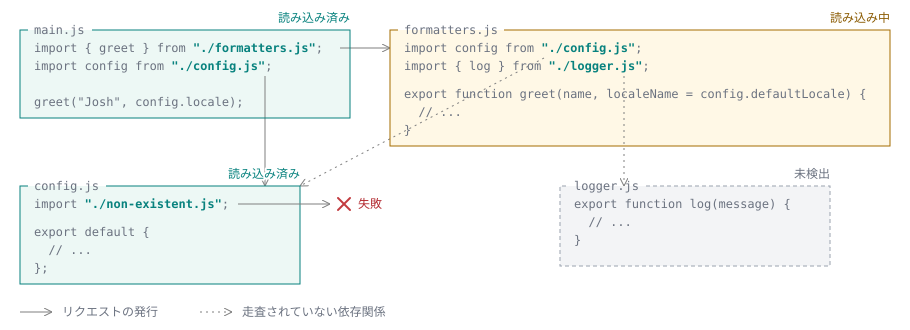

再試行の動作は、ホストと失敗の種類によって異なります。ブラウザー固有の再試行動作については、[ウェブ上のモジュールキャッシュ](/ja/docs/Web/JavaScript/Guide/Modules/Modules_on_the_web#モジュールのキャッシュ)を参照してください。モジュールの読み込みとは異なり、{{domxref("Window/fetch", "fetch()")}} はレスポンスの HTTP ステータスがエラーであるだけでは拒否されません。

リンクは、グラフ内の _すべての_ モジュールの読み込みが完了した場合にのみ行われます。エラーによって一部だけ読み込まれたグラフがリンクされることはありません。

### リンクで発生するエラー

インポートのリンクエラーは、次のような理由で発生します。

- インポート先モジュールでエクスポートされていないバインディングをインポートしている
- 循環的にエクスポートされ、実際には定義されないバインディングをインポートしている（例えば、`a.js` に `export { x } from "./b.js"` と記述し、`b.js` に `export { x } from "./a.js"` と記述している）
- 2 つの `export * from` 宣言のどちらに対応するかが曖昧なバインディングをインポートしている

例えば、読み込みエラーがない元のグラフを使い、`formatters.js` から `logger.js` をインポートする際に `missing` を追加したとします。

```js
// -- formatters.js --
import config from "./config.js";
import { log, missing } from "./logger.js";

// モジュールの残りの部分は変更なし
```

1. 4 つすべてのモジュールの読み込みが完了し、未リンクとして記録されます。
2. `main.js` からリンクが始まり、次に `formatters.js` とその依存関係を訪問します。
3. `config.js` と `logger.js` は正常にリンクされます。
4. `formatters.js` の環境を設定する際、エンジンは `config` と `log` のインポートを作成しますが、`logger.js` はその名前をエクスポートしていないため、`missing` を解決できません。{{jsxref("SyntaxError")}} が発生します。
5. まだリンク中だった `formatters.js` と `main.js` は未リンク状態に戻ります。`config.js` と `logger.js` はリンク済みのままです。モジュール本体は評価されません。

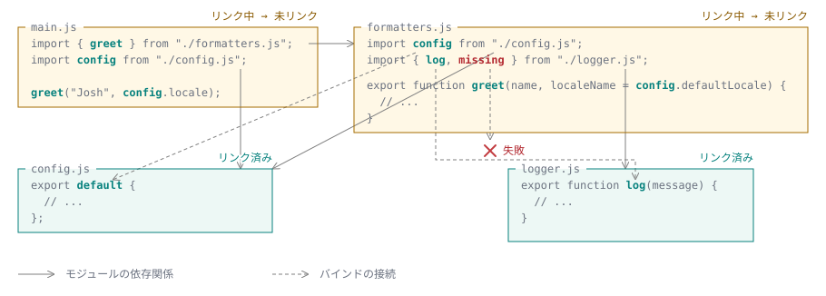

リンクは同期的で、副作用がない点に注意してください。ホストは読み込み後かつ評価前にリンクでき、失敗した場合でも再試行できます（ただし、同じ JavaScript モジュールグラフでは同じリンクエラーが発生します）。リンクエラーが発生した場合、このインポートでは評価が始まりません。共有依存関係が別のエントリーポイントを通じてすでに評価されている場合はあります。

### 評価で発生するエラー

評価エラーは、JavaScript の実行時に発生する通常のエラーです。`throw` 文の使用、無効な関数呼び出し、未初期化変数へのアクセスなどが原因です。モジュールの評価中にエラーが発生すると、モジュールグラフが部分的に評価された状態で残ることもあります。

例えば、読み込みエラーもリンクエラーもない元のグラフから始めて、`config.js` に最上位の `throw` を追加したとします。

```js
// -- config.js --
export default {
  locale: "en-US",
  defaultLocale: "en-US",
};

throw new Error("Configuration unavailable");
```

モジュールの評価が正常に完了する場合も示すため、`main.js` の既存のインポートより前に、もう 1 つ依存関係を追加します。

1. 5 つすべてのモジュールの読み込みとリンクが正常に完了します。
2. `main.js` から評価が始まり、最初の依存先 `extra.js` を訪問します。`extra.js` の評価は正常に完了します。
3. 探索は `formatters.js` を訪問し、次に最初の依存先 `config.js` を訪問します。設定オブジェクトを作成した後、`throw` 文に到達します。
4. エラーは `formatters.js` を通じて `main.js` に伝播します。どちらのモジュール本体も実行を開始しないため、`greet("Josh", config.locale)` は呼び出されません。
5. `config.js`、`formatters.js`、`main.js` はエラーを記録した状態で評価済みとして記録されます。`extra.js` は正常に評価済みのままです。探索は `logger.js` に到達しないため、リンク済みですが未評価のままです。

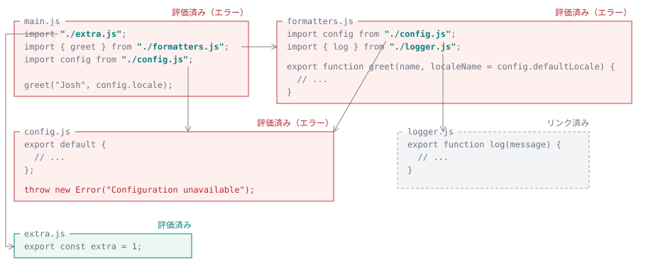

評価済み状態は、評価の試行が終わったことを意味します。モジュール本体が正常に実行されたことや、実行されたこと自体を必ずしも意味しません。モジュールの評価には副作用があるため、エンジンはエラーが発生したかどうか（依存先のエラーを含む）にかかわらず、同じモジュールが一度しか評価されないことを保証します。このモジュールを再利用する後続のインポートは、成功時には同じモジュール名前空間オブジェクトを公開し、失敗時には記録されたエラーを伝播します。名前空間オブジェクトは引き続きライブバインディングを公開します。新しいページやワーカーなどの新しい環境では、ソースを再度読み込んで評価できます。エラーが発生する前に実行されたコードの効果は取り消されません。

## 循環インポート

モジュール依存関係グラフは、リンクと評価の際に深さ優先探索 (DFS) で 2 回たどられます（読み込みでは分岐を非決定的な順序で並行してたどることがあり、循環も通常の共有依存関係と同様に影響しません）。この方法は、上で示した例のような非循環の依存関係グラフではうまく機能します。2 つのモジュールが同じモジュールをインポートする場合も、問題は最小限です。常に、そこから逆向きにたどれる明確な「終点」（`config.js` と `logger.js`）があるためです。同じモジュールを 2 回リンクまたは評価しないように注意するだけで済みます。

しかし、循環は避けられないこともよくあります。モジュール `a` がモジュール `b` をインポートし、`b` が直接または間接的に `a` に依存する場合、循環インポートが発生します。例えば、最も単純な 2 モジュール間の循環を考えてみましょう。

```js
// -- a.js --
import { b } from "./b.js";

export const a = 2;
```

```js
// -- b.js --
import { a } from "./a.js";

export const b = 1;
```

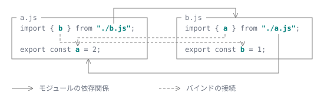

未初期化のインポートへのアクセスによるエラーなど、エラーが一切発生しないと仮定すると、単純な DFS の方法でも実際には問題なく動作します。例としてリンクの手順を見てみましょう。

- エンジンは `a.js` を訪問し、リンク中として記録します。ただし、モジュール環境を設定する前に、まず依存関係を訪問する必要があります。
- エンジンは `b.js` を訪問し、リンク中として記録します。ただし、モジュール環境を設定する前に、まず依存関係を訪問する必要があります。
- エンジンは再び `a.js` を訪問し、すでにリンク中として記録されていることを確認します。これ以上たどる依存関係はありません。
- エンジンは `b.js` をリンクし、`a` を `a.js` の `export const a` に接続します。
- エンジンは同様に `b` を接続して `a.js` をリンクします。
- `a.js` と `b.js` のリンクを待っている上流の依存関係はないため、グラフ全体の処理が完了します。

各インポートを具体的な定義までたどれる限り、リンク先がすでにリンク済みのモジュールである必要はありません。ただし、循環的な再エクスポート（例えば、`a.js` に `export { x } from "./b.js"` と記述し、`b.js` に `export { x } from "./a.js"` と記述する場合）は除きます。

同様に、評価では `a.js` の依存先である `b.js` が先に評価されます。`b.js` も `a.js` に依存していますが、`a.js` はすでに評価中として記録されているため、エンジンは `a.js` に戻りません。その後、`b.js` モジュールは `const b` の初期化を評価します。最後に `a.js` モジュールが評価され、`a = 2` を初期化します。

この例が示すように、循環インポートが常に失敗するわけではありません。インポートした変数の値は、実際に変数を使用したときにのみ取得されます（これにより[ライブバインディング](/ja/docs/Web/JavaScript/Reference/Statements/import#インポートした値はエクスポートしたモジュールだけが変更できる)が可能になります）。その時点で変数が未初期化の場合にのみ、[`ReferenceError`](/ja/docs/Web/JavaScript/Reference/Errors/Cant_access_lexical_declaration_before_init) が発生します。例えば、`a` と `b` の値を使う場合でも、使用前に初期化されるようにすればエラーを防げます。

```js
// -- a.js --
import { b } from "./b.js";

setTimeout(() => {
  console.log(b); // 1
}, 10);

export const a = 2;
```

```js
// -- b.js --
import { a } from "./a.js";

setTimeout(() => {
  console.log(a); // 2
}, 10);

export const b = 1;
```

この例では、`a` と `b` の両方を非同期に使用しています。そのため、モジュールの評価時には `b` も `a` も実際には読み取られず、残りのコードが通常どおり実行され、2 つの `export` 宣言によって `a` と `b` の値が生成されます。その後、タイムアウト後には `a` と `b` の両方が利用可能になるため、2 つの `console.log` 文も通常どおり実行されます。

コードを変更して `a` を同期的に使用すると、モジュールの評価は失敗します。

```js
// -- a.js (エントリーモジュール) --
import { b } from "./b.js";

export const a = 2;
```

```js
// -- b.js --
import { a } from "./a.js";

console.log(a); // ReferenceError: Cannot access 'a' before initialization
export const b = 1;
```

これは、JavaScript が `a.js` を評価するとき、依存先である `b.js` を先に評価する必要があるためです。しかし、`b.js` はまだ利用できない `a` を使用しています。

一方、コードを変更して `b` を同期的に、`a` を非同期に使用すると、モジュールの評価は成功します。

```js
// -- a.js (エントリーモジュール) --
import { b } from "./b.js";

console.log(b); // 1
export const a = 2;
```

```js
// -- b.js --
import { a } from "./a.js";

setTimeout(() => {
  console.log(a); // 2
}, 10);
export const b = 1;
```

これは、`b.js` の評価が正常に完了するため、`a.js` の評価時に `b` の値を利用できるからです。

関数宣言は、どのモジュール本体も実行される前の[リンク中](#モジュールのリンク)に初期化されるため、循環に対してはるかに堅牢です。{{glossary("hoisting")}} によって宣言順序にかかわらず 2 つの関数が互いを呼び出せるのと同じように、リンク時の初期化によってモジュール境界を越えて同じことができます。

```js
// -- a.js (エントリーモジュール) --
import { isEven } from "./b.js";

export function isOdd(n) {
  return n !== 0 && isEven(n - 1);
}
```

```js
// -- b.js --
import { isOdd } from "./a.js";

console.log(isEven(5)); // false

export function isEven(n) {
  return n === 0 || isOdd(n - 1);
}
```

非同期の待ち合わせがなくても、`a.js` の `isOdd` バインディングは、`a.js` の本体が実行される前のリンク中に、すでに関数オブジェクトで初期化されています。これらのモジュールがエクスポートするのは関数宣言だけで、関数はモジュール評価中に初期化される状態を読み取らないため、安全に互いを呼び出せます。未初期化の `let`、`const`、`class` バインディングを読み取ると、そのバインディングがエクスポートされた関数のモジュール内だけで使われる場合でも、エラーが発生します。

### 循環インポートでのエラー

リンクエラーや評価エラーが発生すると、問題はより複雑になります。上の 2 モジュール間の循環で、`export const a = 2;` の後に `throw new Error("Evaluation failed");` を追加したとします。単純な探索では、`a.js` を実行する前に `b.js` を評価成功として記録し、その後 `a.js` でエラーが発生します。

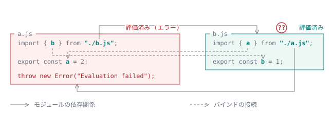

この例では、`a.js` のリンクまたは評価が失敗した場合、`b.js` 自身のリンクと評価が完了していても、`b.js` を成功として記録するべきではありません。`b.js` の依存先である `a.js` の成功に、`b.js` の成功が左右されるためです。そのため、循環内のすべてのモジュールをまとめて成功または失敗として記録する必要があります。

このようなまとまりを正確には強連結成分 (SCC) と呼びます。SCC とは、各モジュールからほかのすべてのモジュールに到達できる、極大なモジュールの集合です。SCC は、単一の循環、または頂点を共有する複数の循環の和集合で構成されることがあります。いずれも、その集合が極大である必要があります。

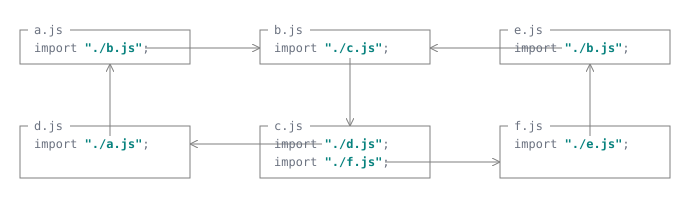

グラフ理論では、任意の有向グラフを SCC の非循環グラフとして表せることが分かっています（SCC をノードとして見ると「縮約グラフ」が得られます）。したがって、単一ノードを処理するのと同じ方法で SCC を処理し、すべてをまとめて成功または失敗として記録すれば、扱いやすい非循環グラフになります。

その結果、上の例では `b.js` の評価が終わっても、すぐには評価済みとして記録されません。`a.js` が完了するまで待ちます。

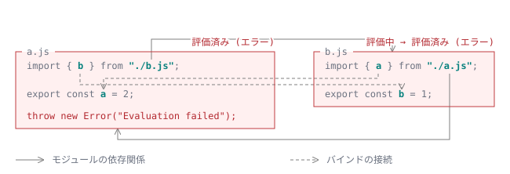

### 循環インポートの回避

循環インポートはコードでエラーが発生しやすくなるため、通常は避けるべきです。循環をなくす一般的な方法は次のとおりです。

- 2 つのモジュールを 1 つにまとめる。
- 共有コードを 3 つ目のモジュールに移す。
- 一方のモジュールのコードを、もう一方に移す。

ただし、ライブラリー同士が相互に依存している場合にも循環インポートが発生することがあり、その解決はより困難です。

## 最上位の await と非同期評価

モジュールでは、関数の外側の最上位で [`await`](/ja/docs/Web/JavaScript/Reference/Operators/await#最上位の_await) を使用できます。これにより、依存するモジュールが実行される前に、モジュールの非同期初期化を完了できます。これまでの[評価](#モジュールの評価)は同期的でしたが、ここでは非同期にする必要があります。これにより、副作用の順序やエラーに関して多くの影響が生じます。

例えば、`config.js` を変更してサーバーから設定を取得するとします。サーバーは元の例と同じオブジェクトを返します。

```js
// -- config.js --
const response = await fetch("https://example.com/config.json");
if (!response.ok) {
  throw new Error(`Failed to fetch configuration: ${response.status}`);
}
export default await response.json();
```

ほかのモジュールを変更する必要はありません。モジュールシステムは、`config.js` が完了するのを自動的に待ってから、それらの本体と `main.js` などの依存モジュールを実行します。

これまでは、モジュールの状態は評価済み、未評価、または SCC 内でほかのモジュールの評価を待機中のいずれかでした。現在は、モジュールが「処理中」という状態になることもあります。この状態は、非同期実行中のモジュールと、非同期依存関係を待っているモジュールの両方に当てはまります。そのため、モジュール内に `await` 式がなくても、この状態になることがあります。

エンジンは引き続き、ソース内でモジュールリクエストが現れる順に、深さ優先で依存関係をたどります。ただし、別の分岐を訪問する前に、ある分岐の実行を完了する必要はなくなりました。非循環グラフでの処理は次のとおりです。

- エンジンはこれまでと同様に、モジュールの依存関係を訪問します。依存先がまだ処理中の場合、エンジンはこのモジュールがその依存先を待つ必要があると記録しますが、ほかの依存関係の訪問を続けます。
- すべての依存関係を訪問し、処理中のものがなくなると、エンジンはモジュール本体を開始します。最上位に `await` があるモジュールは、`await` に到達するまで実行し、その後、待機している値が確定するまで一時停止します。さらに `await` 式がある場合も含め、本体全体の実行が完了するまで処理中のままです。
- 依存関係がまだ処理中のモジュールも処理中となり、最初の `await` より前のコードも含め、本体を実行せずに待ちます。最上位に `await` がないモジュールにも当てはまります。
- モジュールの処理が正常に完了すると、エンジンは待機中のどのインポート元が実行できるかを確認します。インポート元は、待機していたすべての依存関係が正常に完了した後にのみ開始します。複数のモジュールが同時に実行可能になった場合、エンジンは深さ優先探索で決まった評価順序を使い、どれを先に開始するかを決めます。

> [!NOTE]
> 複数の非同期モジュールが同時に実行されている場合（例えば `logger.js` にも最上位の `await` がある場合）、動作は 2 つの非同期関数を並行して実行する場合と同じです。それぞれの `await` は現在のジョブを一時中断し、もう一方のモジュールが再開できるようにします。[`await` の制御フローへの影響](/ja/docs/Web/JavaScript/Reference/Operators/await#await_の制御フローの影響)を参照してください。

この例では、エンジンは `main.js` と `formatters.js` を通じて `config.js` に到達します。フェッチを開始し、最初の `await` で `config.js` を一時停止します。次に、設定に依存しない `logger.js` を訪問して評価します。`formatters.js` は `config.js` を待つ必要があり、`main.js` は `formatters.js` と `config.js` の両方を待つ必要があります。レスポンス本体の構文解析が終わり、`config.js` の処理が完了すると `formatters.js` が実行され、その後 `greet()` を呼び出す `main.js` が実行されます。

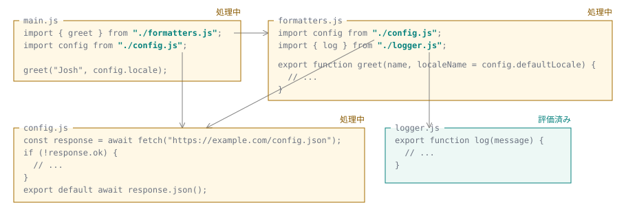

### 最上位の await による非同期性の伝播

したがって、最上位の `await` はそれを含むモジュールだけでなく、そのモジュールを間接的にインポートするすべてのモジュールの評価も非同期にします。次のモジュールグラフでは、最上位の `await` を含むのは `Config` と `Database` だけですが、`Auth`、`Reports`、`Documents`、`Router`、`Dashboard`、`Editor`、`App` はすべて、それらの非同期処理の完了に依存します。ほかの分岐は引き続き同期的に評価できます。

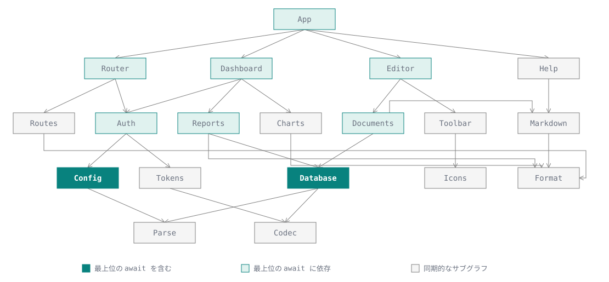

これは、API が評価を同期的に完了する必要がある場合に重要です。Node.js では、依存関係グラフ全体が同期的な場合に限り、[`require()` で ES モジュールを読み込めます](https://nodejs.org/api/modules.html#loading-ecmascript-modules-using-require)<sup>(英語)</sup>。最上位の `await` を含むモジュールは、その上流にあるすべてのモジュール（つまり、そのモジュールをインポートするすべてのモジュール）に「非同期性を伝播」させるため、それらを `require()` で同期的にインポートできません。上のグラフでは、`require()` で `Help` を読み込めますが、`Router` 自体に `await` がない場合でも `Router` は読み込めません。

[`import defer`](/ja/docs/Web/JavaScript/Reference/Statements/import/defer#top-level_await) 宣言（[インポート段階の制御](#インポート段階の制御)を参照）もその一例です。遅延評価は名前空間オブジェクトのプロパティにアクセスすると開始されますが、その処理は同期的に完了できなければならないため、非同期サブグラフの評価を完全には遅延できません。ただし、この場合は `require()` のように遅延をあきらめたり、エラーを発生させたりするのではありません。代わりに、グラフの同期性を妨げる部分、つまり最上位の await を使うモジュールとその依存関係だけを先行して評価します。例えば、別のモジュールが上のグラフの `App` を `import defer` でインポートする場合、そのインポート元の本体が実行される前に、`Config` と `Database`、および依存先の `Parse` と `Codec` が評価されます。`App` と残りの依存関係の本体は遅延されたままにできます。つまり、これらの非同期モジュールに対するグラフの依存関係は、同期的に利用できる結果に置き換えられます。これにより非同期性の伝播が取り除かれ、後で遅延評価を同期的に進められます。

既存のモジュールに最上位の `await` を追加すると、エクスポートが変わらなくても、インポート元にとって互換性を損なう変更になる場合があります。独立したモジュールの実行は続く一方で、インポート元の本体全体が遅延し、`import` 宣言より前に書かれた文も遅延します。これにより、兄弟モジュールの実行順序が変わる場合があります。

例えば、次のモジュールは、グローバル変数を読み取る前に初期化するため、兄弟モジュールのインポート順序に依存しています。

```js
// -- entry.js --
import "./setup.js";
import "./display.js";
```

```js
// -- setup.js --
import { locale } from "./settings.js";

globalThis.appLocale = locale;
```

```js
// -- settings.js --
export const locale = "en-US";
```

```js
// -- display.js --
console.log(globalThis.appLocale); // "en-US"
```

ここで、`settings.js` に最上位の `await` を追加したとします。

```js
// -- settings.js --
export const locale = await Promise.resolve("en-US");
```

`setup.js` は `globalThis.appLocale` への代入を実行する前に、`settings.js` を待つようになります。その間に `display.js` が実行され、`appLocale` がまだ定義されていない場合は `undefined` を出力します。`entry.js` のインポート順序によって `display.js` が `setup.js` の完了を待つことはありません。

必要な順序を保つには、`display.js` が `setup.js` に明示的に依存するようにします。アプリケーションごとにモジュールが一度しか評価されないため、これは安全です。

```js
// -- display.js --
import "./setup.js";

console.log(globalThis.appLocale); // "en-US"
```

同じ問題は、`setup.js` と `display.js` が、この順序で別々の `<script type="module">` 要素のエントリーポイントである場合にも発生します。この場合も、明示的なインポートによって `display.js` が `setup.js` の完了を待つようになります。

### 最上位の await を含む循環の処理

循環では、静的な依存関係グラフと、評価時に実際に待つ依存関係を区別する必要があります。`a.js` をエントリーポイントとし、5 つすべてのモジュールに最上位の `await` がある、[仕様書にある非同期の例](https://tc39.es/ecma262/multipage/ecmascript-language-scripts-and-modules.html#sec-example-cyclic-module-record-graphs)<sup>(英語)</sup>を考えてみましょう。

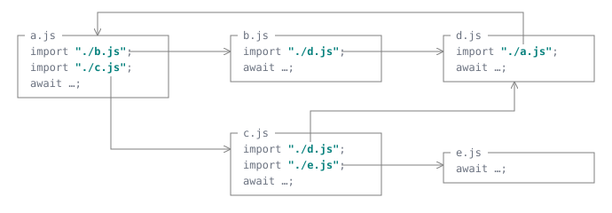

`a.js`、`b.js`、`c.js`、`d.js` は 1 つの SCC を形成します。エンジンはまず `a.js`、`b.js`、`d.js` を訪問します。`d.js` から `a.js` へのインポートに遭遇すると、先ほどと同じように循環から抜けます。この時点では `a.js` は非同期の完了を待つ状態としてまだ記録されていないため、この辺によって `d.js` が `a.js` を待つことはありません。`d.js` が実行を開始します。次にエンジンは `c.js` を経由するもう一方の分岐を訪問し、`d.js` が処理中であることを確認して、`e.js` を開始します。

非同期処理が次の順序で完了するとします。

- `e.js` が完了します。`c.js` は引き続き `d.js` を待っているため、ほかのモジュールはまだ開始しません。
- `d.js` が完了します。`b.js` と `c.js` の両方が実行可能になります。探索の評価順序に従い、まず `b.js` が開始しますが、`await` で一時停止すると `c.js` も開始できます。
- `c.js` が完了します。`a.js` は引き続き `b.js` を待ちます。
- `b.js` が完了します。これで `a.js` は本体の実行を開始できます。
- `a.js` が完了します。エントリーポイントの評価プロミスが履行されます。

先ほど説明した同期的な循環とは異なり、非同期 SCC 内のモジュールがまとめて「評価済み」に遷移するとは限りません。それぞれ異なる時点で完了することがあります。成分全体の結果を維持するために、エンジンはそのモジュール群に _循環ルート_ を関連付けます。この例では、SCC で最初に訪問される `a.js` が循環ルートです。最初の探索後にこの成分に遭遇したインポートは、このルートを使って成分の完了を待ち、評価エラーがないか確認します。モジュール本体の実行が正常に完了しただけでは、成分全体のインポートが成功するとは限りません。

例えば、`b.js` がまだ `await` で待機中に `c.js` が失敗したとします。エラーは `a.js` に伝播し、その本体は開始されず、エントリーポイントの評価プロミスは拒否されます。`b.js` の実行は続きます。それでも、後から `b.js` を動的インポートすると、循環ルート `a.js` に記録されたエラーで拒否されます。`b.js` の実行が成功しても、成分の失敗が消えることはありません。

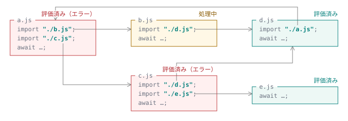

### デッドロック

最上位の await を含むモジュールでは、デッドロックが発生することがあります。

```js
// -- a.js --
import { resolve } from "./b.js";

resolve();
```

```js
// -- b.js --
const { promise, resolve } = Promise.withResolvers();
export { resolve };
await promise;
```

評価が `a.js` から始まる場合、本体を実行する前に `b.js` の完了を待ちます。しかし、`b.js` は `a.js` の `resolve()` 呼び出しでしか履行できないプロミスを待ちます。どちらの評価も完了できません。モジュールアルゴリズムは、このデッドロックを解消するためにプロミスを自動的に拒否することはありません。

上の例は不自然に見えるかもしれません。より現実的なのは、現在のモジュールに依存するモジュールの動的インポートを待つ場合です。

```js
// -- a.js --
await import("./b.js");
```

```js
// -- b.js --
import "./a.js";
```

同様にこの場合も、`b.js` は `a.js` の動的インポートが完了するのを待ちますが、動的インポートは `b.js` の実行が完了して初めて完了できます。

## 動的インポート

これまでに紹介した例はすべて静的な `import` を使い、アプリケーション全体のエントリーポイント（`node` コマンドライン、HTML ファイルなど）を起点としていました。そのため、ユーザーコードが実行される前に読み込みとリンクが行われます。一方、[動的インポート](/ja/docs/Web/JavaScript/Reference/Operators/import)である `import()` は、ユーザーコードの実行が式に到達した時点で、リクエストされたモジュールをエントリーポイントとしてインポートを開始します。これにより、最初のグラフの実行がすでに始まった後（または最上位の `await` がある場合、最初のグラフの評価中）に、モジュールグラフを動的に _拡張_ できます。

例えば、元の `main.js` を変更して Node.js の [`process.stdin`](https://nodejs.org/api/process.html#processstdin)<sup>(英語)</sup> からのデータを待ち受け、ユーザーが `Hi` と入力して Enter キーを押したときにのみ `formatters.js` をインポートできます。

```js
// -- main.js --
import config from "./config.js";

process.stdin.on("data", async (data) => {
  if (data.toString().trim() !== "Hi") return;
  const { greet } = await import("./formatters.js");
  greet("Josh", config.locale);
});
```

最初に `main.js` を読み込むと、`config.js` が検出されます。リスナーの登録によって、`formatters.js` を読み込まずに `main.js` の評価が完了します。リスナーが `Hi` を受信すると、`formatters.js` を起点とする別の読み込み処理が始まり、`config.js` と `logger.js` のインポートが検出されます。この場合、`config.js` はすでに利用可能なため再利用されます。一方、ほかからリクエストされていなければ、`logger.js` も読み込む必要があります。このように、新しい分岐は既存のグラフにある `config.js` で合流し、同じモジュールを再利用します。

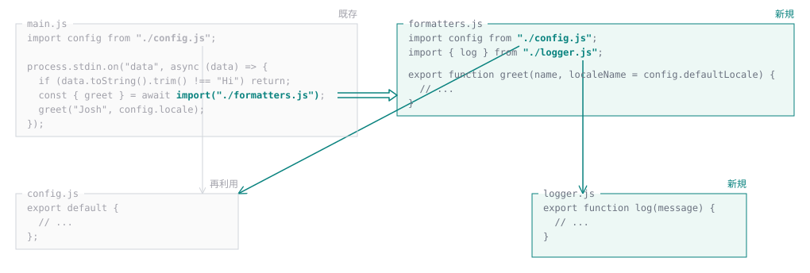

モジュールグラフを拡張すると、どの状態にある既存モジュールにも遭遇する可能性がありますが、その状態は維持されます。読み込み中のモジュールは読み込みが続き、読み込み済みのモジュールは再取得されず、リンク済みのモジュールは再リンクされず、評価済みのモジュールは（以前の評価でエラーが発生した場合も含めて）再評価されません。上の例では、`config.js` はすでに評価済みなので、実行が必要なのは `logger.js` と `formatters.js` だけです。動的にインポートするモジュール自体がすでにモジュールグラフに含まれている場合もあり、その場合は再利用されます。

動的インポートは非同期です。新しいモジュールを取得する必要がある場合や、評価時に最上位の `await` を待つ必要がある場合があるためです。リクエストされたモジュールの評価が正常に完了すると、`import()` のプロミスが履行されます。

新しい探索が `import()` を呼び出したモジュール（例えば `main.js`）に到達する場合もあります。動的インポートは依存関係の辺を形成せず（エントリーポイントにすぎないため）、循環は発生しません。ただし、呼び出し元がそのインポートを待つために最上位の `await` を使うと、[デッドロックの例](#デッドロック)で示すように、どちらも完了できません。

## モジュールのキャッシュ

_モジュールのキャッシュ_ とは、モジュールの同一性と状態を再利用することです。同じインポート元から同じ指定子とインポート属性でリクエストが繰り返され、成功した場合は、同じモジュールを参照する必要があります。異なるリクエストが同じモジュールを参照することもあります。例えば、2 つのモジュールが同じ依存先をインポートする場合です。リクエストをモジュールの同一性に対応付ける方法はホストが決定します。ブラウザー固有の規則については、[ウェブ上のモジュールキャッシュ](/ja/docs/Web/JavaScript/Guide/Modules/Modules_on_the_web#モジュールのキャッシュ)を参照してください。

つまり、インポート元は、評価後の変更も含めて、モジュールのバインディングを共有します。例えば、次の `counter.js` モジュールはカウントを保持します。

```js
export let count = 0;

export function increment() {
  count++;
}
```

別のモジュールは、静的インポートと動的インポートの両方を通じて同じカウンターにアクセスできます。名前空間オブジェクトも共有されます。

```js
import * as counter from "./counter.js";

counter.increment();

const sameCounter = await import("./counter.js");
console.log(sameCounter === counter); // true
console.log(sameCounter.count); // 1

sameCounter.increment();
console.log(counter.count); // 2
```

JavaScript にはモジュールキャッシュをクリアする標準 API がありません。呼び出し元ごとに独立した状態が必要な場合、モジュールはその状態を作成する関数をエクスポートできます。

```js
export function createCounter() {
  let count = 0;
  return {
    increment() {
      return ++count;
    },
  };
}
```

または、URL の指定子に任意のクエリーまたはフラグメントを追加できます（[`import()`](/ja/docs/Web/JavaScript/Reference/Operators/import#モジュール名前空間オブジェクト)を参照）。

## インポート段階の制御

通常の `import` 宣言は、[読み込み、リンク、評価の処理](#モジュールソースから実行まで)全体を開始します。_インポート段階修飾子_ を使うと、インポート元は特定の段階で処理を一時停止できます。後の段階は、実際に必要になったときに実行中のどこかの時点で開始できます。

[`import source`](/ja/docs/Web/JavaScript/Reference/Statements/import/source) を使うと、_読み込み_ の途中で処理が停止します。リクエストされたモジュール自体は取得され構文解析されますが、その依存関係はリクエストされません。インポートされる値は [_モジュールソースオブジェクト_](/ja/docs/Web/JavaScript/Reference/Global_Objects/AbstractModuleSource)で、別の方法でリンクおよび評価できます。次の例では JavaScript のソースインポートを使います。

> [!NOTE]
> JavaScript のソースインポートと、モジュールソースオブジェクトを `import()` に渡す機能は、[ECMAScript Module Phase Imports 提案](https://github.com/tc39/proposal-esm-phase-imports)<sup>(英語)</sup>で定義されている、まだ提案段階の機能です。

```js
// -- main.js --
import source formattersSource from "./formatters.js";
import config from "./config.js";

process.stdin.on("data", async (data) => {
  if (data.toString().trim() !== "Hi") return;
  const { greet } = await import(formattersSource);
  greet("Josh", config.locale);
});
```

`main.js` の評価後、`formatters.js` は構文解析されていますが、ソースインポートを通じてその依存関係がたどられることはありません。`logger.js` はリクエストされていません。`config.js` は `main.js` が通常の方法でインポートするため、評価済みです。

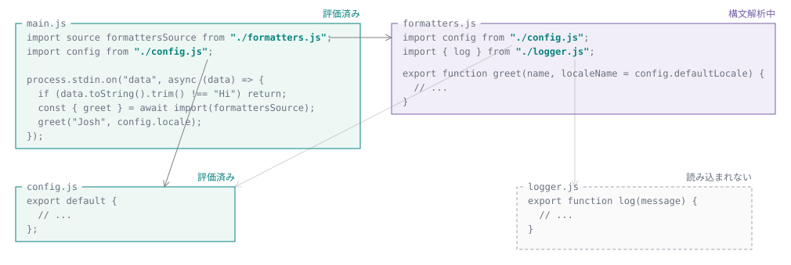

リスナーが `Hi` を受信すると、モジュールソースオブジェクトを `import()` に渡します。これによって `formatters.js` の依存関係の読み込みが始まり、`config.js` を再利用し、`logger.js` を読み込みます。その後、残りのモジュールをリンクして評価します。評価が成功すると、プロミスは名前空間オブジェクトで履行されます。`Hi` が繰り返し入力されても同じモジュールインスタンスが再利用され、再評価は行われません。

[`import defer`](/ja/docs/Web/JavaScript/Reference/Statements/import/defer) を使うと、_評価_ の前に処理が停止します（ただし、非同期評価がある場合は引き続き先行して行われます）。インポートされる値は [_遅延モジュール名前空間オブジェクト_](/ja/docs/Web/JavaScript/Reference/Statements/import/defer#deferred_module_namespace_object)です。例えば、次のとおりです。

```js
// -- main.js --
import defer * as formatters from "./formatters.js";
import config from "./config.js";

process.stdin.on("data", (data) => {
  if (data.toString().trim() !== "Hi") return;
  formatters.greet("Josh", config.locale);
});
```

元の同期的なモジュールを使い、ほかにインポートがないとすると、`main.js` の評価が完了しても、`formatters.js` と `logger.js` はリンク済みですが未評価のままです。`config.js` は `main.js` が通常の方法でもインポートするため評価されます。

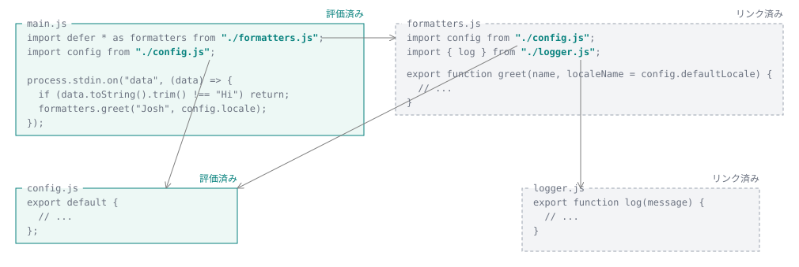

リスナーが `Hi` を受信すると、`formatters.greet` の読み取りによって、まず `logger.js`、次に `formatters.js` の同期評価が開始されます。すでに評価済みの `config.js` は再利用されます。評価中にエラーが発生すると、プロパティへのアクセス時にエラーが発生します。一方、読み込みエラーとリンクエラーは、`main.js` の実行前にすでに確認されています。

遅延インポートを入れ子にして、それぞれの `defer` に一時停止の境界を作ることもできます。次の例では、`a.js` が `b.js` を遅延し、`b.js` が `c.js` を遅延し、さらに `c.js` が `d.js` を遅延します。ほかのインポートは通常のインポートです。すべてのモジュールは同期的です。それぞれのタイマーが遅延名前空間のプロパティを読み取り、評価の次の段階を開始します。各タイマーはスケジューリングされてから 1 秒後に実行されるため、各段階は起動からおよそ 1、2、3 秒後に進みます。

起動時には 7 つすべてのモジュールが読み込まれてリンクされますが、評価されるのは `a.js` だけです。`b` のプロパティにアクセスせず、タイマーをスケジューリングします。

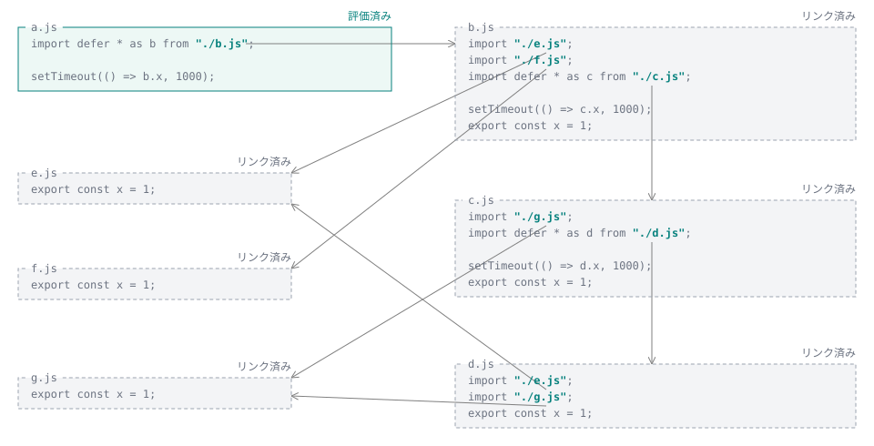

最初のタイマーが実行されると、`b.x` の読み取りによって `e.js`、`f.js`、次に `b.js` が評価されます。`b.js` の評価中に別のタイマーをスケジューリングします。`c.js` の遅延インポートでは評価が始まらないため、`c.js`、`d.js`、`g.js` はリンク済みのままです。

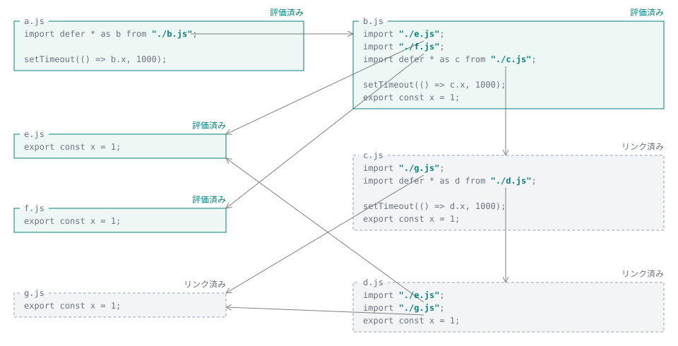

2 つ目のタイマーが実行されると、`c.x` の読み取りによって `g.js`、次に `c.js` が評価されます。`c.js` の評価中に 3 つ目のタイマーをスケジューリングします。この時点では、まだ `d` のプロパティにアクセスしません。

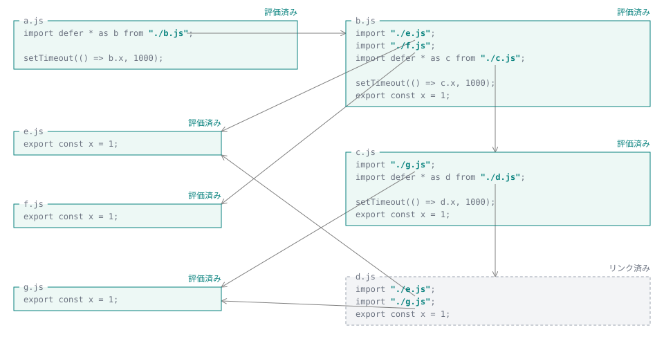

3 つ目のタイマーが実行されると、`d.x` の読み取りによって `d.js` が評価され、すでに評価済みの `e.js` と `g.js` が再利用されます。これですべてのモジュールが評価されます。

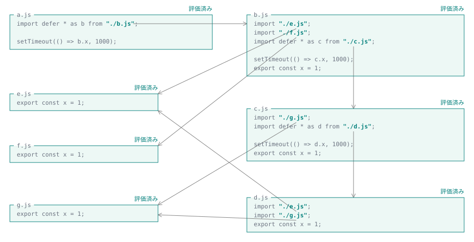

先ほどの[最上位の await による非同期性の伝播](#最上位の_await_による非同期性の伝播)で説明したように、最上位の `await` を含むモジュールとその依存関係は、初期リンクの直後に先行して評価する必要があります。残りの同期的な評価だけを遅延できます。

どちらの種類のフェーズ修飾子も、_対象モジュール_ ではなく _インポート_ に作用する点に注意してください。つまり、別の通常のインポートによって同じモジュールがより早く評価されることがあり、同じモジュールの遅延インポートと先行評価インポートに対して別々のキャッシュ項目は作成されません。詳しくは、[`import defer`](/ja/docs/Web/JavaScript/Reference/Statements/import/defer#caching_semantics) と [`import source`](/ja/docs/Web/JavaScript/Reference/Statements/import/source#caching_semantics) のキャッシュ動作を参照してください。

`import` に対する `import()` と同じように、`import source` 宣言と `import defer` 宣言にも動的な [`import.source()`](/ja/docs/Web/JavaScript/Reference/Operators/import/source) および [`import.defer()`](/ja/docs/Web/JavaScript/Reference/Operators/import/defer) 形式があり、式の評価時にリクエストを開始します。

## 関連情報

- [JavaScript モジュール](/ja/docs/Web/JavaScript/Guide/Modules)
- [ウェブでのモジュールの使用](/ja/docs/Web/JavaScript/Guide/Modules/Modules_on_the_web)
- [プラットフォームをまたぐモジュール](/ja/docs/Web/JavaScript/Guide/Modules/Modules_across_platforms)
