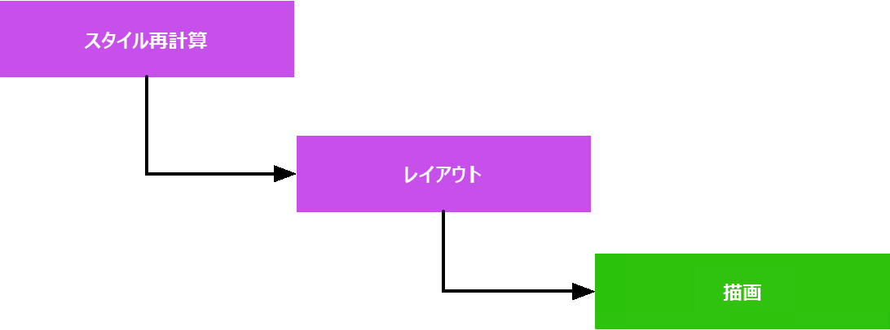

ウェブ上では、{{domxref('SVGAnimationElement', 'SVG')}}、{{domxref('window.requestAnimationFrame','JavaScript')}}（{{htmlelement('canvas')}} や {{domxref('WebGL_API','WebGL')}} を含む）、CSS の {{cssxref('animation')}}、{{htmlelement('video')}}、アニメーション GIF、アニメーション PNG などを使ってアニメーションを実現できます。CSS プロパティのアニメーションによるパフォーマンスコストはプロパティによって異なり、コストの高い CSS プロパティをアニメーションさせると、ブラウザーが滑らかな{{glossary("FPS", "フレームレート")}}を維持するのに苦労し、{{glossary('jank', "ジャンク")}}が発生することがあります。

動画やアニメーション GIF などのアニメーションメディアでは、パフォーマンス上の主な懸念はファイルサイズです。パフォーマンスに悪影響を与えない速さでファイルをダウンロードすることが最大の課題です。CSS、SVG、\<canvas>、WebGL、その他の JavaScript アニメーションなど、コードで実装されたアニメーションは、帯域幅の使用量が小さくてもパフォーマンスの問題を引き起こすことがあります。これらのアニメーションは CPU を消費したり、ジャンクを発生させたりすることがあります。

ユーザーは、すべてのインターフェイスをスムーズに操作でき、すべてのユーザーインターフェイスが応答することを期待しています。アニメーションは、サイトをより速く、応答性が高いように感じさせるのに役立ちますが、正しく行わないと、サイトをより遅く、ぎこちなく感じさせることもあります。応答性の高いユーザーインターフェイスのフレームレートは 1 秒あたり 60 フレーム (fps) です。常に 60fps を維持することは不可能ですが、すべてのアニメーションで高く安定したフレームレートを維持することが重要です。

[CSS アニメーション](/ja/docs/Web/CSS/Guides/Animations/Using)では、複数の[キーフレーム](/ja/docs/Web/CSS/Reference/At-rules/@keyframes)を指定します。それぞれのキーフレームでは、アニメーションの特定の段階における要素の見た目を CSS で定義します。ブラウザーは、各キーフレームから次のキーフレームへの遷移としてアニメーションを作成します。

JavaScript を使用して要素をアニメーション化する場合と比べ、CSS アニメーションは簡単に作成できます。また、フレームを描画するタイミングや、必要に応じてフレームを省略するかどうかをブラウザーが制御できるため、パフォーマンスも向上することがあります。

ただし、CSS プロパティの変更に伴うパフォーマンスコストは、プロパティによって異なります。アニメーションが滑らかに見えるフレームレートは、一般に 1 秒あたり 60 フレームとされています。60fps の場合、ブラウザーはスクリプトの実行、必要に応じたスタイルとレイアウトの再計算、更新領域の再描画を 16.7 ミリ秒以内に行う必要があります。遅いスクリプトやコストの高い CSS プロパティのアニメーションは、ブラウザーが滑らかなフレームレートを維持するのに苦労し、[ジャンク](/ja/docs/Glossary/Jank)が発生することがあります。

## レンダリングウォーターフォール

要素が CSS プロパティをアニメーションしているときに、ブラウザーがページに変更を加えるために使用するプロセスは、以下の手順からなるウォーターフォールと記述することができます。

1. **スタイル再計算**: 要素のプロパティが変更された場合、ブラウザーは計算されたスタイルを再計算する必要があります。
2. **レイアウト**: 次に、ブラウザーは計算されたスタイル設定を用いて、要素の位置と形状を決定します。この処理は「レイアウト」と呼ばれていますが、「再フロー」とも呼ばれることがあります。
3. **描画**: 最後に、ブラウザーは要素を画面に再描画する必要があります。ページをレイヤーに分割し、それぞれを個別に描画した後、「コンポジション」と呼ばれる処理で結合することもあります（この手順では示していません）。

この一連の動作は、完了するまで画面が更新されないので、単一のフレームに収まる必要があります。

## CSS プロパティのコスト

レンダリングウォーターフォールの文脈では、一部プロパティは他のプロパティよりもコストが高くなります。

- 要素の**形状**または**位置**に影響するプロパティは、次のものを起動します。
  - スタイルの再計算
  - レイアウト
  - 再描画

  例: {{cssxref("left")}}, {{cssxref("max-width")}}, {{cssxref("border-width")}}, {{cssxref("margin-left")}}, {{cssxref("font-size")}}

- 形状や位置に影響せず、独自のレイヤーで描画されないプロパティは、レイアウトを起動せず、次の処理を起動します。
  - スタイルの再計算
  - 再描画

  例: {{cssxref("color")}}

- **独自のレイヤー**で描画されるプロパティは、更新が**合成**で処理されるため、再描画さえ発生しません。次の処理を起動します。
  - スタイルの再計算

  例: {{cssxref("transform")}}, {{cssxref("opacity")}}

## 開発者ツール

ほとんどのウェブブラウザーには、ページ上の要素をアニメーションさせる際にブラウザーがどのような処理を行うかを把握するためのツールがあります。これらのツールを使って、アプリケーションのアニメーションのフレームレートを測定し、パフォーマンスのボトルネックが見つかった場合は診断できます。

- [Chrome パフォーマンスツール](https://developer.chrome.com/docs/devtools/#performance)
- [Firefox パフォーマンスツール](https://firefox-source-docs.mozilla.org/devtools-user/performance/)
