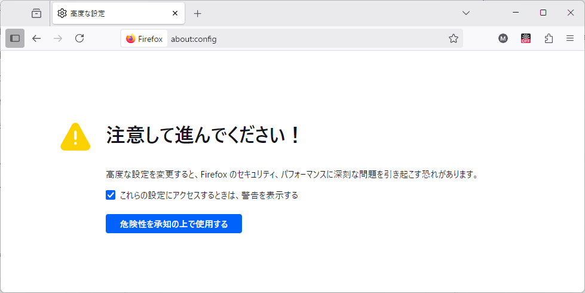

多くのアプリケーションにおいて、アニメーションは快適なユーザー体験に不可欠です。ウェブアニメーションの実装方法には、CSS {{cssxref("transition","トランジション","","nocode")}}/{{cssxref("animation","アニメーション","","nocode")}}や JavaScript ベースのアニメーション（{{domxref("Window.requestAnimationFrame","requestAnimationFrame()")}} を使用）など、さまざまな手法があります。この記事では、CSS ベースと JavaScript ベースのアニメーションのパフォーマンスの違いを分析します。

## CSS トランジションとアニメーション

CSS トランジションとアニメーションは、どちらもアニメーションを作成するために使用することができます。それぞれに独自の利用シナリオがあります。

- CSS の {{cssxref("transition","トランジション")}}は、現在のスタイルと最終的な CSS の状態の間で簡単にアニメーションを作成できます。例えば、ボタンが通常の状態からホバー状態に移行する場合などです。要素がトランジションの途中にある場合でも、新しいトランジションは最終的な CSS の状態に跳ぶのではなく、現在のスタイルから直接始まります。詳しくは[CSS トランジションの使用](/ja/docs/Web/CSS/Guides/Transitions/Using)を参照してください。
- 一方、CSS の {{cssxref("animation","animations")}} では、開発者は 2 つの状態間ではなく、開始時と終了時のプロパティ値のセット間でアニメーションを作成できます。CSS アニメーションは 2 つの要素で構成されます。CSS アニメーションを記述するスタイルと、アニメーションのスタイルの開始状態、終了状態、および中間点を示す一連のキーフレームです。詳しくは[CSS アニメーションの使用](/ja/docs/Web/CSS/Guides/Animations/Using)を参照してください。

パフォーマンスの観点では、CSS トランジションとアニメーションのどちらで実装しても違いはありません。この記事では、どちらも同じ CSS ベースの手法として扱います。

## requestAnimationFrame

{{domxref("Window.requestAnimationFrame", "requestAnimationFrame()")}} API は、JavaScript でアニメーションを作成する効率的な方法です。このメソッドのコールバック関数は、各フレームの次の再描画前にブラウザーによって呼び出されます。明示的な遅延時間を指定する必要がある {{domxref("Window.setTimeout", "setTimeout()")}}/{{domxref("Window.setInterval", "setInterval()")}} と比べて、`requestAnimationFrame()` ははるかに効率的です。開発者は、ループが呼び出されるたびに要素のスタイルを変更する（またはキャンバスの描画を更新するなど）ことでアニメーションを作成できます。

> [!NOTE]
> CSS トランジションやアニメーションと同様に、`requestAnimationFrame()` は現在のタブがバックグラウンドに移ると一時停止します。

詳しくは、[animating with JavaScript from setInterval to requestAnimationFrame](https://hacks.mozilla.org/2011/08/animating-with-javascript-from-setinterval-to-requestanimationframe/)<sup>(英語)</sup> を参照してください。

## パフォーマンスの比較:<br>トランジションと requestAnimationFrame

実際のところ、少なくとも Firefox では、ほとんどの場合、CSS ベースのアニメーションのパフォーマンスは JavaScript ベースのアニメーションとほぼ同等です。JavaScript ベースのアニメーションライブラリーには、[GSAP](https://gsap.com/) や [Velocity.JS](https://github.com/julianshapiro/velocity/wiki) のように、[CSS のネイティブなトランジションやアニメーション](https://css-tricks.com/myth-busting-css-animations-vs-javascript/)<sup>(英語)</sup>よりも優れたパフォーマンスを実現できると主張するものもあります。これは、CSS トランジションやアニメーションが各再描画イベントの前にメイン UI スレッドで要素のスタイルを再サンプリングするためです。この処理は、次の再描画前に呼び出される `requestAnimationFrame()` コールバックを介して要素のスタイルを再サンプリングするのとほぼ同じです。両方のアニメーションがメイン UI スレッドで実行される場合、パフォーマンスに違いはありません。

この節では、Firefox を使ってパフォーマンステストを行い、全体としてどのアニメーション方式が優れているかを見ていきます。

### FPS ツールを有効にする

例を読む前に、まず FPS ツールを有効にし、現在のフレームレートを確認してください。

1. URL バーに _about:config_ と入力し、`危険性を承知の上で使用する` ボタンをクリックして設定画面を開きます。
   
2. 検索バーで、環境設定の `layers.acceleration.draw-fps` を検索してください。
3. 項目をダブルクリックして値を `true` に設定します。これで Firefox ウィンドウの左上隅に 3 つの小さな紫色のボックスが表示されるようになります。最初のボックスは FPS を表します。
   

### パフォーマンス検査の実行

下のテストでは、最初に合計 1000 個の {{htmlelement("div")}} 要素を CSS アニメーションで変形させます。

```js
const boxes = [];
const button = document.getElementById("toggle-button");
const boxContainer = document.getElementById("box-container");
const animationType = document.getElementById("type");

// ボックスの作成
for (let i = 0; i < 1000; i++) {
  const div = document.createElement("div");
  div.classList.add("css-animation");
  div.classList.add("box");
  boxContainer.appendChild(div);
  boxes.push(div.style);
}

let toggleStatus = true;
let rafId;
button.addEventListener("click", () => {
  if (toggleStatus) {
    animationType.textContent = " requestAnimationFrame";
    for (const child of boxContainer.children) {
      child.classList.remove("css-animation");
    }
    rafId = window.requestAnimationFrame(animate);
  } else {
    window.cancelAnimationFrame(rafId);
    animationType.textContent = " CSS アニメーション";
    for (const child of boxContainer.children) {
      child.classList.add("css-animation");
    }
  }
  toggleStatus = !toggleStatus;
});

const duration = 6000;
const translateX = 500;
const rotate = 360;
const scale = 1.4 - 0.6;
let start;
function animate(time) {
  if (!start) {
    start = time;
    rafId = window.requestAnimationFrame(animate);
    return;
  }

  const progress = (time - start) / duration;
  if (progress < 2) {
    let x = progress * translateX;
    let transform;
    if (progress >= 1) {
      x = (2 - progress) * translateX;
      transform = `translateX(${x}px) rotate(${
        (2 - progress) * rotate
      }deg) scale(${0.6 + (2 - progress) * scale})`;
    } else {
      transform = `translateX(${x}px) rotate(${progress * rotate}deg) scale(${
        0.6 + progress * scale
      })`;
    }

    for (const box of boxes) {
      box.transform = transform;
    }
  } else {
    start = null;
  }
  rafId = window.requestAnimationFrame(animate);
}
```

```html hidden
<div id="header">
  <button id="toggle-button">切り替え</button>
  <span id="type">CSS アニメーション</span>
</div>
<div id="box-container"></div>
```

```css hidden
#header {
  position: sticky;
  top: 0.5rem;
  margin: 0 0.5rem;
  z-index: 100;
  background-color: lightgreen;
}

#box-container {
  margin-top: 1.5rem;
  display: grid;
  grid-template-columns: repeat(40, 1fr);
  gap: 15px;
}

.box {
  width: 30px;
  height: 30px;
  background-color: red;
}

.css-animation {
  animation: animate 6s linear 0s infinite alternate;
}

@keyframes animate {
  0% {
    transform: translateX(0) rotate(0deg) scale(0.6);
  }
  100% {
    transform: translateX(500px) rotate(360deg) scale(1.4);
  }
}
```

{{ EmbedLiveSample("Running the performance test", "100%", "480") }}

切り替えボタンをクリックすると、アニメーションを `requestAnimationFrame()` に切り替えられます。

両方のアニメーションを実行し、それぞれの FPS（最初の紫色のボックス）を比較してみてください。CSS アニメーションと `requestAnimationFrame()` のパフォーマンスはほぼ同等であることが分かるはずです。

### メインスレッド外でのアニメーション

上記のテスト結果を踏まえても、CSS アニメーションのほうが優れた選択肢だと考えられます。その理由は、アニメーション対象のプロパティが再フローや再描画を引き起こさない限り、サンプリング処理をメインスレッド外に移行できるためです（詳しくは [CSS トリガー](https://csstriggers.com/)<sup>(英語)</sup>を参照）。最も一般的なのは CSS の `transform` プロパティです。要素が[レイヤー](https://wiki.mozilla.org/Gecko:Overview#Graphics)<sup>(英語)</sup>に昇格すると、`transform` プロパティのアニメーションを GPU で実行できるため、特にモバイル端末ではパフォーマンスや効率が向上します。詳しくは [OffMainThreadCompositing](https://wiki.mozilla.org/Platform/GFX/OffMainThreadCompositing)<sup>(英語)</sup> を参照してください。

Firefox で OMTA (Off Main Thread Animation) を有効にするには、_about:config_ を開き、`layers.offmainthreadcomposition.async-animations` を検索します。その値を `true` に切り替えます。


OMTA を有効にしたら、上記の検査を再度実行してください。 CSS アニメーションの FPS がこれで大幅に高くなっていることが確認できるはずです。

> [!NOTE]
> Nightly/Developer Edition では、OMTA がデフォルトで有効になっているはずです。そのため、逆の順序でテストする必要があるかもしれません（まず有効な状態でテストし、その後 OMTA を無効にしてテストします）。

## まとめ

ブラウザーはレンダリングの流れを最適化できます。可能な限り、アニメーションには常に CSS トランジションやアニメーションを使いましょう。アニメーションが非常に複雑な場合は、代わりに JavaScript ベースのアニメーションに頼らざるを得ないかもしれません。
