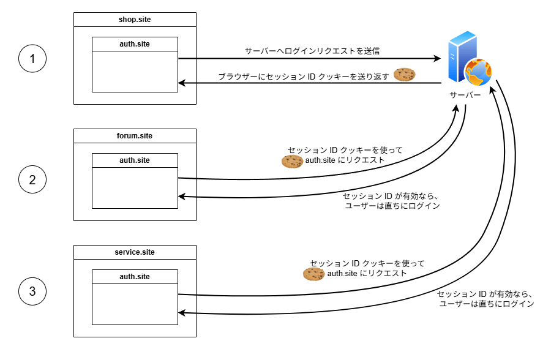

この記事では、サードパーティクッキーとは何か、それに関連する問題、およびそれらの問題を回避する方法について説明します。

## サードパーティクッキーとは

[クッキー](/ja/docs/Web/HTTP/Guides/Cookies)は、特定のドメインおよびスキーム（通常は `https`）に関連付けられており、 {{HTTPHeader("Set-Cookie")}} の `Domain` 属性が設定されている場合は、サブドメインにも関連付けられる場合があります。

- クッキーのドメインとスキームが、ユーザーが現在見ているページ（ブラウザーのアドレスバーに表示されている URL）と一致している場合、そのクッキーは、そのページと同じサイトからのものであるとみなされ、「ファーストパーティクッキー」と呼ばれます。
- ドメインとスキームが異なる場合、そのクッキーは同じサイトからのものとはみなされず、「サードパーティクッキー」と呼ばれます。

> [!NOTE]
> サードパーティクッキーは、「クロスサイトクッキー」と呼ばれることもあります。「サードパーティクッキー」は、サードパーティの企業または組織が所有していることを意味するため、より正確な名称であると言えます。ただし、関係するサイトをすべて所有しているかどうかに関係なく、その動作や潜在的な課題は同じです。例えば、あるサイトが、自社が所有する別のドメインの画像などのリソースにアクセスする場合があります。

ファーストパーティクッキーは、ユーザーが最初にページを訪問したとき、同じサイト内の別のページへの内部リンクをクリックしたとき、または同じサイトにあるリソース（例えば、埋め込み画像、ウェブフォント、JavaScript ファイルなど）をリクエストしたときに設定される場合があります。

サードパーティクッキーは、次の一般的な状況で送信されます。

- あるサイトでリンクをクリックして、別のサイトに移動する場合。
- {{htmlelement("iframe")}} に埋め込まれた画像や他の文書など、他のサイトからの要素がページに埋め込まれている場合（多くの場合、「サードパーティコンテンツ」と呼ばれます）。コンポーネントに対する元のリクエストだけでなく、さらにサードパーティのクッキーを設定するリクエストを生成する場合があります。

## サードパーティクッキーは何のために使用されているのか

他のサイトへのリンクをクリックすると設定されるサードパーティクッキーは、さまざまな目的で使用されます。例えば、パートナーサイトへのアフィリエイトリンクがあり、ユーザーがリンクをクリックするとクッキーを設定し、特定の製品が購入された場合に割引のバナーを表示したり、紹介者に手数料を支払ったりすることができます。

クッキーを設定するサードパーティのコンテンツも、さまざまな用途があります。例えば、複数の異なるが関連性のあるサイトにログインウィジェットを埋め込み、そのウィジェットがすべてのサイトでクッキーを共有してユーザーがログインしていることを確認することで、ユーザーが各サイトで再度ログインする必要がなくなります。

サードパーティクッキーのその他の用途には、以下のものがあります。

- 複数のサイト間でユーザーの環境設定やテーマ情報を共有する。
- 複数のサイトから分析データを収集する。
- 広告のインプレッション数をカウントし、ユーザーの関心を記録することで、広告技術プラットフォームがより関連性の高い広告を配信できるようにする。

上記のログインウィジェットの例を、架空の会社を例にさらに詳しく説明しましょう。この会社では、オンラインショップ (`shop.site`)、コミュニティディスカッションフォーラム (`forum.site`)、カスタマーサービスおよび返品 (`service.site`) に別個のドメインを保有しています。

3 つのサイトにはそれぞれ、サイト間のログイン状態を保持するためのログインウィジェットが `auth.site` にホストされています。ユーザーは、これらのサイトのいずれかにログインすると、セッション ID を含む `auth.site` 用のクッキーがブラウザーに作成されます。ユーザーが他のサイトのいずれかにアクセスすると、埋め込まれた `auth.site` インスタンスは、ユーザーが最初のサイトでログインしたときに設定されたセッション ID クッキーにアクセスできます。それをサーバーに送信し、まだ有効であるかどうかを確認して、そのサイトにすぐにログインすることができます。



## サードパーティクッキーの問題点

上記の用途は、一見無害に見えます。しかし、サードパーティクッキーは、ユーザーの同意なしに不正な目的で使用される可能性もあり、その場合は技術的には正当な使用と区別がつきません。

第三者へのリンクをクリックしたり、`<iframe>` に埋め込まれた第三者のコンテンツを操作したりすると（例えば、フォームへの入力やボタンのクリックなど）、クッキーが設定され、ユーザーの予想しない第三者にユーザーの情報が渡される可能性があります。この情報は、次のような目的で使用される可能性があります。

- ユーザーが特定の製品に関する情報を検索するたびに、ターゲットを絞った広告をウェブサイトに表示してユーザーを追い回す。
- ユーザーをスパムメールや迷惑電話の標的にする。
- その行動を操作して、アフィリエイトの収益を増やす特定のオプションを選んだり、統計情報を操作したりする。

このようなケースは、それぞれ単独でも問題ですが、さらに悪い状況になり得ます。サードパーティのサーバーは、サードパーティのコンテンツが埋め込まれたさまざまなサイトに設定されたクッキーから情報を集め、ユーザーの閲覧履歴、関心、習慣、個人情報などの詳細なプロフィールを作成できます。こうした情報は、不気味で、ユーザーのプライバシーに過度に踏み込むような体験を生み出したり、ユーザーを詐欺に遭わせたり、さらには個人情報を盗んだりするために使われるおそれがあります。

このような場合、サードパーティクッキーは「トラッキングクッキー」と呼ばれます。

> [!NOTE]
> 不正な手段で入手したユーザー情報は、他のサードパーティにも販売されることが多く、問題がさらに拡大します。

欧州連合の[一般データ保護規則](https://gdpr.eu/) (GDPR) や[カリフォルニア州消費者プライバシー法](https://www.oag.ca.gov/privacy/ccpa) (CCPA) などの法律は、企業が設定するクッキーや収集する情報について透明性を確保することを法的要件とすることで、この問題に対処しています。例えば、顧客にこのようなデータの収集について同意を求める、企業が顧客について保有するデータを確認できるようにする、顧客が希望する場合にデータを削除する、などが挙げられます。しかし、顧客にとって、自分のデータがどのように使用されているのかが常に明確であるとは限りません。

## ブラウザーはサードパーティクッキーをどのように処理するのか

ブラウザーベンダーは、ユーザーが前述の動作を好まないことを把握しています。ユーザー体験への悪影響を軽減するため、一部のブラウザーではサードパーティクッキーをデフォルトでブロックし始めており、正当な用途を実現するための代替手段も実装されています（[サードパーティクッキーからの移行](#サードパーティクッキーからの移行)を参照）。

次のリストでは、いくつかのブラウザーにおけるサードパーティクッキーのブロック状況を説明します。

- Firefox では、デフォルトで有効になっている[強化型トラッキング防止](https://support.mozilla.org/ja/kb/enhanced-tracking-protection-firefox-desktop)を有効にすると、[包括的 Cookie 保護](https://blog.mozilla.org/en/mozilla/firefox-rolls-out-total-cookie-protection-by-default-to-all-users-worldwide/)<sup>(英語)</sup>も有効になります。これにより、サードパーティクッキーはサイトごとに別個のクッキージャーに保存され、サイト間のトラッキングが防止されます。
- Safari には[トラッキング防止ポリシー](https://webkit.org/tracking-prevention-policy/)<sup>(英語)</sup>があり、同様のサードパーティクッキー保護がデフォルトで有効になっています。詳しくは、[インテリジェントトラッキング防止](https://webkit.org/tracking-prevention/#intelligent-tracking-prevention-itp)<sup>(英語)</sup> (ITP) を参照してください。
- Google Chrome はサードパーティクッキーをデフォルトではブロックせず、シークレットモードか、ユーザーが `chrome://settings` で明示的にブロックする設定にした場合にのみブロックします。
- Edge は、訪問したことのないサイトのトラッカーをブロックし、既知の有害なトラッカーをデフォルトでブロックします。詳しくは、「[追跡防止](https://learn.microsoft.com/ja/microsoft-edge/web-platform/tracking-prevention)」を参照してください。
- [Brave ブラウザー](https://brave.com/)は、トラッキングクッキーをデフォルトでブロックします。

Firefox、Chrome、Edge では、ブラウザーの設定からサードパーティクッキーを個別に許可できます。一方、Safari では制御がより制限されています。サイト間のトラッキング防止は無効にできますが、フレームごとにサードパーティクッキーへのアクセスを許可するには、[ストレージアクセス API](/ja/docs/Web/API/Storage_Access_API) を使ってコードで設定する必要があります。

> [!NOTE]
> サードパーティクッキー（または単にトラッキングクッキー）も、ブラウザーの拡張機能によってブロックされる場合があります。

クッキーをブロックすると、ウェブサイトの機能やサードパーティコンポーネント（ソーシャルメディアウィジェットなど）が意図どおりに動かなくなる場合があります。そのため、ブラウザーは人気のあるウェブサイトで長く使われているサードパーティクッキーの問題に対処するため、例外や経験則をソースコードに盛り込んでいます。

一般に開発者は、プライバシーへの潜在的な害とサードパーティクッキーへの依存を減らすため、サードパーティクッキーが送信される状況を制限する方法を検討する必要があります。

## `SameSite` によるサードパーティクッキーの制限

[`SameSite`](/ja/docs/Web/HTTP/Reference/Headers/Set-Cookie#samesitesamesite-value) 属性を使うと、サーバーはサードパーティクッキーを送信するかどうか、また送信するタイミングを指定できます。`Set-Cookie` ヘッダーで `SameSite` を指定しない場合、Chromium ベースのブラウザーではデフォルト値の `Lax` が使われますが、ほかのブラウザーではデフォルト値が異なります。そのため、一貫した動作にするには `SameSite` を明示的に設定することが推奨されます。

可能な場合は、アプリで妥当なデフォルトとして `Lax` を使うようにしてください。これにより、ユーザーが別のサイトからクッキーの発行元サイトに移動した場合を除き、ブラウザーはサードパーティクッキーを送信しなくなります。例えば、ユーザーが別のサイトから自分のサイトに移動したときにクッキーをすぐに送り、サイトにアクセスした直後から使い勝手を個人設定する場合に便利です。

しかし、先ほどのログインの例のように、複数のサイトにまたがるコンテンツを `<iframe>` で埋め込み、機能の実現にサードパーティクッキーを必要とする場合、この方法ではうまくいきません。このような場合は、ブラウザーがクッキーを送信できるように `SameSite=None` を明示的に設定する必要があります。

```http
Set-Cookie: widget_session=7yjgj57e4n3d; SameSite=None; Secure; HttpOnly
```

`SameSite=None` を設定する場合は、`Secure` 属性も設定する必要があります。`SameSite=None` には保護されたコンテキストが必要です。上記の例では、JavaScript (例えば {{domxref("Document.cookie")}}) からクッキーにアクセスできないように `HttpOnly` 属性も設定しています。機密情報を保持するクッキーには、必ず `HttpOnly` 属性を設定してください。JavaScript から利用できるようにすると非常に危険です。この予防措置により、クロスサイトスクリプティング ([XSS](/ja/docs/Web/Security/Attacks/XSS)) 攻撃を緩和できます。

> [!NOTE]
> 機密情報に使用されるクッキーも、[有効期間](/ja/docs/Web/HTTP/Guides/Cookies#削除_cookie_の持続時間の定義)を短く指定する必要があります。

> [!NOTE]
> クッキーを設定したサイトからのリクエストでのみ送信したい場合は、`SameSite` 属性を `Strict` に設定できます。これにより、サードパーティクッキーはどのような状況でも送信されなくなります。

## サードパーティクッキーからの移行

サードパーティクッキーがブロックされているブラウザーでサイトの機能不全を最小限に抑えるには、次のような戦略があります。

1. サードパーティのクッキーの使用状況を監査します。クッキーは、サイトをまたぐコンテキストで使用するには、 `SameSite=None` 属性を設定する必要があります。したがって、コード内で `SameSite=None` を検索するか、保存されている `SameSite=None` クッキーを、ブラウザーの開発者ツール（例えば、[Firefox のストレージインスペクター](https://firefox-source-docs.mozilla.org/devtools-user/storage_inspector/)）で確認することで、サードパーティのクッキーを特定することができます。 Chrome の[問題](https://developer.chrome.com/docs/devtools/issues/)パネルでも、[サードパーティのクッキーのブロックに関する問題](https://privacysandbox.google.com/cookies/prepare/audit-cookies#chrome-dev-tools)と、影響を受けるクッキーのリストが報告されます。
2. サードパーティのクッキーをブロックして機能を検査し、何が機能しなくなったかを確認してください。一部のクッキーはもはや必要がなくなったことがわかるかもしれません。
3. 少なくとも当初は、サードパーティクッキーのデータが利用できない場合でもコード全体が動かなくなるのではなく、個人設定の精度が下がる程度で済むよう、回復力のあるコードを作成できます。[グレースフルディグラデーション](/ja/docs/Glossary/Graceful_degradation)の原則に従いましょう。
4. ユーザーアンケートやクイズなどの別の方法でデータを収集するか、すでに保有しているデータ（例えば、製品の注文履歴）を見て傾向を推測します。
5. データを維持するには、[ウェブストレージ](/ja/docs/Web/API/Web_Storage_API)などの代替のクライアント側ストレージ機構を使用するか、サーバー側ソリューションを検討してください。
6. サードパーティクッキーが、少数の関連する既知のウェブサイトでのみ使用されている場合は、[ストレージアクセス API](/ja/docs/Web/API/Storage_Access_API) を使って、特定のサイトにのみサイトをまたぐクッキーへのアクセスを許可できます。ストレージアクセス API は、フレームごとにサイトがサードパーティクッキーを使用する許可をユーザーに求めます。
7. サードパーティクッキーが、それを生成した最上位サイトと 1 対 1 で使用されている場合は、[個別区画化された状態を持つクッキー](/ja/docs/Web/Privacy/Guides/Third-party_cookies/Partitioned_cookies)（CHIPS、別名オプトインパーティションクッキー）を使うと、最上位サイトごとに別々のクッキージャーを持つ区画化ストレージに保存できます。既存のサイト間クッキーに `partitioned` 属性を追加するだけで利用できます。これらのクッキーは制限なく使用できますが、ほかのサイトとは共有できません。

## 関連情報

- [HTTP クッキー](/ja/docs/Web/HTTP/Guides/Cookies)
- [ウェブのプライバシー](/ja/docs/Web/Privacy)
