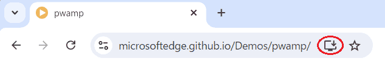

PWA の特徴の 1 つは、ブラウザーがユーザーに端末へのインストールを提案できることです。インストール後、PWA はプラットフォーム固有のアプリのように表示され、端末に常設されます。OS からほかのアプリと同じように直接起動できます。

これをまとめると次のようになります。

- 対応ブラウザーは、ユーザーに PWA の端末へのインストールを提案します。
- PWA はプラットフォーム固有のアプリのようにインストールでき、インストールプロセスをカスタマイズできます。
- インストールすると、PWA のアイコンが端末上のプラットフォーム固有のアプリと並んで表示されます。
- インストールされると、 PWA はブラウザー上のウェブサイトではなく、スタンドアロンアプリとして起動できます。

このガイドでは、これらの各機能について解説します。まず、ブラウザーがユーザーにインストールを提案するために、ウェブアプリケーションが満たす必要のある要件について説明します。

## インストール可能性

対応ブラウザーがウェブアプリケーションのインストールをユーザーに提案するには、いくつかの技術的要件を満たす必要があります。これらは、ウェブアプリケーションが PWA であるための最低要件と考えることができます。

> [!NOTE]
> PWA のインストールに必須ではありませんが、多くの PWA はオフライン操作を提供するために[サービスワーカー](/ja/docs/Web/API/Service_Worker_API)を使用しています。
> 詳しくは、[CycleTracker: サービスワーカー](/ja/docs/Web/Progressive_web_apps/Tutorials/CycleTracker/Service_workers)のチュートリアルをご覧ください。

## ウェブアプリマニフェスト

ウェブアプリマニフェストとは、PWA の端末上での外観や動作をブラウザーに伝える JSON ファイルです。ウェブアプリケーションが PWA であるためにはインストール可能でなければならず、そのためにはマニフェストが必要です。

マニフェストはアプリの HTML に {{HTMLElement("link")}} 要素を使用して記述します。

```html
<!doctype html>
<html lang="en">
  <head>
    <link rel="manifest" href="manifest.json" />
    <!-- ... -->
  </head>
  <body></body>
</html>
```

PWA に複数のページがある場合、すべてのページでこの方法によってマニフェストを参照する必要があります。

マニフェストにはメンバーの集合が入った単一の JSON オブジェクトを格納し、各メンバーは PWA の外観や動作の何らかの側面を定義します。次のものは、 `"name"` と `"icons"` の 2 つのメンバーだけを格納した、かなり最小限のマニフェストです。

```json
{
  "name": "My PWA",
  "icons": [
    {
      "src": "icons/512.png",
      "type": "image/png",
      "sizes": "512x512"
    }
  ]
}
```

#### 必須のマニフェストメンバー

Chromium ベースのブラウザー（Google Chrome、Samsung Internet、Microsoft Edge など）では、マニフェストに以下のメンバーが含まれていることが要求されます。

- [`name`](/ja/docs/Web/Progressive_web_apps/Manifest/Reference/name) または [`short_name`](/ja/docs/Web/Progressive_web_apps/Manifest/Reference/short_name)
- [`icons`](/ja/docs/Web/Progressive_web_apps/Manifest/Reference/icons) には 192px および 512px のアイコンが必要です。
- [`start_url`](/ja/docs/Web/Progressive_web_apps/Manifest/Reference/start_url)
- [`display`](/ja/docs/Web/Progressive_web_apps/Manifest/Reference/display) または [`display_override`](/ja/docs/Web/Progressive_web_apps/Manifest/Reference/display_override) (または両方)
- [`prefer_related_applications`](/ja/docs/Web/Progressive_web_apps/Manifest/Reference/prefer_related_applications) は `false` に設定するか、指定しない

それぞれのメンバーの完全な説明は、[ウェブアプリマニフェストのリファレンスドキュメント](/ja/docs/Web/Progressive_web_apps/Manifest)を参照してください。

### HTTPS、localhost、loopback のいずれかが必須

PWA がインストール可能であるためには、`https` プロトコルを使用しているか、`localhost` または `127.0.0.1` を使用して、ローカル開発環境から提供しなければなりません。

これは `file://` URL から読み込まれたリソースを安全であるとみなす[保護されたコンテキスト](/ja/docs/Web/Security/Defenses/Secure_Contexts)よりも厳しい要求です。

## アプリストアからのインストール

ユーザーは、 Google Play ストアや Apple App ストアのように、自分のプラットフォームのアプリストアでアプリを探すことを期待しています。

アプリがインストール可能な前提条件を満たしていれば、アプリをパッケージ化し、アプリストアを通じて配布できます。このプロセスはアプリストアごとに異なります。

- [PWA を Google Play ストアで公開する方法](https://chromeos.dev/en/publish/pwa-in-play)
- [PWA を Microsoft ストアで公開する方法](https://learn.microsoft.com/en-us/microsoft-edge/progressive-web-apps/how-to/microsoft-store)
- [PWA を Meta Quest ストアで公開する方法](https://developers.meta.com/vr/resources/publish-submit/)

[PWABuilder](https://docs.pwabuilder.com/#/builder/quick-start) は、様々なアプリストア向けに PWA をパッケージ化し、公開するプロセスを簡素化するツールです。 Google Play ストア、 Microsoft ストア、 Meta Quest ストア、 iOS App Store に対応しています。

アプリをアプリストアに追加した場合、ユーザーはプラットフォーム固有のアプリと同じように、そこからインストールすることができます。

## ウェブからのインストール

対応ブラウザーは、ウェブアプリケーションが前述のインストール要件を満たしていると判断すると、ユーザーにアプリのインストールを提案します。つまり、PWA はウェブサイトとして配布してウェブ検索で見つけられるようにし、アプリストアでも配布してユーザーに見つけてもらうことができます。

この例は、 PWA がどちらの利点も提供できる方法の好例です。これは PWA でプログレッシブエンハンスメントがどのように動作するのかの良い例でもあります。ユーザーがウェブ上で PWA をインストールできないブラウザーで PWA に出会った場合、通常のウェブサイトと同じように使用することができます。

ウェブから PWA をインストールするための UI は、ブラウザーやプラットフォームによって異なります。例えば、ブラウザーはユーザーがページに移動したときに URL バーに「インストール」アイコンを表示することがあります。



ユーザーがアイコンを選択すると、PWA をインストールするか確認するプロンプトがブラウザーに表示され、ユーザーが承諾すると PWA がインストールされます。

プロンプトには、[`name`](/ja/docs/Web/Progressive_web_apps/Manifest/Reference/name) と [`icons`](/ja/docs/Web/Progressive_web_apps/Manifest/Reference/icons) の各マニフェストメンバーから取得した PWA の名前とアイコンが表示されます。

### ブラウザーの互換性

ウェブからの PWA インストールの提案への対応は、ブラウザーやプラットフォームによって異なります。

デスクトップの場合は次の通りです。

- Chromium ブラウザーは、対応しているすべてのデスクトップオペレーティングシステムで、マニフェストファイルのある PWA のインストールに対応しています。
- Safari は macOS Sonoma (Safari 17) 以降で、「Dock に追加」（「ファイル」>「Dock に追加...」）に対応しており、マニフェストファイルの有無を問わず、あらゆるウェブアプリを追加できます。
- Firefox はマニフェストファイルを使用した PWA のインストールに対応していません。

モバイルの場合は次の通りです。

- Android で PWA を [WebAPK](https://web.dev/learn/pwa/installation#webapks)<sup>(英語)</sup> としてインストールするブラウザーは、Google Mobile Services (GMS) を搭載した端末での Chrome と、Samsung 製端末での Samsung Internet だけです。これにより、アプリランチャーやアプリ切り替え画面、システム設定に PWA が独立した項目として登録されます。
  Firefox、Edge、Opera、および GMS を搭載していない端末での Chrome など、その他のブラウザーでは、代わりにブラウザーのバッジが付いたホーム画面のショートカットが追加され、サイトはブラウザーで開きます。
- iOS 16.3 以前では、 PWA は Safari でしかインストールできません。
- iOS 16.4 以降では、Safari、Chrome、Edge、Firefox、Orion の共有メニューから PWA をインストールできます。

### サイトをアプリとしてインストール

デスクトップ版および Android 版の Chrome、デスクトップ版 Safari、およびデスクトップ版 Edge も、マニフェストファイルを持つ持たないに関わらず、またマニフェストファイルのインストール可能基準に見なされることなく、ユーザーが任意のウェブサイトをアプリとしてインストールすることに対応しています。
マニフェストファイルを使用する利点は、ブラウザーがユーザーの訪問時にサイトのインストールを積極的に提案でき、開発者がインストール時の動作をカスタマイズできることです。

### インストールプロンプトを起動

PWA は、ブラウザーがデフォルトで提供する UI に頼る代わりに、ユーザーがインストールプロンプトを開くためのページ内 UI を用意できます。これにより、PWA をインストールする理由や背景を説明し、インストール方法をユーザーに見つけてもらいやすくなります。

この手法は、[`beforeinstallprompt`](/ja/docs/Web/API/Window/beforeinstallprompt_event) イベントに依存します。このイベントは、ブラウザーが PWA をインストール可能と判断するとすぐに、グローバルな [`Window`](/ja/docs/Web/API/Window) オブジェクト上で発生します。このイベントには、インストールプロンプトを表示する [`prompt()`](/ja/docs/Web/API/BeforeInstallPromptEvent/prompt) メソッドがあります。つまり PWA は、

- 自分自身で「インストール」ボタンを追加することができます。
- `beforeinstallprompt` イベントを待ち受けすることができます。
- イベントのデフォルトの動作を [`preventDefault()`](/ja/docs/Web/API/Event/preventDefault) を呼び出してキャンセルします。
- 自分自身で「インストール」ボタンのイベントハンドラーで、 [`prompt()`](/ja/docs/Web/API/BeforeInstallPromptEvent/prompt) を呼び出します。

これは iOS では対応していません。

### インストールプロンプトのカスタマイズ

デフォルトでは、インストールプロンプトには PWA の名前とアイコンが表示されます。マニフェストメンバーに [`description`](/ja/docs/Web/Progressive_web_apps/Manifest/Reference/description) と [`screenshots`](/ja/docs/Web/Progressive_web_apps/Manifest/Reference/screenshots) の値が指定されている場合、Android ではこれらの値もプロンプトに表示され、ユーザーが PWA をインストールするか判断するための情報になります。

下記のスクリーンショットは、 Android で動作する Google Chrome で [PWAmp demo](https://github.com/MicrosoftEdge/Demos/tree/main/pwamp) のインストールプロンプトがどのように表示されるかを示しています。


## アプリの起動

PWA がインストールされると、そのアイコンはユーザーがインストールしている他のアプリと一緒に端末に表示され、アイコンをクリックするとアプリが起動します。

[`display`](/ja/docs/Web/Progressive_web_apps/Manifest/Reference/display) マニフェストメンバーを使用して、表示モード、すなわち起動したときに PWA がどのように現れるかを制御することができます。具体的には次のようになります。

- `"standalone"` は、 PWA がブラウザーの UI 要素なしで、プラットフォーム固有のアプリケーションのように見えるようにすることを示します。
- `"browser"` は、 PWA を通常のウェブサイトと同じように、新しいブラウザーのタブやウィンドウとして開くためのものであることを示します。

ブラウザーが指定された表示モードに対応していない場合、 `display` はあらかじめ定義された順序に従って対応している表示モードで代用します。 [`display_override`](/ja/docs/Web/Progressive_web_apps/Manifest/Reference/display_override) を使用すると、代替シーケンスを再定義することができます。
