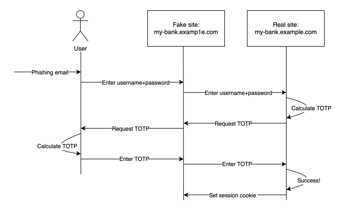

フィッシングは{{glossary("social engineering", "ソーシャルエンジニアリング")}}攻撃の一種です。ユーザーは、実際には攻撃者とやりとりしているにもかかわらず、自分がアカウントを持つサイトとやりとりしていると思い込まされます。攻撃者はユーザーを偽サイトに誘導して資格情報を入力させ、それを盗みます。

## 概要

フィッシングは古くからある攻撃ですが、今でも非常によく見られます。防御を回避したり、新たな脆弱性を利用したりするため、さまざまな形に変化してきました。基本的な形は次のようなものです。

1. 攻撃者がターゲットサイトと誤認させるドメイン名を登録します。例えば、ユーザーの銀行取引ウェブサイトが `my-bank.example.com` であれば、攻撃者は `my-bank.examp1e.com` のようなドメイン名を登録します。
2. 攻撃者は、本物のサイトと誤認させるサイトを作成します。
3. 攻撃者はユーザーにメールを送信し、`my-bank.example.com` からメールが来たように装い、ユーザーにそのサイトを訪問させる何らかの理由を示し、偽サイト `my-bank.examp1e.com` へのリンクを含めます。
4. ユーザーはこのクリックをリンクし、ログインします。ユーザーがユーザー名とパスワードを入力したら、攻撃者はその資格情報を取得します。

フィッシング攻撃では、テキストメッセージや音声通話など、異なる手段で標的に接触することもあります。ウェブサイトを使わず、ユーザーを説得してパスワードや PIN コードを口頭で伝えさせる場合もあります。

フィッシング攻撃の中には、だまされる人が出ることを期待して、多数の潜在的な被害者に無差別にメッセージを送るものもあります。一方、スピアフィッシング攻撃では、攻撃者は特定の被害者について調べ、誘い文句をより説得力のあるものにするため、個人情報を集めます。例えば、メールを被害者の知人から送られたように見せたり、個人的な情報を含めたりすることがあります。

フィッシング攻撃は、だまされやすい人や経験の浅い人だけを標的にするものではありません。何十年にもわたる経験から、経験や知識が豊富なユーザーでも、特に忙しいとき、疲れているとき、注意が散漫になっているときには、フィッシング攻撃の被害に遭う可能性があることが分かっています。

## 防御

フィッシングに対するウェブサイト側の防御が難しい理由のひとつは、標的のサイトが攻撃にまったく関与しないことです。攻撃者がユーザーをだませるかどうかにかかっています。この節では役立つ対策をいくつか説明しますが、本当に効果的なのは、パスワードの代わりに[パスキー](#パスキー)を使うことです。

### DNS の設定

フィッシングメールでは、標的のウェブサイトから本当に送られたように被害者に思わせるため、送信者アドレスを偽装することがよくあります。次の 3 種類の {{glossary("DNS")}} レコードは、メールサーバーがこのような偽装を検出するのに役立ちます。これにより、フィッシングメールが受信者のメールクライアントで迷惑メールとして扱われたり、完全にブロックされたりする可能性が高まります。

- [Security Policy Framework (SPF)](https://www.cloudflare.com/en-ca/learning/dns/dns-records/dns-spf-record/)(英語) レコードには、そのドメインからメールを送信することを許可されたアドレスが記載されています。受信側のメールサーバーはメールの `Return-Path` ヘッダーからドメイン名を取り出し、そのドメインに対応する SPF レコードを検索します。
- [DomainKeys Identified Mail (DKIM)](https://www.cloudflare.com/en-ca/learning/dns/dns-records/dns-dkim-record/)(英語) レコードを使うと、送信者はメールに{{glossary("digital signature", "デジタル署名")}}を付けられます。受信側のサーバーは署名からドメイン名を取り出し、そのドメインに対応する DKIM レコードを検索します。DKIM レコードには、署名の検証に使う公開鍵が含まれます。また、署名内のドメイン名は、メールの `From` ヘッダー内のドメイン名と整合していなければなりません。つまり、ドメイン名が一致するか、`From` ヘッダー内の値が署名内のドメインのサブドメインである必要があります。
- [Domain-based Message Authentication Reporting and Conformance (DMARC)](https://www.cloudflare.com/en-ca/learning/dns/dns-records/dns-dmarc-record/)(英語) は、SPF や DKIM の検証に失敗したメールをどのように扱うかを受信側に指示します。迷惑メールとして隔離するか、拒否するか、許可するかを指定できます。

メールサーバーが偽装されたメッセージを認識できるように、所有するドメインにこれらの DNS レコードを設定してください。

### パスワードマネージャー

パスワードマネージャーは、フィッシング攻撃に対してある程度の保護を提供します。主な機能は次の 3 つです。

- **パスワードの生成**: ユーザー登録時に強力なパスワードを生成します。
- **パスワードの保管**: ユーザーがパスワードを覚えておく必要がないように、安全に保管します（そのため、より強力なパスワードを使えます）。
- **パスワードの入力**: ユーザーがサイトのログインページを訪れたときに、そのサイトのパスワードを自動的に入力します。

最後の機能がフィッシング対策に役立ちます。ユーザーが偽のドメイン `my-bank.examp1e.com` と正規のドメイン `my-bank.example.com` の違いに気づかなくても、パスワードマネージャーはそれを認識し、偽サイトには正規サイトのパスワードを自動入力しません。これが、ログイン要求が正当なものではないとユーザーが気づくきっかけになるかもしれません。

ウェブ開発者がユーザーにパスワードマネージャーを使わせることはできません。しかし、注意しないと、パスワードマネージャーをサイトに連携できなくしてしまうことがあります。ユーザーがサイトでパスワードマネージャーを使えるようにするために、実践すべきことと避けるべきことをまとめた記事「[ログインフォームをパスワードマネージャーに適合させる](https://hidde.blog/making-password-managers-play-ball-with-your-login-form/)」(英語)も参考になります。ブラウザーに組み込まれたものや、広く使われている単体アプリケーションなど、さまざまなパスワードマネージャーでサイトをテストすることも重要です。

残念ながら、ユーザーはツールがときどき失敗することを想定し、その失敗を回避するよう慣らされています。そのため、ユーザーがパスワードマネージャーを使っていて、それがサイトで動作し、フィッシングの試行中にパスワードが自動入力されなかったとしても、ユーザーがパスワードを手動で貼り付けない保証はありません。

### 多要素認証

ユーザーの認証に{{glossary("multi-factor authentication", "多要素認証 (MFA)")}}を使うとフィッシングは難しくなりますが、使用する方法によっては防げません。

特に一般的な MFA の実装では、ユーザーはパスワードと、そのログイン試行に固有の[ワンタイムパスワード (OTP)](/ja/docs/Web/Security/Authentication/OTP) と呼ばれるコードを入力する必要があります。よく使われる方式は 2 種類あります。

- SMS ベースの OTP:
  - ユーザーは登録時に携帯電話番号を提供します。
  - ユーザーがユーザー名とパスワードを入力すると、ウェブサイトは OTP を含む SMS を送信します。
  - ユーザーが OTP を入力します。
  - OTP の値が一致すると、ユーザーはサインインします。

- 時刻ベースの OTP (TOTP):
  - ユーザーは認証アプリをインストールしています。
  - ユーザーがユーザー名とパスワードを入力すると、ウェブサイトは現在時刻を入力として OTP を計算します。
  - ユーザーの認証アプリも同じ計算を行い、ユーザーはアプリが生成した OTP を入力します。
  - OTP の値が一致すると、ユーザーはサインインします。

攻撃者が SMS メッセージを傍受する可能性があるため、TOTP は SMS ベースの OTP より安全だと考えられています。しかし、フィッシングの観点では、どちらの方法にも脆弱性があります。

OTP を第二要素として使うユーザーに対しては、攻撃者がユーザーと正規サイトの間でリアルタイムにやりとりを中継し、入力された資格情報や OTP を悪用することがあります。

1. 攻撃者がユーザーに偽サイトへのリンクを含むメールを送信します。
2. ユーザーがメール内のリンクをクリックし、偽サイトでユーザー名とパスワードを入力します。
3. 偽サイトがユーザー名とパスワードを正規サイトに中継します。
4. 正規サイトが TOTP を生成します。
5. 偽サイトがユーザーに TOTP の入力を求めます。
6. ユーザーの認証アプリが同じ TOTP を生成し、ユーザーはそれを偽サイトに入力します。
7. 偽サイトが TOTP を正規サイトに中継し、攻撃者がアクセスを得ます。

これは攻撃者がリアルタイムで操作をしなければならない文、パスワードだけを狙うフィッシングより難しくなっています。フィッシング用のツールキットによって実行の複雑さが軽減されます。

### パスキー

フィッシングに対する最も強力な技術的防御は、[パスキー](/ja/docs/Web/Security/Authentication/Passkeys)を使ってユーザーを認証することです。

パスキーはユーザーがサイトに登録するときに作成され、作成元の {{glossary("origin", "オリジン")}}に固有です。パスキーは、ユーザーの端末に組み込まれているか接続されている、認証器と呼ばれるモジュールによって生成、保管されます。

パスワードや OTP コードと異なり、ユーザーがサイトにパスキーを手動で入力することはありません。実際、パスキーがサイトに送信されることもありません。ウェブサイトが Web Authentication を使った認証を求めると、ブラウザーはサイトのオリジンに一致するパスキーを認証器に要求します。認証器がパスキーを見つけると、トークンを生成し、ブラウザーがそれをウェブサイトに送信します。ウェブサイトはトークンを検証し、ユーザーをサインインさせます。

パスキーはサイトのオリジンに固有です。そのため、ユーザーの `my-bank.example.com` のアカウント用にパスキーを作成した場合、`my-bank.examp1e.com` では使用できません。ブラウザーは偽サイトに対してそのパスキーを適用できるものとして扱わないからです。

このため、パスキーはフィッシングに対する効果的な防御になります。パスキーはパスワードや OTP よりも新しい認証方式であり、関連ツールはまだ成熟していません。しかし状況は変化しており、将来的にはパスキーがウェブで最も一般的な認証方式となり、パスワードに取って代わる可能性があります。

### 個人用セキュリティ表示

あまり使われなくなったフィッシング対策のひとつに、ログインページでユーザーに秘密のメッセージや画像を表示する方法があります。

1. ユーザー登録後、アカウントに関連付ける秘密のメッセージや画像を選ぶよう求めます。
2. ユーザーがサインインするとき、まずユーザー名を入力します。
3. ログインページに、そのアカウントに関連付けられた秘密が表示されます。
4. 予想していた秘密と異なる場合、ユーザーはパスワードを入力してはいけません。

この方法の考え方は、攻撃者は秘密を知らないため、偽のログインページにそれを表示できないというものです。

この方法の一種では、ユーザー名の代わりに永続的なクッキーを使って、どの秘密を表示するか決めます。

実際には、この方法にはいくつかの問題があります。

- ユーザーがセキュリティ表示に注意を払うこと、つまりユーザー教育に頼っています。適切に管理された企業などの統制された環境を除けば、一般にユーザー教育はフィッシング攻撃の防止にあまり効果がないことが、経験から分かっています。
- 表示する秘密を決める仕組みによっては、MFA と同じ中間者攻撃に対して脆弱な可能性があります。
- サーバーが表示する秘密を決める仕組み自体に脆弱性があるかもしれません。例えば、攻撃者にとってパスワードよりユーザー名を知るほうが簡単な場合があります。ユーザー名が分かれば、攻撃者が秘密を特定し、説得力のある偽サイトを作成できる可能性があります。

こうした弱点があるため、この対策はほとんど使われていません。MFA とパスキーのほうが強力な防御と考えられています。

## 防御の概要チェックリスト

- ドメインに `SPF`、`DKIM`、`DMARC` の DNS レコードを設定してください。
- ユーザー認証にパスキーを使うことを検討してください。
- パスワードを使う場合は、MFA の使用を検討し、パスワードマネージャーがサイトで動作することを確認してください。
