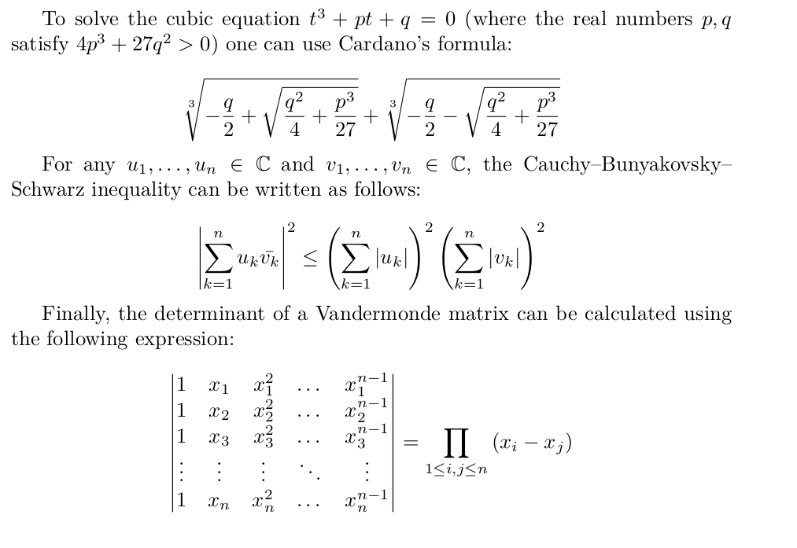

{{PreviousMenu("Web/MathML/Tutorials/For_beginners/Tables", "Web/MathML/Tutorials/For_beginners")}}

Материала из предыдущих статей уже должно хватить, чтобы записать достаточно сложные формулы MathML. В этой задаче вы сможете применить полученные знания.

## Небольшая статья по математике

Перепишите приведённую ниже математическую статью с помощью HTML и MathML:



Знать [LaTeX](https://en.wikipedia.org/wiki/LaTeX) необязательно, но может быть полезно посмотреть исходный код, из которого создано изображение:

```latex
\documentclass{article}

\usepackage{amsmath}
\usepackage{amssymb}

\begin{document}

Чтобы решить кубическое уравнение $t^3 + pt + q = 0$ (где действительные числа
$p, q$ удовлетворяют условию ${4p^3 + 27q^2} > 0$), можно применить формулу Кардано:

\[
  \sqrt[{3}]{
    -\frac{q}{2}
    +\sqrt{\frac{q^2}{4} + {\frac{p^{3}}{27}}}
  }+
  \sqrt[{3}]{
    -\frac{q}{2}
    -\sqrt{\frac{q^2}{4} + {\frac{p^{3}}{27}}}
  }
\]

Для любых $u_1, \dots, u_n \in \mathbb{C}$ и
$v_1, \dots, v_n \in \mathbb{C}$ неравенство Коши — Буняковского — Шварца
записывается следующим образом:

\[
  \left| \sum_{k=1}^n {u_k \bar{v_k}} \right|^2
  \leq
  {
    \left( \sum_{k=1}^n {|u_k|} \right)^2
    \left( \sum_{k=1}^n {|v_k|} \right)^2
  }
\]

Наконец, определитель матрицы Вандермонда можно вычислить по следующей формуле:

\[
  \begin{vmatrix}
  1 & x_1 & x_1^2 & \dots & x_1^{n-1} \\
  1 & x_2 & x_2^2 & \dots & x_2^{n-1} \\
  1 & x_3 & x_3^2 & \dots & x_3^{n-1} \\
  \vdots & \vdots & \vdots & \ddots & \vdots \\
  1 & x_n & x_n^2 & \dots & x_n^{n-1} \\
  \end{vmatrix}
  = {\prod_{1 \leq {i,j} \leq n} {(x_i - x_j)}}
\]

\end{document}
```

## Начальная заготовка

Чтобы приступить к заданию, используйте обычный шаблон HTML. В нём уже заданы кодировка UTF-8 и специальные веб-шрифты для элементов `<body>` и `<math>`, похожие на шрифты в выводе LaTeX. Замените знаки вопроса `???` на соответствующее содержимое MathML.

```html
<!doctype html>
<html lang="ru">
  <head>
    <meta charset="utf-8" />
    <title>Три знаменитые математические формулы</title>
    <link
      rel="stylesheet"
      href="https://fred-wang.github.io/MathFonts/LatinModern/mathfonts.css" />
  </head>
  <body class="htmlmathparagraph">
    <p>
      Чтобы решить кубическое уравнение ??? (где действительные числа ??? удовлетворяют условию ???), можно применить формулу Кардано: ???
    </p>

    <p>
      Для любых ??? и ??? неравенство Коши — Буняковского — Шварца записывается так: ???
    </p>

    <p>
      Наконец, определитель матрицы Вандермонда можно вычислить по следующей формуле: ???
    </p>
  </body>
</html>
```

## Советы и подсказки

- Сначала добавьте пустые элементы `<math>` и решите, где задать атрибут `display="block"`.
- Найдите нужные символы Unicode, например «−», «ℂ» и «∑», в [списке математических операторов и символов](https://en.wikipedia.org/wiki/Mathematical_operators_and_symbols_in_Unicode).
- Определите семантику каждой части записи (переменная, оператор, число и т. д.) и выберите подходящий элемент-токен.
- Найдите сложные конструкции (дроби, корни, индексы, матрицы) и выберите подходящие элементы MathML.
- Используйте `<mrow>` для группировки подвыражений.
- Обратите внимание на растягиваемые элементы и крупные операторы.
- Проверяйте HTML и MathML с помощью [валидатора W3C](https://validator.w3.org/nu/), чтобы обнаружить случайные ошибки в разметке.
- Если не получается или запись MathML вручную кажется слишком трудоёмкой, воспользуйтесь инструментами для [создания MathML](/ru/docs/Web/MathML/Guides/Authoring), например [TeXZilla](https://fred-wang.github.io/TeXZilla/).

{{PreviousMenu("Web/MathML/Tutorials/For_beginners/Tables", "Web/MathML/Tutorials/For_beginners")}}
